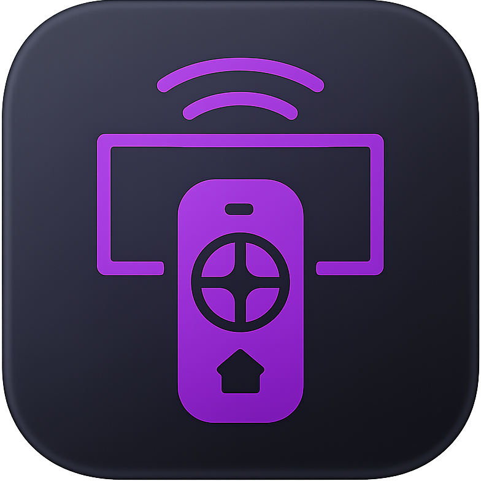

<p align="center">
  
</p>

# Roku Controller

Fast, cross‑platform desktop app for discovering and controlling Roku devices. Built with Tauri 2 (Rust backend) and React + TypeScript (frontend).

<p>
  <a href="https://tauri.app" target="_blank"></a>
  <a href="https://react.dev" target="_blank"></a>
  <a href="https://www.rust-lang.org" target="_blank"></a>
  <a href="https://www.typescriptlang.org" target="_blank"></a>
</p>

## Overview

Roku Controller makes it simple to discover Roku devices on your network, browse installed channels, and control playback with a clean, keyboard‑friendly interface. It pairs a high‑performance Rust backend (for SSDP discovery and Roku ECP calls) with a modern, Material UI‑powered React frontend.

Key workflows:
- Discover Roku devices automatically and switch between them instantly
- Use the on‑screen remote for navigation and playback control
- Browse installed apps in a visual grid and launch them on the device

## Screenshots

Composite screenshot showing remote controls, apps grid, and device sidebar:

<p align="center">
  
  
</p>

Close-ups for quick scanning:

<p align="center">
  
  
</p>

## Demo

Short GIF showing navigation and launching an app:

<p align="center">
  
</p>

## Features

### Core Functionality
- **Device Discovery**: Automatic discovery of Roku devices on your network via SSDP
- **Remote Control**: Full remote control with navigation, playback, and system controls
- **App Management**: View, browse, and launch installed apps on your Roku device
- **Multiple Device Support**: Switch between multiple Roku devices seamlessly

### Enhanced UI/UX
- **Material-UI Design**: Modern, responsive interface with dark theme
- **Tabbed Interface**: Clean separation between remote control and app management
- **App Grid Layout**: Visual app browser with icons and metadata
- **Real-time Feedback**: Success/error notifications for all actions
- **Auto-refresh**: Automatic device discovery and app list updates

### Technical Features
- **Rust Backend**: High-performance Rust backend using the Roku ECP API
- **React Frontend**: Modern React frontend with TypeScript
- **Tauri Framework**: Cross-platform desktop application
- **XML Parsing**: Robust XML parsing for Roku API responses
- **Error Handling**: Comprehensive error handling and user feedback

## Quick Start

### Prerequisites
- [Node.js](https://nodejs.org/) (v16 or higher)
- [Rust](https://rustup.rs/) (latest stable)
- [Tauri CLI](https://tauri.app/v1/guides/getting-started/prerequisites)

### Installation Steps
1. Clone the repository:
   ```bash
   git clone <repository-url>
   cd mine-roku
   ```

2. Install frontend dependencies:
   ```bash
   npm install
   ```

3. Install Tauri CLI (if not already installed):
   ```bash
   npm install -g @tauri-apps/cli
   ```

4. Run in development mode:
   ```bash
   npm run tauri dev
   ```

5. Build for production:
   ```bash
   npm run tauri build
   ```

6. Frontend-only dev server (optional):
   ```bash
   npm run dev
   ```

## Usage Guide

### Device Discovery
1. Launch the application
2. The app will automatically search for Roku devices on your network
3. Available devices will appear as chips at the top of the interface
4. Click on a device chip to select it

### Remote Control
1. Select a device from the device list
2. Use the "Remote Control" tab for navigation and playback controls:
   - **Navigation Pad**: Use arrow buttons and OK button for menu navigation
   - **Control Buttons**: Home, Back, and Info buttons
   - **Playback Controls**: Play/Pause, Rewind, Fast Forward
   - **Additional Controls**: Search and Enter buttons

### App Management
1. Select a device from the device list
2. Switch to the "Apps" tab
3. Browse installed apps in a visual grid layout
4. Click "Launch" on any app to open it on your Roku device
5. Use the "Refresh" button to update the app list

## How It Works

Under the hood, the app uses SSDP to discover Roku devices and the Roku External Control Protocol (ECP) over HTTP to send commands and query installed apps.

Core Tauri commands (Rust):
- `discover_roku_devices()` — Network SSDP discovery, returns devices
- `list_roku_apps(ip, port)` — Fetch installed apps via ECP
- `send_roku_command(ip, port, command)` — Remote/navigation and playback
- `launch_roku_app(ip, port, app_id)` — Launch a channel/app by ID

## Project Structure

```
mine-roku/
├── src/                          # React frontend
│   ├── components/
│   │   ├── AppLauncher.tsx      # App management component
│   │   ├── DeviceTabs.tsx       # Device selection component
│   │   └── RemoteControl.tsx    # Remote control component
│   ├── App.tsx                  # Main app component
│   ├── main.tsx                 # React entry point
│   └── theme.ts                 # Material-UI theme
├── src-tauri/                   # Rust backend
│   ├── src/
│   │   ├── commands.rs          # Tauri command implementations
│   │   ├── lib.rs               # Library exports
│   │   └── main.rs              # Main application entry
│   ├── Cargo.toml              # Rust dependencies
│   └── tauri.conf.json         # Tauri configuration
├── public/                      # Static assets
├── docs/
│   └── screenshots/             # README screenshots (add your images here)
├── package.json                 # npm configuration
└── README.md                   # This file
```

## Development

### Frontend Development
- The frontend is built with React + TypeScript + Material-UI
- Uses Tauri's `invoke` API to communicate with the Rust backend
- Styled with Material-UI components and custom CSS

### Backend Development
- Rust backend using Tauri framework
- HTTP client for Roku ECP API communication
- XML parsing for Roku API responses
- SSDP client for device discovery

### Testing
- Vitest + Testing Library (jsdom)
- Run tests with coverage: `npm test`

### Adding New Features
1. Add new Tauri commands in `src-tauri/src/commands.rs`
2. Export commands in `src-tauri/src/lib.rs`
3. Register commands in `src-tauri/src/main.rs`
4. Use commands in React components with `invoke()`

## Troubleshooting

### Device Discovery Issues
- Ensure your computer and Roku devices are on the same network
- Check firewall settings - SSDP uses UDP port 1900
- Try refreshing the device list manually

### Connection Issues
- Verify Roku device is powered on and connected to network
- Check if Roku's ECP (External Control Protocol) is enabled
- Some older Roku models may have limited ECP support

### App Launch Issues
- Ensure the app is properly installed on the Roku device
- Some apps may require specific parameters or may not support ECP launch
- Check the app ID is correct (visible in the app details)

## Android Build Configuration

When customizing the Gradle properties `archList` and `targetList` for the Android build,
ensure both lists contain the same number of entries so each architecture pairs with a
corresponding Rust compilation target. Mismatched lists will cause the build to fail.

## Contributing

1. Fork the repository
2. Create a feature branch
3. Make your changes
4. Test thoroughly
5. Submit a pull request

## License

This project is licensed under the MIT License - see the LICENSE file for details.

## Acknowledgments

- [Tauri](https://tauri.app/) - For the excellent cross-platform framework
- [Material-UI](https://mui.com/) - For the beautiful UI components
- [Roku ECP API](https://developer.roku.com/docs/app-development/ecp) - For the device control protocol
