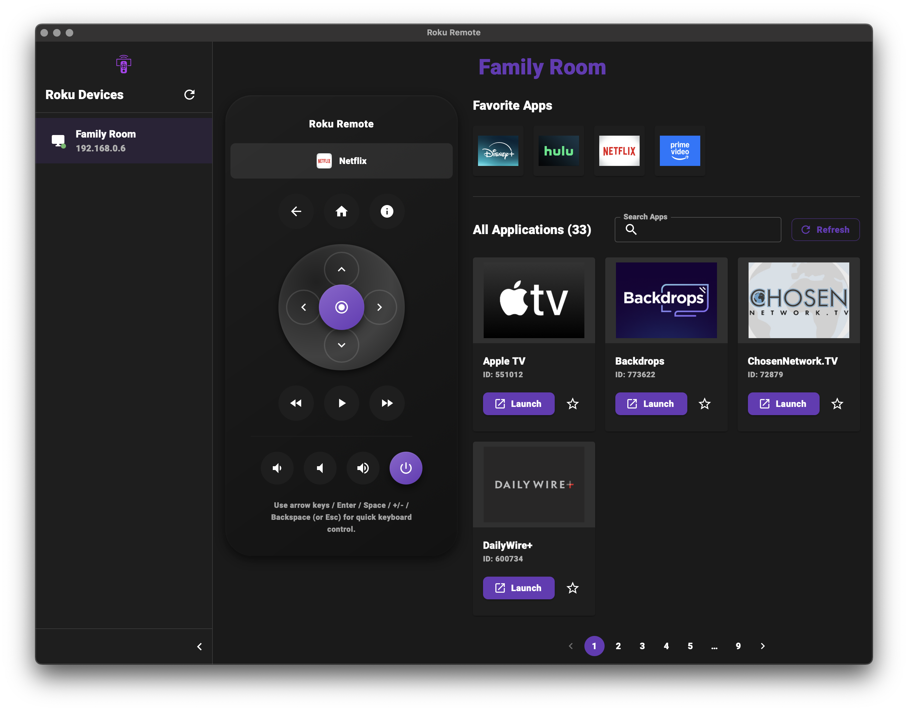
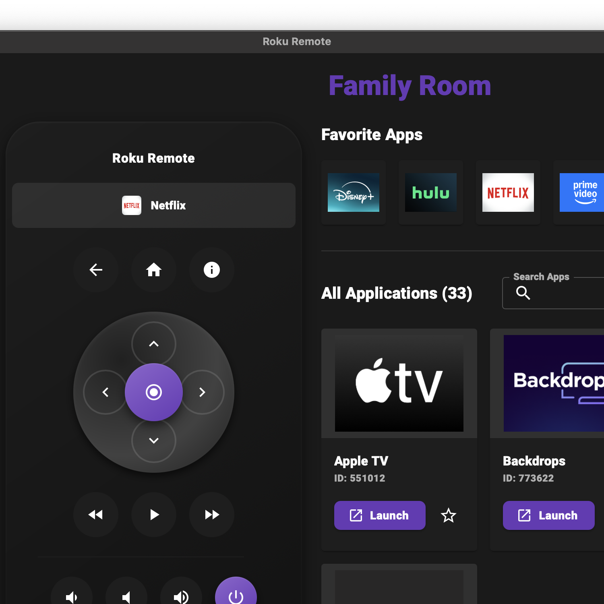
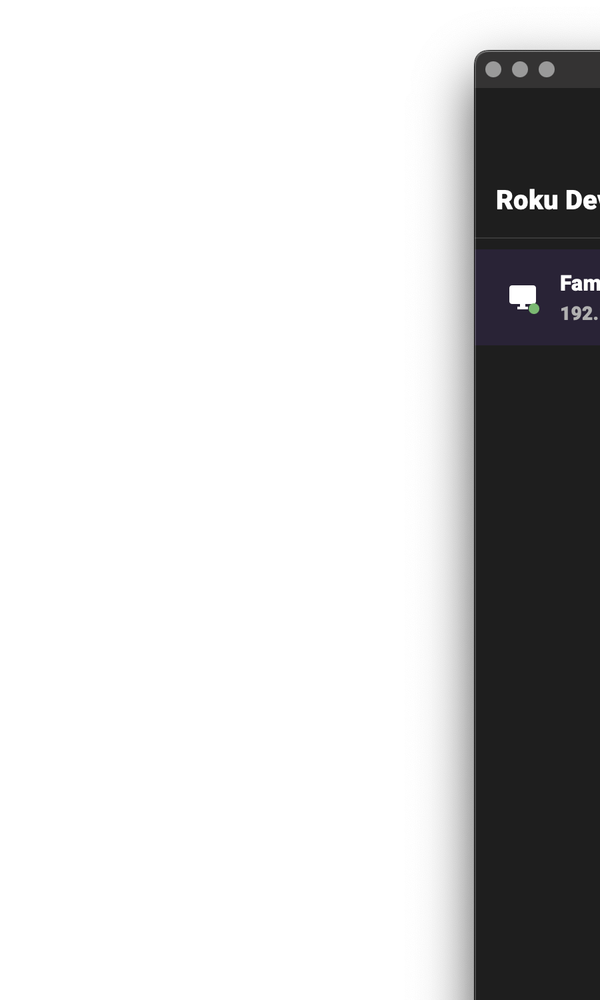
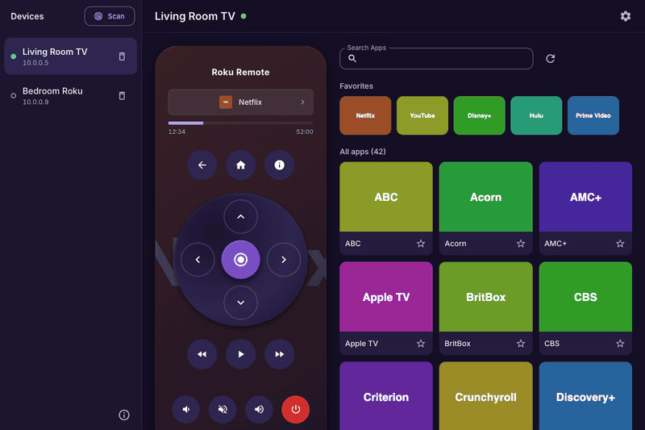

<p align="center">
  
</p>

# Roku Remote

Fast, cross‑platform desktop app for discovering and controlling Roku devices. Built with Tauri 2 (Rust backend) and React + TypeScript (frontend).

<p>
  <a href="https://tauri.app" target="_blank"></a>
  <a href="https://react.dev" target="_blank"></a>
  <a href="https://www.rust-lang.org" target="_blank"></a>
  <a href="https://www.typescriptlang.org" target="_blank"></a>
</p>

## Overview

Roku Remote makes it simple to discover Roku devices on your network, browse installed channels, and control playback with a clean, keyboard‑friendly interface. It pairs a high‑performance Rust backend (for SSDP discovery and Roku ECP calls) with a modern, Material UI‑powered React frontend.

Key workflows:
- Discover Roku devices automatically and switch between them instantly
- Use the on‑screen remote for navigation and playback control
- Browse installed apps in a visual grid and launch them on the device

## Screenshots

Composite screenshot showing remote controls, apps grid, and device list:

<p align="center">
  
  
</p>

Close-ups for quick scanning:

<p align="center">
  
  
</p>

## Demo

Short GIF showing navigation and launching an app:

<p align="center">
  
</p>

## Features

### Core Functionality
- **Device Discovery**: Automatic discovery of Roku devices on your network via SSDP
- **Remote Control**: Full remote control with navigation, playback, and system controls
- **App Management**: View, browse, and launch installed apps on your Roku device
- **Multiple Device Support**: Switch between multiple Roku devices seamlessly
- **Android Widget and Lock Screen**: A home-screen remote widget, and volume, play/pause and power on the lock screen

### Enhanced UI/UX
- **Dark, Modern Design**: Deep purple theme with a bundled typeface, on desktop and phone layouts
- **Remote Styles**: Classic, Studio, Glass and High Contrast, picked from previews in Settings
- **Device Switcher**: Always-visible device list on desktop; on phones, a sheet opened from the device name
- **App Grid**: One scrolling grid with search; tap an app's artwork to launch it
- **Favorites**: Star apps to launch them with one tap, from the remote screen or the apps grid
- **Real-time Feedback**: Success/error notifications for all actions
- **Auto-refresh**: Automatic device discovery and app list updates

### Technical Features
- **Rust Backend**: High-performance Rust backend using the Roku ECP API
- **React Frontend**: Modern React frontend with TypeScript
- **Tauri Framework**: Cross-platform desktop application
- **XML Parsing**: Robust XML parsing for Roku API responses
- **Error Handling**: Comprehensive error handling and user feedback

## Quick Start

### Prerequisites
- [Node.js](https://nodejs.org/) 26, ideally through [nvm](https://github.com/nvm-sh/nvm) (the repo has an `.nvmrc`)
- [pnpm](https://pnpm.io/) 12
- [Rust](https://rustup.rs/) (latest stable)

### Installation Steps
1. Clone the repository:
   ```bash
   git clone <repository-url>
   cd mine-roku
   ```

2. Select Node 26 and install pnpm (Node 26 no longer includes corepack):
   ```bash
   nvm install
   npm install -g pnpm@12
   ```

3. Install dependencies, which include the Tauri CLI:
   ```bash
   pnpm install
   ```

4. Run in development mode:
   ```bash
   pnpm tauri dev
   ```

5. Build for production:
   ```bash
   pnpm tauri build
   ```

6. Frontend-only dev server (optional):
   ```bash
   pnpm dev
   ```

## Usage Guide

### Device Discovery
1. Launch the application
2. The app will automatically search for Roku devices on your network
3. Available devices will appear as chips at the top of the interface
4. Click on a device chip to select it

### Remote Control
1. Select a device from the device list
2. Use the "Remote Control" tab for navigation and playback controls:
   - **Navigation Pad**: Use arrow buttons and OK button for menu navigation
   - **Control Buttons**: Home, Back, and Info buttons
   - **Playback Controls**: Play/Pause, Rewind, Fast Forward
   - **Volume and Power**: Volume up/down, mute, and a power button that turns a Roku TV on or off

### Android Widget and Lock Screen
- **Widget**: Long-press the home screen, choose Widgets, and add "Roku Remote". Pick the Roku it should control (open the app and scan first if the list is empty). At 4×1 it is a row of power, volume, play/pause and mute; drag it taller for the full remote with the D-pad. It works with the app closed. Add one widget per TV if you have several. To change a widget's Roku, long-press it and tap the edit (pencil) button.
- **Lock screen**: While the app is open, the media controls on the lock screen and in the notification shade show volume down, play/pause, volume up, mute and power. Android removes them some time after the app is closed; the widget stays.
- Power-on needs the TV to stay on the network in standby ("Fast TV Start" in the Roku's settings).

### App Management
1. Select a device from the device list
2. Switch to the "Apps" tab
3. Browse installed apps in a visual grid layout
4. Click "Launch" on any app to open it on your Roku device
5. Use the "Refresh" button to update the app list

## How It Works

Under the hood, the app uses SSDP to discover Roku devices and the Roku External Control Protocol (ECP) over HTTP to send commands and query installed apps.

Core Tauri commands (Rust):
- `discover_roku_devices()` — Network SSDP discovery, returns devices
- `list_roku_apps(ip, port)` — Fetch installed apps via ECP
- `send_roku_command(ip, port, command)` — Remote/navigation and playback
- `launch_roku_app(ip, port, app_id)` — Launch a channel/app by ID

## Project Structure

```
mine-roku/
├── src/                          # React frontend
│   ├── components/
│   │   ├── AppLauncher.tsx      # Apps grid with search and favorites
│   │   ├── DevicePanel.tsx      # Device list, scan and forget
│   │   ├── SettingsDialog.tsx   # Settings, updates and data deletion
│   │   └── RemoteControl.tsx    # Remote control component
│   ├── App.tsx                  # Main app component
│   ├── main.tsx                 # React entry point
│   ├── tokens.ts                # Design tokens (color, radius, motion)
│   └── theme.ts                 # Material-UI theme built from the tokens
├── src-tauri/                   # Rust backend
│   ├── src/
│   │   ├── commands.rs          # Tauri command implementations
│   │   ├── lib.rs               # Library exports
│   │   └── main.rs              # Main application entry
│   ├── Cargo.toml              # Rust dependencies
│   └── tauri.conf.json         # Tauri configuration
├── public/                      # Static assets
├── docs/
│   └── screenshots/             # README screenshots (add your images here)
├── package.json                 # Package configuration
└── README.md                   # This file
```

## Development

### Frontend Development
- The frontend is built with React + TypeScript + Material-UI
- Uses Tauri's `invoke` API to communicate with the Rust backend
- Styled with Material-UI components and custom CSS

### Backend Development
- Rust backend using Tauri framework
- HTTP client for Roku ECP API communication
- XML parsing for Roku API responses
- SSDP client for device discovery

### Testing
- Vitest + Testing Library (jsdom)
- Run tests with coverage: `pnpm test`

### Adding New Features
1. Add new Tauri commands in `src-tauri/src/commands.rs`
2. Export commands in `src-tauri/src/lib.rs`
3. Register commands in `src-tauri/src/main.rs`
4. Use commands in React components with `invoke()`

## Troubleshooting

### Device Discovery Issues
- Ensure your computer and Roku devices are on the same network
- Check firewall settings - SSDP uses UDP port 1900
- On macOS 15 or later, allow Roku Remote in System Settings > Privacy & Security > Local Network. Builds made with `pnpm tauri dev` from a terminal don't need this, but the bundled app does. `codesign -dv "Roku Remote.app"` must print `Identifier=com.rokucontroller.remote`, or macOS can't match the permission to the app (see [ARCHITECTURE.md](ARCHITECTURE.md#macos-platform-layer))
- Try refreshing the device list manually

### Connection Issues
- Verify Roku device is powered on and connected to network
- Check if Roku's ECP (External Control Protocol) is enabled
- Some older Roku models may have limited ECP support

### App Launch Issues
- Ensure the app is properly installed on the Roku device
- Some apps may require specific parameters or may not support ECP launch

## Android Build Configuration

The app compiles against and targets Android 17 (API 37); `setup-env.sh` installs the matching
SDK platform and NDK r28 (16 KB page-size aligned native libraries). On Android 17 the app asks
for "Nearby devices" (local network) access the first time it needs to reach a Roku; without it
nothing on the LAN is reachable. Rust logs and panics appear in logcat under the tag `RokuRust`.

When customizing the Gradle properties `archList` and `targetList` for the Android build,
ensure both lists contain the same number of entries so each architecture pairs with a
corresponding Rust compilation target. Mismatched lists will cause the build to fail.

Android verification commands:
- `pnpm android:lint`
- `pnpm android:test`

Signing setup:
- Copy `src-tauri/gen/android/keystore.properties.example` to `src-tauri/gen/android/keystore.properties`
- Fill in your local signing values (do not commit the real file)
- Release APKs must be signed with the release key, or they won't install over the app. See [Android signing](#android-signing).

## Updates

The installed app updates itself from the latest [GitHub release](https://github.com/BeardedUnicorn/MineRoku/releases).
Ten seconds after launch, and then once a day, it reads
`https://github.com/BeardedUnicorn/MineRoku/releases/latest/download/latest.json`.
When that names a newer version, a dialog asks before anything downloads. Settings → Updates
shows the running version, checks now, and turns the automatic check off.

- **macOS and Windows.** On yes, the app downloads the update, checks its signature, installs it
  and restarts. On macOS the update replaces the app where it is. On Windows the NSIS installer
  runs in passive mode (a progress window and no questions). The Rust side does this with
  `tauri-plugin-updater` ([src-tauri/src/updates.rs](src-tauri/src/updates.rs)), so the webview
  needs no updater permission. A development build (`pnpm tauri dev`) checks but won't install.
- **Android.** The app isn't in a store, so it reads the same `latest.json` from Rust. On yes it
  downloads that release's `RokuRemote-X.Y.Z-android-arm64.apk` into its cache. The download
  resumes if Android cuts the app off in the background. The app then checks that the file is this
  app at that version and opens Android's installer, which asks before replacing the app and keeps
  its data
  ([AppUpdate.kt](src-tauri/gen/android/app/src/main/java/com/rokucontroller/remote/AppUpdate.kt)).
  The first time, Android asks for Roku Remote to be allowed to install apps. If the app's own
  download fails, **Download in browser** hands the APK to the browser instead. When Android 16+'s
  Advanced Protection is on, Android refuses apps from outside a store, and the dialog says how to
  turn it off.
- `latest.json` carries every release's notes as well as the new version's (`changelog`). So an app
  several releases behind shows what each release since its own brought.
- Releases before 0.2.0 have no updater: install the first updating release by hand once. It's
  signed with the same key as 0.1.0, so it installs over it and keeps your devices and settings.

The updates are signed with a minisign key:

- The public key is `plugins.updater.pubkey` in [src-tauri/tauri.conf.json](src-tauri/tauri.conf.json).
  The private key and its password are the repository secrets `TAURI_SIGNING_PRIVATE_KEY` and
  `TAURI_SIGNING_PRIVATE_KEY_PASSWORD`. Only the Release workflow's build step sees them.
- With the key in the environment, the release build also makes the updates
  ([src-tauri/tauri.updater.conf.json](src-tauri/tauri.updater.conf.json) turns on
  `createUpdaterArtifacts`). It then checks each signature against the public key before the file
  goes into `releases/`, so a mismatched key can't ship. A plain `pnpm tauri build` doesn't need the
  key.
- `requireSignedVersion` is on. The app installs an update only when the version recorded in its
  signature matches the version `latest.json` announces, so an older signed build can't be passed
  off as a newer one.
- **Keep a copy of the private key and its password** away from this computer (in a password
  manager, say). Without them, no later release can update the installed apps.
- **A new key** (lost or leaked): run `pnpm tauri signer generate -w ~/.tauri/roku-remote-updater.key`.
  Replace both secrets and `plugins.updater.pubkey`, then release. Installed apps can't verify an
  update signed with the new key, so that one release has to be installed by hand.

To try a desktop update against a local feed, build an older app that reads it:

```bash
pnpm tauri build --bundles app --config '{"version":"0.0.1","plugins":{"updater":{"endpoints":["http://localhost:8787/latest.json"],"dangerousInsecureTransportProtocol":true}}}'
```

Then serve a release's macOS `.app.tar.gz` and a `latest.json` that points at it (from the Release
workflow's artifacts, or `node scripts/release.mjs build --target macos-arm64` with the key) on port
8787, and open the old app.

## Releasing

Add each change users would notice under `## Unreleased` in [CHANGELOG.md](CHANGELOG.md) as it
lands. Then, in the main checkout, on `main`:

```bash
pnpm release minor --dry-run    # the next version and its CHANGELOG section; changes nothing
```

```bash
pnpm release minor              # bump, CHANGELOG, commit "Release X.Y.Z", tag vX.Y.Z
```

```bash
pnpm release publish            # push main and the tag; CI builds and publishes the release
```

`pnpm release <patch|minor|major>` writes the version into `package.json` (`tauri.conf.json` reads
it from there; Android's `versionCode` is derived from it), `src-tauri/Cargo.toml` and
`src-tauri/Cargo.lock`. It renames `## Unreleased` to the new version's heading, then commits and
tags. It builds nothing and pushes nothing.

The pushed tag starts the [Release workflow](.github/workflows/release.yml), which builds every file
on GitHub's runners (`gh run list --workflow release.yml` follows it). Once every build has passed,
it creates the GitHub release with the version's CHANGELOG section:

| File | Built on |
| --- | --- |
| `RokuRemote-X.Y.Z-macos-arm64.dmg` | macOS, Apple silicon |
| `RokuRemote-X.Y.Z-macos-x64.dmg` | macOS, cross-compiled for Intel |
| `RokuRemote-X.Y.Z-windows-x64-setup.exe` | Windows |
| `RokuRemote-X.Y.Z-android-arm64.apk` | Linux, for arm64 Android phones |

Next to them are the desktop updates: `RokuRemote-X.Y.Z-macos-{arm64,x64}.app.tar.gz` and their
`.sig` files, `RokuRemote-X.Y.Z-windows-x64-setup.exe.sig`, and `latest.json`, the feed installed
apps read. A re-run replaces the files of a release that already exists. Running the workflow by
hand, or a pull request that changes how releases are built, builds the same files as workflow
artifacts and publishes nothing.

The installers aren't notarized (the Mac app is signed ad hoc). The first time a downloaded build is
opened, macOS says it can't verify Roku Remote: open System Settings → Privacy & Security and click
**Open Anyway**. On Windows, SmartScreen says it protected the PC: click **More info**, then **Run
anyway**. Because each ad-hoc signature is new, macOS may ask for Local Network access again after
an update.

### Android signing

Android installs an APK over the app only when both are signed with the same key, so every release
APK is signed with the one release key, the key that signed 0.1.0:

- The key is the PKCS12 keystore `src-tauri/gen/android/app/keystore.p12`, with its alias and
  password in `src-tauri/gen/android/keystore.properties`. Both are gitignored. For CI, the
  keystore (base64) and its password and alias are the repository secrets `ANDROID_KEYSTORE`,
  `ANDROID_KEYSTORE_PASSWORD` and `ANDROID_KEY_ALIAS`. The Android build writes them into
  `keystore.properties` on the runner and deletes them after the build.
- After the build, `node scripts/release.mjs build --target android-arm64` runs `apksigner` and
  checks that the APK has exactly one signer, with the certificate whose SHA-256 is
  `ANDROID_SIGNER_SHA256` in [scripts/release.mjs](scripts/release.mjs). It runs `aapt2` to check
  the package name and version as well. So an APK that wouldn't install over the last one can't
  ship.
- Setting the secrets from the main checkout:

```bash
base64 -i src-tauri/gen/android/app/keystore.p12 | gh secret set ANDROID_KEYSTORE
```

```bash
gh secret set ANDROID_KEYSTORE_PASSWORD
```

```bash
gh secret set ANDROID_KEY_ALIAS
```

- **Keep a copy of the keystore and its password** away from this computer. Without them, no later
  APK installs over the app.
- **A new key** (lost or leaked): make one with `keytool -genkeypair -storetype PKCS12`, replace the
  secrets and `ANDROID_SIGNER_SHA256`, and release. Phones have to uninstall the app before
  installing that APK, which deletes its saved devices and settings.

## Contributing

1. Fork the repository
2. Create a feature branch
3. Make your changes
4. Test thoroughly
5. Submit a pull request

## License

This project is licensed under the MIT License - see the LICENSE file for details.

## Acknowledgments

- [Tauri](https://tauri.app/) - For the excellent cross-platform framework
- [Material-UI](https://mui.com/) - For the beautiful UI components
- [Roku ECP API](https://developer.roku.com/docs/app-development/ecp) - For the device control protocol
