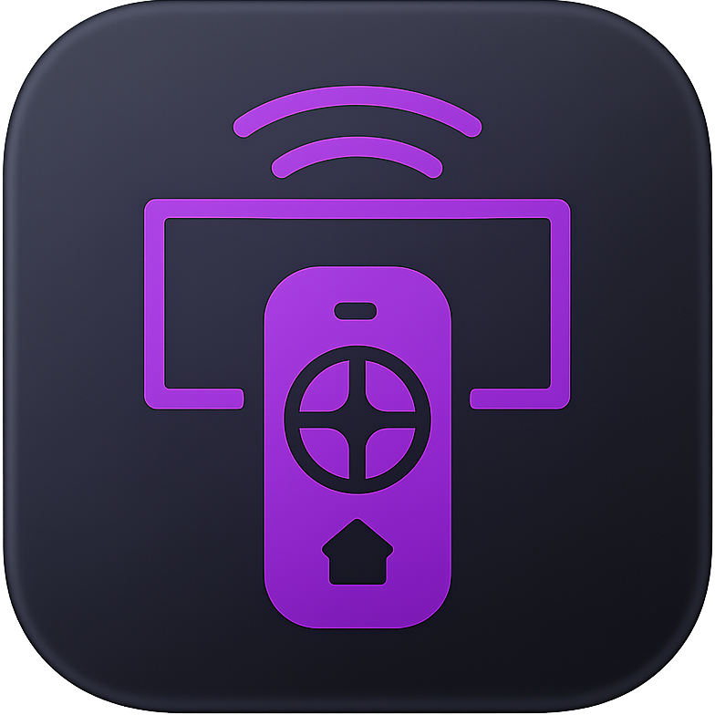
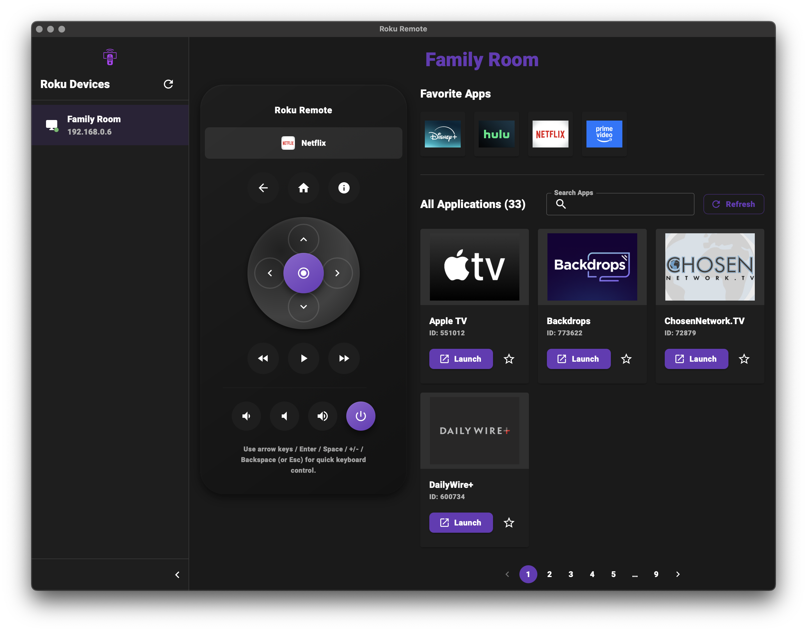
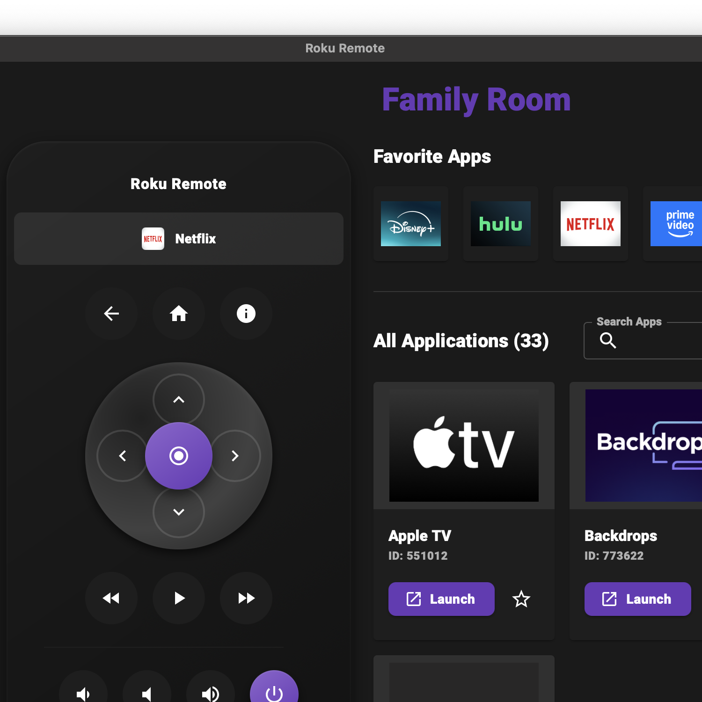
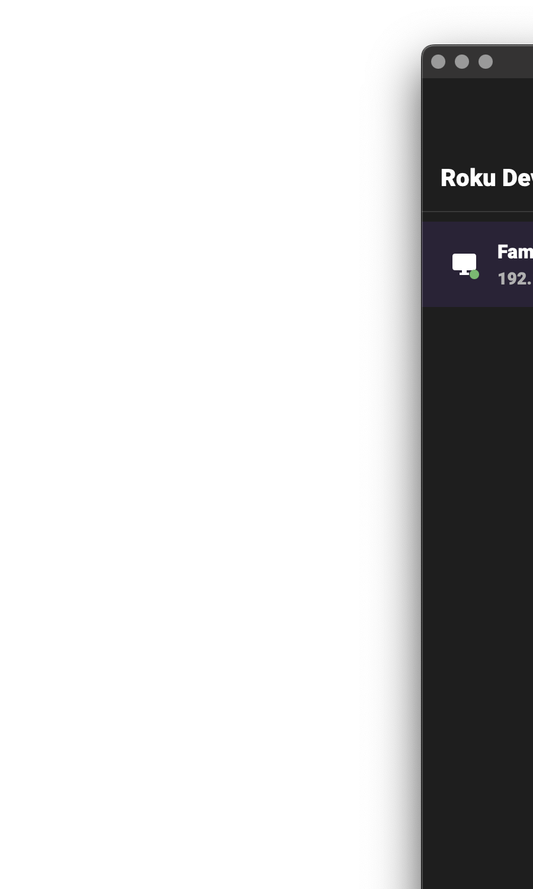
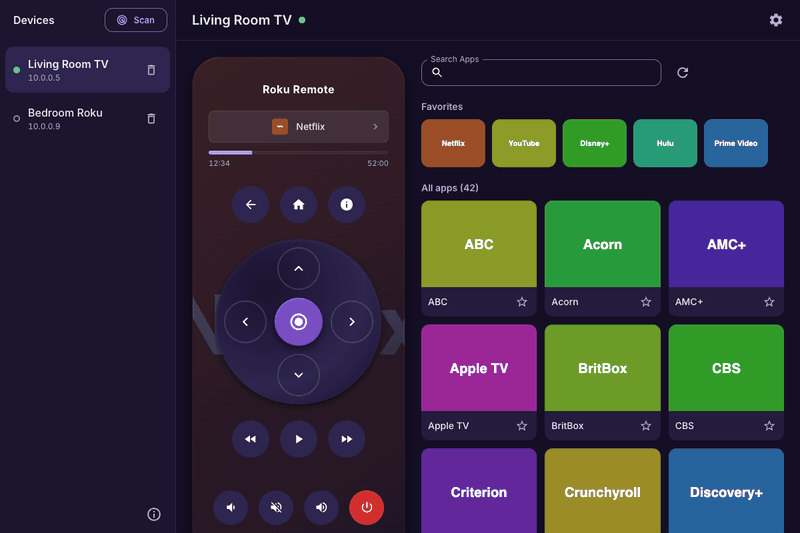

This file is a merged representation of the entire codebase, combined into a single document by Repomix.

# File Summary

## Purpose
This file contains a packed representation of the entire repository's contents.
It is designed to be easily consumable by AI systems for analysis, code review,
or other automated processes.

## File Format
The content is organized as follows:
1. This summary section
2. Repository information
3. Directory structure
4. Repository files (if enabled)
5. Multiple file entries, each consisting of:
  a. A header with the file path (## File: path/to/file)
  b. The full contents of the file in a code block

## Usage Guidelines
- This file should be treated as read-only. Any changes should be made to the
  original repository files, not this packed version.
- When processing this file, use the file path to distinguish
  between different files in the repository.
- Be aware that this file may contain sensitive information. Handle it with
  the same level of security as you would the original repository.

## Notes
- Some files may have been excluded based on .gitignore rules and Repomix's configuration
- Binary files are not included in this packed representation. Please refer to the Repository Structure section for a complete list of file paths, including binary files
- Files matching patterns in .gitignore are excluded
- Files matching default ignore patterns are excluded
- Files are sorted by Git change count (files with more changes are at the bottom)

# Directory Structure
```
crates/
  roku/
    src/
      lib.rs
    .gitignore
    Cargo.toml
    LICENSE
    README.md
  ssdp-client/
    .github/
      workflows/
        ci.yml
    examples/
      search.rs
    src/
      error.rs
      lib.rs
      search_target.rs
      search.rs
    .gitignore
    Cargo.toml
    CHANGELOG.md
    LICENSE-APACHE
    LICENSE-MIT
    README.md
public/
  tauri.svg
  vite.svg
src/
  components/
    AppLauncher.test.tsx
    AppLauncher.tsx
    BottomNavBar.test.tsx
    BottomNavBar.tsx
    MediaPlayerModal.tsx
    RemoteButtonSpecs.test.tsx
    RemoteButtonSpecs.tsx
    RemoteControl.test.tsx
    RemoteControl.tsx
    Sidebar.test.tsx
    Sidebar.tsx
  App.css
  App.tsx
  iconCache.ts
  index.css
  main.tsx
  setupTests.ts
  store.ts
  testUtils.tsx
  theme.ts
  vite-env.d.ts
src-tauri/
  capabilities/
    default.json
  gen/
    android/
      app/
        src/
          main/
            java/
              com/
                rokucontroller/
                  remote/
                    MainActivity.kt
                    MediaControlReceiver.kt
                    MediaSessionManager.kt
            res/
              drawable/
                ic_launcher_background.xml
              drawable-v24/
                ic_launcher_foreground.xml
              layout/
                activity_main.xml
              values/
                colors.xml
                strings.xml
                themes.xml
              values-night/
                themes.xml
              xml/
                file_paths.xml
                network_security_config.xml
            AndroidManifest.xml
        .gitignore
        build.gradle.kts
        proguard-rules.pro
        tauri.build.gradle.kts
        tauri.properties
      buildSrc/
        src/
          main/
            java/
              com/
                roku_controller/
                  app/
                    kotlin/
                      BuildTask.kt
                      RustPlugin.kt
        build.gradle.kts
      gradle/
        wrapper/
          gradle-wrapper.properties
      .editorconfig
      .gitignore
      build.gradle.kts
      gradle.properties
      gradlew
      gradlew.bat
      keystore.properties
      settings.gradle
  src/
    background_discovery.rs
    background.rs
    commands.rs
    lib.rs
    main.rs
  .gitignore
  build.rs
  Cargo.toml
  tauri.conf.json
.gitignore
.repomixignore
.yarnrc.yml
AGENTS.md
index.html
package.json
README.md
setup-env.sh
tsconfig.json
tsconfig.node.json
vite.config.ts
```

# Files

## File: crates/ssdp-client/.github/workflows/ci.yml
````yaml
on: [push, pull_request]

name: CI

jobs:
  check:
    name: Check
    runs-on: ubuntu-latest
    steps:
      - uses: actions/checkout@v2
      - uses: actions-rs/toolchain@v1
        with:
          profile: minimal
          toolchain: stable
          override: true
      - uses: actions-rs/cargo@v1
        with:
          command: check

  test:
    name: Tests
    runs-on: ubuntu-latest
    steps:
      - uses: actions/checkout@v2
      - uses: actions-rs/toolchain@v1
        with:
          profile: minimal
          toolchain: stable
          override: true
      - uses: actions-rs/cargo@v1
        with:
          command: test

  fmt:
    name: Rustfmt
    runs-on: ubuntu-latest
    steps:
      - uses: actions/checkout@v2
      - uses: actions-rs/toolchain@v1
        with:
          profile: minimal
          toolchain: stable
          override: true
          components: rustfmt
      - uses: actions-rs/cargo@v1
        with:
          command: fmt
          args: --all -- --check
````

## File: crates/ssdp-client/examples/search.rs
````rust
use futures::prelude::*;
use ssdp_client::URN;
use std::time::Duration;

#[tokio::main]
async fn main() -> Result<(), ssdp_client::Error> {
    let search_target = URN::device("schemas-upnp-org", "ZonePlayer", 1).into();
    let timeout = Duration::from_secs(3);
    let mut responses = ssdp_client::search(&search_target, timeout, 2, None).await?;

    while let Some(response) = responses.next().await {
        let response = response?;
        println!("- {}", response.search_target());
        println!("  - location: {}", response.location());
        println!("  - usn: {}", response.usn());
        println!("  - server: {}", response.server());
        println!(
            "  - properties: {:?}",
            response.extra_header("PROPERTIES.TEST")
        );
    }

    Ok(())
}
````

## File: crates/ssdp-client/src/error.rs
````rust
use std::{fmt, io, str::Utf8Error};

#[derive(Debug)]
/// The Error type
pub enum Error {
    /// IO Error
    IO(io::Error),
    /// SSDP is not encoded properly
    Utf8(Utf8Error),
    /// Missing header in the SSDP Response
    MissingHeader(&'static str),
    /// Invalid header in the SSDP Response
    InvalidHeader(&'static str),
    /// Malformed search target in SSDP header
    ParseSearchTargetError(ParseSearchTargetError),
    /// Failed to parse HTTP response
    InvalidHTTP(&'static str),
    /// Non-200 HTTP Status Code
    HTTPError(u32),
}

impl fmt::Display for Error {
    fn fmt(&self, f: &mut fmt::Formatter<'_>) -> fmt::Result {
        match self {
            Error::IO(err) => write!(f, "io error: {err}"),
            Error::Utf8(err) => write!(f, "utf8 decoding error: {err}"),
            Error::MissingHeader(err) => write!(f, "missing header: {err}"),
            Error::InvalidHeader(err) => write!(f, "invalid header: {err}"),
            Error::ParseSearchTargetError(err) => write!(f, "{err}"),
            Error::InvalidHTTP(err) => write!(f, "failed to parse http response: {err}"),
            Error::HTTPError(err) => write!(
                f,
                "control point responded with non-zero exit code: {err}"
            ),
        }
    }
}

impl std::error::Error for Error {
    fn source(&self) -> Option<&(dyn std::error::Error + 'static)> {
        match self {
            Error::IO(err) => Some(err),
            Error::Utf8(err) => Some(err),
            Error::ParseSearchTargetError(err) => Some(err),
            _ => None,
        }
    }
}

impl From<io::Error> for Error {
    fn from(err: io::Error) -> Self {
        Error::IO(err)
    }
}
impl From<Utf8Error> for Error {
    fn from(err: Utf8Error) -> Self {
        Error::Utf8(err)
    }
}
impl From<ParseSearchTargetError> for Error {
    fn from(err: ParseSearchTargetError) -> Self {
        Error::ParseSearchTargetError(err)
    }
}

/// An error returned when parsing a search target using `from_str` fails
#[derive(Debug, Eq, PartialEq)]
pub struct ParseURNError;
impl std::error::Error for ParseURNError {}
impl fmt::Display for ParseURNError {
    fn fmt(&self, f: &mut fmt::Formatter<'_>) -> fmt::Result {
        write!(f, "failed to parse URN")
    }
}

/// An error returned when parsing a search target using `from_str` fails
#[derive(Debug, Eq, PartialEq)]
pub enum ParseSearchTargetError {
    /// Failed to parse URN in Search Target
    #[allow(clippy::upper_case_acronyms)]
    URN(ParseURNError),
    /// Failed to parse Search Target
    ST,
}

impl fmt::Display for ParseSearchTargetError {
    fn fmt(&self, f: &mut fmt::Formatter<'_>) -> fmt::Result {
        match self {
            ParseSearchTargetError::URN(_) => write!(f, "invalid urn supplied"),
            ParseSearchTargetError::ST => write!(f, "invalid search target format"),
        }
    }
}
impl std::error::Error for ParseSearchTargetError {
    fn source(&self) -> Option<&(dyn std::error::Error + 'static)> {
        if let ParseSearchTargetError::URN(err) = self {
            Some(err)
        } else {
            None
        }
    }
}
````

## File: crates/ssdp-client/src/lib.rs
````rust
#![warn(
    missing_docs,
    nonstandard_style,
    rust_2018_idioms,
    future_incompatible,
    missing_debug_implementations
)]

//! An asynchronous library for discovering, notifying and subscribing to devices and services on a network.
//!
//! SSDP stands for Simple Service Discovery Protocol and it is a protocol that
//! distributes messages across a local network for devices and services to
//! discover each other. SSDP can most commonly be found in devices that implement
//! `UPnP` as it is used as the discovery mechanism for that standard.
//!
//! # Example
//! ```rust,no_run
//! # async fn f() -> Result<(), ssdp_client::Error> {
//! use futures::prelude::*;
//! use std::time::Duration;
//! use ssdp_client::SearchTarget;
//!
//! let search_target = SearchTarget::RootDevice;
//! let mut responses = ssdp_client::search(&search_target, Duration::from_secs(3), 2, None).await?;
//!
//! while let Some(response) = responses.next().await {
//!     println!("{:?}", response?);
//! }
//! # return Ok(());
//! # }
//! ```

/// SSDP Error types
mod error;
mod search;
mod search_target;

pub use error::Error;
pub use search::{search, SearchResponse};
pub use search_target::{SearchTarget, URN};
````

## File: crates/ssdp-client/src/search_target.rs
````rust
use crate::error::{ParseSearchTargetError, ParseURNError};
use std::{borrow::Cow, fmt};

#[derive(Debug, Eq, PartialEq, Clone)]
/// Specify what SSDP control points to search for
pub enum SearchTarget {
    /// Search for all devices and services.
    All,
    /// Search for root devices only.
    RootDevice,
    /// unique identifier for a device
    UUID(String),
    /// e.g. schemas-upnp-org:device:ZonePlayer:1
    /// or schemas-sonos-com:service:Queue:1
    URN(URN),
    /// e.g. roku:ecp
    Custom(String, String),
}
impl fmt::Display for SearchTarget {
    fn fmt(&self, f: &mut fmt::Formatter<'_>) -> fmt::Result {
        match self {
            SearchTarget::All => write!(f, "ssdp:all"),
            SearchTarget::RootDevice => write!(f, "upnp:rootdevice"),
            SearchTarget::UUID(uuid) => write!(f, "uuid:{uuid}"),
            SearchTarget::URN(urn) => write!(f, "{urn}"),
            SearchTarget::Custom(key, value) => write!(f, "{key}:{value}"),
        }
    }
}

impl std::str::FromStr for SearchTarget {
    type Err = ParseSearchTargetError;

    fn from_str(s: &str) -> Result<Self, Self::Err> {
        Ok(match s {
            "ssdp:all" => SearchTarget::All,
            "upnp:rootdevice" => SearchTarget::RootDevice,
            s if s.starts_with("uuid") => {
                SearchTarget::UUID(s.trim_start_matches("uuid:").to_string())
            }
            s if s.starts_with("urn") => URN::from_str(s)
                .map(SearchTarget::URN)
                .map_err(ParseSearchTargetError::URN)?,
            s => {
                let split: Vec<&str> = s.split(":").collect();
                if split.len() != 2 {
                    return Err(ParseSearchTargetError::ST);
                }
                SearchTarget::Custom(split[0].into(), split[1].into())
            }
        })
    }
}

#[derive(Clone, Debug, Eq, PartialEq, Ord, PartialOrd)]
#[allow(missing_docs)]
/// Uniform Resource Name
///
/// e.g. `urn:schemas-upnp-org:service:RenderingControl:1`
pub enum URN {
    Device(Cow<'static, str>, Cow<'static, str>, u32),
    Service(Cow<'static, str>, Cow<'static, str>, u32),
}
impl fmt::Display for URN {
    fn fmt(&self, f: &mut fmt::Formatter<'_>) -> fmt::Result {
        match self {
            URN::Device(domain, typ, version) => {
                write!(f, "urn:{domain}:device:{typ}:{version}")
            }
            URN::Service(domain, typ, version) => {
                write!(f, "urn:{domain}:service:{typ}:{version}")
            }
        }
    }
}

impl URN {
    /// Creates an instance of a device URN
    pub const fn device(domain: &'static str, typ: &'static str, version: u32) -> Self {
        URN::Device(Cow::Borrowed(domain), Cow::Borrowed(typ), version)
    }
    /// Creates an instance of a service URN
    pub const fn service(domain: &'static str, typ: &'static str, version: u32) -> Self {
        URN::Service(Cow::Borrowed(domain), Cow::Borrowed(typ), version)
    }

    /// Extracts the `schemas-upnp-org` part of the
    /// `urn:schemas-upnp-org:service:RenderingControl:1`
    pub fn domain_name(&self) -> &str {
        match self {
            URN::Device(domain_name, _, _) => domain_name,
            URN::Service(domain_name, _, _) => domain_name,
        }
    }

    /// Extracts the `RenderingControl` part of the
    /// `urn:schemas-upnp-org:service:RenderingControl:1`
    pub fn typ(&self) -> &str {
        match self {
            URN::Device(_, typ, _) => typ,
            URN::Service(_, typ, _) => typ,
        }
    }

    /// Extracts the `1` part of the
    /// `urn:schemas-upnp-org:service:RenderingControl:1`
    pub fn version(&self) -> u32 {
        match self {
            URN::Device(_, _, v) => *v,
            URN::Service(_, _, v) => *v,
        }
    }
}

impl From<URN> for SearchTarget {
    fn from(val: URN) -> Self {
        SearchTarget::URN(val)
    }
}

impl std::str::FromStr for URN {
    type Err = ParseURNError;
    fn from_str(str: &str) -> Result<Self, Self::Err> {
        let mut iter = str.split(':');
        if iter.next() != Some("urn") {
            return Err(ParseURNError);
        }

        let domain = iter.next().ok_or(ParseURNError)?.to_string().into();
        let urn_type = &iter.next().ok_or(ParseURNError)?;
        let typ = iter.next().ok_or(ParseURNError)?.to_string().into();
        let version = iter
            .next()
            .ok_or(ParseURNError)?
            .parse::<u32>()
            .map_err(|_| ParseURNError)?;

        if iter.next().is_some() {
            return Err(ParseURNError);
        }

        if urn_type.eq_ignore_ascii_case("service") {
            Ok(URN::Service(domain, typ, version))
        } else if urn_type.eq_ignore_ascii_case("device") {
            Ok(URN::Device(domain, typ, version))
        } else {
            Err(ParseURNError)
        }
    }
}

#[cfg(test)]
mod tests {
    use super::{SearchTarget, URN};

    #[test]
    fn parse_search_target() {
        assert_eq!("ssdp:all".parse(), Ok(SearchTarget::All));
        assert_eq!("upnp:rootdevice".parse(), Ok(SearchTarget::RootDevice));

        assert_eq!(
            "uuid:some-uuid".parse(),
            Ok(SearchTarget::UUID("some-uuid".to_string()))
        );

        assert_eq!(
            "urn:schemas-upnp-org:device:ZonePlayer:1".parse(),
            Ok(SearchTarget::URN(URN::Device(
                "schemas-upnp-org".into(),
                "ZonePlayer".into(),
                1
            )))
        );
        assert_eq!(
            "urn:schemas-sonos-com:service:Queue:2".parse(),
            Ok(SearchTarget::URN(URN::Service(
                "schemas-sonos-com".into(),
                "Queue".into(),
                2
            )))
        );
        assert_eq!(
            "roku:ecp".parse(),
            Ok(SearchTarget::Custom("roku".into(), "ecp".into()))
        );
    }
}
````

## File: crates/ssdp-client/src/search.rs
````rust
use crate::{Error, SearchTarget};

use futures_core::stream::Stream;
use genawaiter::sync::{Co, Gen};
use std::{collections::HashMap, net::SocketAddr, time::Duration};
use tokio::net::UdpSocket;

const INSUFFICIENT_BUFFER_MSG: &str = "buffer size too small, udp packets lost";
const DEFAULT_SEARCH_TTL: u32 = 2;

#[derive(Debug)]
/// Response given by ssdp control point
pub struct SearchResponse {
    location: String,
    st: SearchTarget,
    usn: String,
    server: String,
    extra_headers: HashMap<String, String>,
}

impl SearchResponse {
    /// URL of the control point
    pub fn location(&self) -> &str {
        &self.location
    }
    /// search target returned by the control point
    pub fn search_target(&self) -> &SearchTarget {
        &self.st
    }
    /// Unique Service Name
    pub fn usn(&self) -> &str {
        &self.usn
    }
    /// Server (user agent)
    pub fn server(&self) -> &str {
        &self.server
    }
    /// Other Custom header
    pub fn extra_header(&self, key: &str) -> Option<&str> {
        self.extra_headers.get(key).map(|x| x.as_str())
    }
}

#[cfg(not(any(windows, target_os = "android")))]
async fn get_bind_addr() -> Result<SocketAddr, std::io::Error> {
    Ok(([0, 0, 0, 0], 0).into())
}

#[cfg(windows)]
async fn get_bind_addr() -> Result<SocketAddr, std::io::Error> {
    let any: SocketAddr = ([0, 0, 0, 0], 0).into();
    let socket = UdpSocket::bind(any).await?;
    let googledns: SocketAddr = ([8, 8, 8, 8], 80).into();
    socket.connect(googledns).await?;
    let bind_addr = socket.local_addr()?;
    Ok(bind_addr)
}

#[cfg(target_os = "android")]
async fn get_bind_addr() -> Result<SocketAddr, std::io::Error> {
    // On Android, bind to INADDR_ANY
    let addr = ([0, 0, 0, 0], 0).into();
    log::info!("Android SSDP: Using bind address: {:?}", addr);
    Ok(addr)
}

/// Get the WiFi interface IP on Android by reading network interfaces
#[cfg(target_os = "android")]
fn get_wifi_interface_ip() -> Result<std::net::Ipv4Addr, std::io::Error> {
    use std::ffi::CStr;
    use std::ptr;
    
    log::info!("Android SSDP: Searching for WiFi interface IP...");
    
    unsafe {
        let mut ifaddrs: *mut libc::ifaddrs = ptr::null_mut();
        if libc::getifaddrs(&mut ifaddrs) != 0 {
            let err = std::io::Error::last_os_error();
            log::error!("Android SSDP: getifaddrs failed: {}", err);
            return Err(err);
        }
        
        let mut current = ifaddrs;
        let mut wifi_ip: Option<std::net::Ipv4Addr> = None;
        
        while !current.is_null() {
            let ifaddr = &*current;
            let name = CStr::from_ptr(ifaddr.ifa_name).to_str().unwrap_or("");
            
            // Look for wlan interface
            if name.starts_with("wlan") && !ifaddr.ifa_addr.is_null() {
                let addr = &*ifaddr.ifa_addr;
                
                if addr.sa_family == libc::AF_INET as u16 {
                    let sockaddr_in = &*(ifaddr.ifa_addr as *const libc::sockaddr_in);
                    let ip_bytes = sockaddr_in.sin_addr.s_addr.to_ne_bytes();
                    let ip = std::net::Ipv4Addr::new(ip_bytes[0], ip_bytes[1], ip_bytes[2], ip_bytes[3]);
                    
                    // Skip loopback and link-local
                    if !ip.is_loopback() && !ip.is_link_local() {
                        // Skip common VPN ranges: 100.64.0.0/10
                        if ip.octets()[0] == 100 && ip.octets()[1] >= 64 && ip.octets()[1] <= 127 {
                            log::debug!("Android SSDP: Skipping VPN address {} on {}", ip, name);
                            current = ifaddr.ifa_next;
                            continue;
                        }
                        
                        log::info!("Android SSDP: Found WiFi interface {} with IP {}", name, ip);
                        wifi_ip = Some(ip);
                        break;
                    }
                }
            }
            
            current = ifaddr.ifa_next;
        }
        
        libc::freeifaddrs(ifaddrs);
        
        if let Some(ip) = wifi_ip {
            Ok(ip)
        } else {
            log::warn!("Android SSDP: No suitable WiFi interface found");
            Err(std::io::Error::new(
                std::io::ErrorKind::NotFound,
                "No WiFi interface found"
            ))
        }
    }
}

/// Search for SSDP control points within a network.
pub async fn search(
    search_target: &SearchTarget,
    timeout: Duration,
    mx: usize,
    ttl: Option<u32>,
) -> Result<impl Stream<Item = Result<SearchResponse, Error>>, Error> {
    let bind_addr: SocketAddr = get_bind_addr().await?;
    let broadcast_address: SocketAddr = ([239, 255, 255, 250], 1900).into();

    log::info!("SSDP: Starting search for target: {}", search_target);
    log::info!("SSDP: Binding to address: {}", bind_addr);
    log::info!("SSDP: Will send M-SEARCH to: {}", broadcast_address);
    log::info!("SSDP: Timeout: {:?}, MX: {}, TTL: {:?}", timeout, mx, ttl);
    
    let socket = match UdpSocket::bind(&bind_addr).await {
        Ok(s) => {
            log::info!("SSDP: Successfully bound socket to {}", s.local_addr().unwrap_or(bind_addr));
            s
        }
        Err(e) => {
            log::error!("SSDP: Failed to bind socket to {}: {}", bind_addr, e);
            return Err(Error::IO(e));
        }
    };
    
    // Android-specific: Bind socket to wlan0 interface to bypass VPN
    #[cfg(target_os = "android")]
    {
        use std::os::fd::AsRawFd;
        let fd = socket.as_raw_fd();
        
        // Try to bind to wlan0 interface
        let interface_name = b"wlan0\0";
        unsafe {
            let result = libc::setsockopt(
                fd,
                libc::SOL_SOCKET,
                libc::SO_BINDTODEVICE,
                interface_name.as_ptr() as *const libc::c_void,
                interface_name.len() as libc::socklen_t,
            );
            if result == 0 {
                log::info!("Android SSDP: Successfully bound socket to wlan0 interface");
            } else {
                log::warn!("Android SSDP: Failed to bind to wlan0 (may require root): {}", std::io::Error::last_os_error());
                // Continue anyway - it might still work
            }
        }
        
        // Set SO_REUSEADDR
        unsafe {
            let optval: libc::c_int = 1;
            let result = libc::setsockopt(
                fd,
                libc::SOL_SOCKET,
                libc::SO_REUSEADDR,
                &optval as *const _ as *const libc::c_void,
                std::mem::size_of_val(&optval) as libc::socklen_t,
            );
            if result == 0 {
                log::info!("Android SSDP: Set SO_REUSEADDR successfully");
            } else {
                log::warn!("Android SSDP: Failed to set SO_REUSEADDR: {}", std::io::Error::last_os_error());
            }
        }
    }
    
    // Configure socket for multicast
    let ttl_val = ttl.unwrap_or(DEFAULT_SEARCH_TTL);
    match socket.set_multicast_ttl_v4(ttl_val) {
        Ok(_) => log::info!("SSDP: Set multicast TTL to {}", ttl_val),
        Err(e) => log::warn!("SSDP: Failed to set multicast TTL: {}", e),
    }
    
    // Enable broadcast
    match socket.set_broadcast(true) {
        Ok(_) => log::info!("SSDP: Enabled broadcast on socket"),
        Err(e) => log::warn!("SSDP: Failed to set broadcast: {}", e),
    }

    // Join multicast group
    let multicast_addr = std::net::Ipv4Addr::new(239, 255, 255, 250);
    
    #[cfg(target_os = "android")]
    {
        // Get the actual WiFi interface IP to join multicast on correct interface
        match get_wifi_interface_ip() {
            Ok(interface_ip) => {
                log::info!("Android SSDP: Attempting to join multicast group {} on interface {}", multicast_addr, interface_ip);
                match socket.join_multicast_v4(multicast_addr, interface_ip) {
                    Ok(_) => log::info!("Android SSDP: Successfully joined multicast group"),
                    Err(e) => {
                        log::error!("Android SSDP: Failed to join multicast group: {} (error kind: {:?})", e, e.kind());
                        // Try with 0.0.0.0 as fallback
                        let any_interface = std::net::Ipv4Addr::new(0, 0, 0, 0);
                        log::info!("Android SSDP: Trying fallback with 0.0.0.0 interface");
                        match socket.join_multicast_v4(multicast_addr, any_interface) {
                            Ok(_) => log::info!("Android SSDP: Joined multicast group with fallback interface"),
                            Err(e2) => {
                                log::error!("Android SSDP: Fallback also failed: {}", e2);
                                return Err(Error::IO(e));
                            }
                        }
                    }
                }
            }
            Err(e) => {
                log::warn!("Android SSDP: Could not determine WiFi interface IP: {}", e);
                log::info!("Android SSDP: Attempting to join multicast with 0.0.0.0");
                let any_interface = std::net::Ipv4Addr::new(0, 0, 0, 0);
                match socket.join_multicast_v4(multicast_addr, any_interface) {
                    Ok(_) => log::info!("Android SSDP: Joined multicast group with 0.0.0.0"),
                    Err(e) => {
                        log::error!("Android SSDP: Failed to join multicast: {}", e);
                        return Err(Error::IO(e));
                    }
                }
            }
        }
    }
    
    #[cfg(not(target_os = "android"))]
    {
        let interface = std::net::Ipv4Addr::new(0, 0, 0, 0);
        if let Err(e) = socket.join_multicast_v4(multicast_addr, interface) {
            log::debug!("Could not join multicast group (may be ok): {}", e);
        }
    }

    let msg = format!(
        "M-SEARCH * HTTP/1.1\r\nHost: 239.255.255.250:1900\r\nMan: \"ssdp:discover\"\r\nST: {}\r\nMX: {}\r\n\r\n",
        search_target, mx
    );
    
    log::info!("SSDP: Prepared M-SEARCH message ({} bytes)", msg.len());
    log::debug!("SSDP M-SEARCH message:\n{}", msg);
    
    // Send multiple times for reliability, especially on Android
    let send_count = if cfg!(target_os = "android") { 5 } else { 3 };
    log::info!("SSDP: Will send {} M-SEARCH packets", send_count);
    
    for i in 0..send_count {
        match socket.send_to(msg.as_bytes(), &broadcast_address).await {
            Ok(bytes) => {
                log::info!("SSDP: Successfully sent {} bytes to {} (attempt {})", bytes, broadcast_address, i + 1);
            }
            Err(e) => {
                log::error!("SSDP: Failed to send M-SEARCH (attempt {}): {} (kind: {:?})", i + 1, e, e.kind());
            }
        }
        if i < send_count - 1 {
            tokio::time::sleep(Duration::from_millis(200)).await;
        }
    }

    log::info!("SSDP: Starting to listen for responses (timeout: {:?})", timeout);
    Ok(Gen::new(move |co| socket_stream(socket, timeout, co)))
}

macro_rules! yield_try {
    ( $co:expr => $expr:expr ) => {
        match $expr {
            Ok(val) => val,
            Err(e) => {
                $co.yield_(Err(e.into())).await;
                continue;
            }
        }
    };
}

async fn socket_stream(
    socket: UdpSocket,
    timeout: Duration,
    co: Co<Result<SearchResponse, Error>>,
) {
    log::debug!("SSDP: Entering socket_stream, waiting for responses");
    let start_time = std::time::Instant::now();
    
    loop {
        let mut buf = [0u8; 2048];
        let elapsed = start_time.elapsed();
        
        if elapsed >= timeout {
            log::info!("SSDP: Timeout reached after {:?}, stopping response collection", elapsed);
            break;
        }
        
        let remaining_timeout = timeout - elapsed;
        log::debug!("SSDP: Waiting for response (remaining timeout: {:?})", remaining_timeout);
        
        let text = match tokio::time::timeout(remaining_timeout, socket.recv_from(&mut buf)).await {
            Err(_) => {
                log::info!("SSDP: No more responses within timeout period");
                break;
            }
            Ok(res) => match res {
                Ok((2048, _)) => {
                    log::warn!("{INSUFFICIENT_BUFFER_MSG}");
                    continue;
                }
                Ok((read,addr)) => {
                    log::info!("SSDP: Received {} bytes from {}", read, addr);
                    let text = yield_try!(co => std::str::from_utf8(&buf[..read]));
                    log::debug!("SSDP: Received response from {}:\n{}", addr, text);
                    text
                }
                Err(e) => {
                    log::error!("SSDP: Socket recv error: {} (kind: {:?})", e, e.kind());
                    co.yield_(Err(e.into())).await;
                    continue;
                }
            },
        };

        log::debug!("SSDP: Parsing headers from response");
        let headers = yield_try!(co => parse_headers(text));

        let mut location = None;
        let mut st = None;
        let mut usn = None;
        let mut server = None;
        let mut extra_headers = HashMap::new();

        for (header, value) in headers {
            log::trace!("SSDP: Header '{}' = '{}'", header, value);
            if header.eq_ignore_ascii_case("location") {
                location = Some(value);
            } else if header.eq_ignore_ascii_case("st") {
                st = Some(value);
            } else if header.eq_ignore_ascii_case("usn") {
                usn = Some(value);
            } else if header.eq_ignore_ascii_case("server") {
                server = Some(value);
            } else {
                extra_headers.insert(header.to_owned(), value.to_owned());
            }
        }

        let location = yield_try!(co => location
            .ok_or(Error::MissingHeader("location")))
        .to_string();
        let st = yield_try!(co => yield_try!(co => st.ok_or(Error::MissingHeader("st"))).parse::<SearchTarget>());
        let usn = yield_try!(co => usn.ok_or(Error::MissingHeader("urn"))).to_string();
        let server = yield_try!(co => server.ok_or(Error::MissingHeader("server"))).to_string();

        log::info!("SSDP: Successfully parsed response - location: {}, ST: {:?}, USN: {}", location, st, usn);

        co.yield_(Ok(SearchResponse {
            location,
            st,
            usn,
            server,
            extra_headers,
        }))
        .await;
    }
    
    log::info!("SSDP: Response collection completed, processed for {:?}", start_time.elapsed());
}

fn parse_headers(response: &str) -> Result<impl Iterator<Item = (&str, &str)>, Error> {
    let mut response = response.split("\r\n");
    let status_code = response
        .next()
        .ok_or(Error::InvalidHTTP("http response is empty"))?
        .trim_start_matches("HTTP/1.1 ")
        .chars()
        .take_while(|x| x.is_numeric())
        .collect::<String>()
        .parse::<u32>()
        .map_err(|_| Error::InvalidHTTP("status code is not a number"))?;

    if status_code != 200 {
        return Err(Error::HTTPError(status_code));
    }

    let iter = response.filter_map(|l| {
        let mut split = l.splitn(2, ':');
        match (split.next(), split.next()) {
            (Some(header), Some(value)) => Some((header, value.trim())),
            _ => None,
        }
    });

    Ok(iter)
}
````

## File: crates/ssdp-client/.gitignore
````
/target
/.idea
/ssdp.iml
**/*.rs.bk
Cargo.lock
````

## File: crates/ssdp-client/Cargo.toml
````toml
[package]
name = "ssdp-client"
version = "2.1.0"
authors = ["Jakob Hellermann <jakob.hellermann@protonmail.com>"]
description = "An asynchronous library for discovering, notifying and subscribing to devices and services on a network."
categories = ["network-programming", "asynchronous"]
keywords = ["async", "ssdp", "networking", "protocols"]
repository = "https://github.com/jakobhellermann/ssdp-client"
documentation = "https://docs.rs/ssdp-client"
readme = "README.md"
license = "MIT/Apache-2.0"
edition = "2018"

[dependencies]
tokio = { version = "1.0", features = ["net", "time"] }
futures-core = "0.3"
log = "0.4"
genawaiter = { version = "0.99", default-features = false, features = ["futures03"] }

[dev-dependencies]
futures = "0.3"
tokio = { version = "1.0", features = ["macros", "rt-multi-thread"] }

[target.'cfg(target_os = "android")'.dependencies]
libc = "0.2"
````

## File: crates/ssdp-client/CHANGELOG.md
````markdown
# Changelog

## 2.1.0
- capture extra headers (#10 by @wfeii1980)

## 2.0.0
- add new parameter to `search` function to specify `TTL`

## 1.0.0
- Add TTL parameter to `search` and set default according to spec (thanks @gabrielmagno https://github.com/jakobhellermann/ssdp-client/pull/8)

## 0.6.2
- added windows support thanks to @dheijl ([5a70069](https://github.com/jakobhellermann/ssdp-client/commit/5a700693e9cef4f1fe8c069311209fddf59b0596)) 
 
## 0.6.0
- upgrade to tokio 0.3

## 0.5.5
- support custom search targets thanks to @carloabelli ([a6acbf5](https://github.com/jakobhellermann/ssdp-client/commit/a6acbf5d14c4d7b1aed079fd35a09caf29d604dd))
````

## File: crates/ssdp-client/LICENSE-APACHE
````
Apache License
                        Version 2.0, January 2004
                     http://www.apache.org/licenses/

TERMS AND CONDITIONS FOR USE, REPRODUCTION, AND DISTRIBUTION

1. Definitions.

   "License" shall mean the terms and conditions for use, reproduction,
   and distribution as defined by Sections 1 through 9 of this document.

   "Licensor" shall mean the copyright owner or entity authorized by
   the copyright owner that is granting the License.

   "Legal Entity" shall mean the union of the acting entity and all
   other entities that control, are controlled by, or are under common
   control with that entity. For the purposes of this definition,
   "control" means (i) the power, direct or indirect, to cause the
   direction or management of such entity, whether by contract or
   otherwise, or (ii) ownership of fifty percent (50%) or more of the
   outstanding shares, or (iii) beneficial ownership of such entity.

   "You" (or "Your") shall mean an individual or Legal Entity
   exercising permissions granted by this License.

   "Source" form shall mean the preferred form for making modifications,
   including but not limited to software source code, documentation
   source, and configuration files.

   "Object" form shall mean any form resulting from mechanical
   transformation or translation of a Source form, including but
   not limited to compiled object code, generated documentation,
   and conversions to other media types.

   "Work" shall mean the work of authorship, whether in Source or
   Object form, made available under the License, as indicated by a
   copyright notice that is included in or attached to the work
   (an example is provided in the Appendix below).

   "Derivative Works" shall mean any work, whether in Source or Object
   form, that is based on (or derived from) the Work and for which the
   editorial revisions, annotations, elaborations, or other modifications
   represent, as a whole, an original work of authorship. For the purposes
   of this License, Derivative Works shall not include works that remain
   separable from, or merely link (or bind by name) to the interfaces of,
   the Work and Derivative Works thereof.

   "Contribution" shall mean any work of authorship, including
   the original version of the Work and any modifications or additions
   to that Work or Derivative Works thereof, that is intentionally
   submitted to Licensor for inclusion in the Work by the copyright owner
   or by an individual or Legal Entity authorized to submit on behalf of
   the copyright owner. For the purposes of this definition, "submitted"
   means any form of electronic, verbal, or written communication sent
   to the Licensor or its representatives, including but not limited to
   communication on electronic mailing lists, source code control systems,
   and issue tracking systems that are managed by, or on behalf of, the
   Licensor for the purpose of discussing and improving the Work, but
   excluding communication that is conspicuously marked or otherwise
   designated in writing by the copyright owner as "Not a Contribution."

   "Contributor" shall mean Licensor and any individual or Legal Entity
   on behalf of whom a Contribution has been received by Licensor and
   subsequently incorporated within the Work.

2. Grant of Copyright License. Subject to the terms and conditions of
   this License, each Contributor hereby grants to You a perpetual,
   worldwide, non-exclusive, no-charge, royalty-free, irrevocable
   copyright license to reproduce, prepare Derivative Works of,
   publicly display, publicly perform, sublicense, and distribute the
   Work and such Derivative Works in Source or Object form.

3. Grant of Patent License. Subject to the terms and conditions of
   this License, each Contributor hereby grants to You a perpetual,
   worldwide, non-exclusive, no-charge, royalty-free, irrevocable
   (except as stated in this section) patent license to make, have made,
   use, offer to sell, sell, import, and otherwise transfer the Work,
   where such license applies only to those patent claims licensable
   by such Contributor that are necessarily infringed by their
   Contribution(s) alone or by combination of their Contribution(s)
   with the Work to which such Contribution(s) was submitted. If You
   institute patent litigation against any entity (including a
   cross-claim or counterclaim in a lawsuit) alleging that the Work
   or a Contribution incorporated within the Work constitutes direct
   or contributory patent infringement, then any patent licenses
   granted to You under this License for that Work shall terminate
   as of the date such litigation is filed.

4. Redistribution. You may reproduce and distribute copies of the
   Work or Derivative Works thereof in any medium, with or without
   modifications, and in Source or Object form, provided that You
   meet the following conditions:

   (a) You must give any other recipients of the Work or
       Derivative Works a copy of this License; and

   (b) You must cause any modified files to carry prominent notices
       stating that You changed the files; and

   (c) You must retain, in the Source form of any Derivative Works
       that You distribute, all copyright, patent, trademark, and
       attribution notices from the Source form of the Work,
       excluding those notices that do not pertain to any part of
       the Derivative Works; and

   (d) If the Work includes a "NOTICE" text file as part of its
       distribution, then any Derivative Works that You distribute must
       include a readable copy of the attribution notices contained
       within such NOTICE file, excluding those notices that do not
       pertain to any part of the Derivative Works, in at least one
       of the following places: within a NOTICE text file distributed
       as part of the Derivative Works; within the Source form or
       documentation, if provided along with the Derivative Works; or,
       within a display generated by the Derivative Works, if and
       wherever such third-party notices normally appear. The contents
       of the NOTICE file are for informational purposes only and
       do not modify the License. You may add Your own attribution
       notices within Derivative Works that You distribute, alongside
       or as an addendum to the NOTICE text from the Work, provided
       that such additional attribution notices cannot be construed
       as modifying the License.

   You may add Your own copyright statement to Your modifications and
   may provide additional or different license terms and conditions
   for use, reproduction, or distribution of Your modifications, or
   for any such Derivative Works as a whole, provided Your use,
   reproduction, and distribution of the Work otherwise complies with
   the conditions stated in this License.

5. Submission of Contributions. Unless You explicitly state otherwise,
   any Contribution intentionally submitted for inclusion in the Work
   by You to the Licensor shall be under the terms and conditions of
   this License, without any additional terms or conditions.
   Notwithstanding the above, nothing herein shall supersede or modify
   the terms of any separate license agreement you may have executed
   with Licensor regarding such Contributions.

6. Trademarks. This License does not grant permission to use the trade
   names, trademarks, service marks, or product names of the Licensor,
   except as required for reasonable and customary use in describing the
   origin of the Work and reproducing the content of the NOTICE file.

7. Disclaimer of Warranty. Unless required by applicable law or
   agreed to in writing, Licensor provides the Work (and each
   Contributor provides its Contributions) on an "AS IS" BASIS,
   WITHOUT WARRANTIES OR CONDITIONS OF ANY KIND, either express or
   implied, including, without limitation, any warranties or conditions
   of TITLE, NON-INFRINGEMENT, MERCHANTABILITY, or FITNESS FOR A
   PARTICULAR PURPOSE. You are solely responsible for determining the
   appropriateness of using or redistributing the Work and assume any
   risks associated with Your exercise of permissions under this License.

8. Limitation of Liability. In no event and under no legal theory,
   whether in tort (including negligence), contract, or otherwise,
   unless required by applicable law (such as deliberate and grossly
   negligent acts) or agreed to in writing, shall any Contributor be
   liable to You for damages, including any direct, indirect, special,
   incidental, or consequential damages of any character arising as a
   result of this License or out of the use or inability to use the
   Work (including but not limited to damages for loss of goodwill,
   work stoppage, computer failure or malfunction, or any and all
   other commercial damages or losses), even if such Contributor
   has been advised of the possibility of such damages.

9. Accepting Warranty or Additional Liability. While redistributing
   the Work or Derivative Works thereof, You may choose to offer,
   and charge a fee for, acceptance of support, warranty, indemnity,
   or other liability obligations and/or rights consistent with this
   License. However, in accepting such obligations, You may act only
   on Your own behalf and on Your sole responsibility, not on behalf
   of any other Contributor, and only if You agree to indemnify,
   defend, and hold each Contributor harmless for any liability
   incurred by, or claims asserted against, such Contributor by reason
   of your accepting any such warranty or additional liability.

END OF TERMS AND CONDITIONS

APPENDIX: How to apply the Apache License to your work.

   To apply the Apache License to your work, attach the following
   boilerplate notice, with the fields enclosed by brackets "[]"
   replaced with your own identifying information. (Don't include
   the brackets!)  The text should be enclosed in the appropriate
   comment syntax for the file format. We also recommend that a
   file or class name and description of purpose be included on the
   same "printed page" as the copyright notice for easier
   identification within third-party archives.

Copyright [2016] [ssdp-rs Developers]

Licensed under the Apache License, Version 2.0 (the "License");
you may not use this file except in compliance with the License.
You may obtain a copy of the License at

	http://www.apache.org/licenses/LICENSE-2.0

Unless required by applicable law or agreed to in writing, software
distributed under the License is distributed on an "AS IS" BASIS,
WITHOUT WARRANTIES OR CONDITIONS OF ANY KIND, either express or implied.
See the License for the specific language governing permissions and
limitations under the License.
````

## File: crates/ssdp-client/LICENSE-MIT
````
Copyright (c) 2016 ssdp-rs Developers

Permission is hereby granted, free of charge, to any
person obtaining a copy of this software and associated
documentation files (the "Software"), to deal in the
Software without restriction, including without
limitation the rights to use, copy, modify, merge,
publish, distribute, sublicense, and/or sell copies of
the Software, and to permit persons to whom the Software
is furnished to do so, subject to the following
conditions:

The above copyright notice and this permission notice
shall be included in all copies or substantial portions
of the Software.

THE SOFTWARE IS PROVIDED "AS IS", WITHOUT WARRANTY OF
ANY KIND, EXPRESS OR IMPLIED, INCLUDING BUT NOT LIMITED
TO THE WARRANTIES OF MERCHANTABILITY, FITNESS FOR A
PARTICULAR PURPOSE AND NONINFRINGEMENT. IN NO EVENT
SHALL THE AUTHORS OR COPYRIGHT HOLDERS BE LIABLE FOR ANY
CLAIM, DAMAGES OR OTHER LIABILITY, WHETHER IN AN ACTION
OF CONTRACT, TORT OR OTHERWISE, ARISING FROM, OUT OF OR
IN CONNECTION WITH THE SOFTWARE OR THE USE OR OTHER
DEALINGS IN THE SOFTWARE.
````

## File: crates/ssdp-client/README.md
````markdown


[](https://crates.io/crates/ssdp-client)

ssdp-client
=======
An asynchronous library for discovering, notifying and subscribing to devices and services on a network.

SSDP stands for Simple Service Discovery Protocol and it is a protocol that
distributes messages across a local network for devices and services to
discover each other. SSDP can most commonly be found in devices that implement
`UPnP` as it is used as the discovery mechanism for that standard.

**Technical Specification:**
http://upnp.org/specs/arch/UPnP-arch-DeviceArchitecture-v2.0.pdf

# Example usage:

```rust
use futures::prelude::*;
use std::time::Duration;
use ssdp_client::SearchTarget;

let search_target = SearchTarget::RootDevice;
let mut responses = ssdp_client::search(&search_target, Duration::from_secs(3), 2, None).await?;

while let Some(response) = responses.next().await {
    println!("{:?}", response?);
}
```

License
-------

Licensed under either of

 * Apache License, Version 2.0 ([LICENSE-APACHE](LICENSE-APACHE) or http://www.apache.org/licenses/LICENSE-2.0)
 * MIT license ([LICENSE-MIT](LICENSE-MIT) or http://opensource.org/licenses/MIT)

at your option.

Contribution
------------

Please use [rustfmt](https://github.com/rust-lang/rustfmt) before any pull requests.

Unless you explicitly state otherwise, any contribution intentionally submitted
for inclusion in the work by you, as defined in the Apache-2.0 license, shall be dual licensed as above, without any
additional terms or conditions.
````

## File: crates/roku/.gitignore
````
/target
Cargo.lock
````

## File: crates/roku/Cargo.toml
````toml
[package]
name = "roku"
version = "0.2.0"
authors = ["Carlo Abelli <carlo@abelli.me>"]
edition = "2018"
license = "MIT"
description = "Rust wrapper around the Roku API"
repository = "https://github.com/carloabelli/roku"

[dependencies]
futures-util = "0.3"
reqwest = { version = "0.11", default-features = false, features = ["blocking", "rustls-tls"] }
serde = { version = "1.0", features = [ "derive" ] }
serde-xml-rs = "0.4"
ssdp-client = "1.0"
thiserror = "1.0"
url = "2.2"
````

## File: crates/roku/LICENSE
````
MIT License

Copyright (c) 2020 Carlo Abelli

Permission is hereby granted, free of charge, to any person obtaining a copy
of this software and associated documentation files (the "Software"), to deal
in the Software without restriction, including without limitation the rights
to use, copy, modify, merge, publish, distribute, sublicense, and/or sell
copies of the Software, and to permit persons to whom the Software is
furnished to do so, subject to the following conditions:

The above copyright notice and this permission notice shall be included in all
copies or substantial portions of the Software.

THE SOFTWARE IS PROVIDED "AS IS", WITHOUT WARRANTY OF ANY KIND, EXPRESS OR
IMPLIED, INCLUDING BUT NOT LIMITED TO THE WARRANTIES OF MERCHANTABILITY,
FITNESS FOR A PARTICULAR PURPOSE AND NONINFRINGEMENT. IN NO EVENT SHALL THE
AUTHORS OR COPYRIGHT HOLDERS BE LIABLE FOR ANY CLAIM, DAMAGES OR OTHER
LIABILITY, WHETHER IN AN ACTION OF CONTRACT, TORT OR OTHERWISE, ARISING FROM,
OUT OF OR IN CONNECTION WITH THE SOFTWARE OR THE USE OR OTHER DEALINGS IN THE
SOFTWARE.
````

## File: crates/roku/README.md
````markdown
# Roku

Rust wrapper around the Roku API.
````

## File: public/tauri.svg
````
<svg width="206" height="231" viewBox="0 0 206 231" fill="none" xmlns="http://www.w3.org/2000/svg">
<path d="M143.143 84C143.143 96.1503 133.293 106 121.143 106C108.992 106 99.1426 96.1503 99.1426 84C99.1426 71.8497 108.992 62 121.143 62C133.293 62 143.143 71.8497 143.143 84Z" fill="#FFC131"/>
<ellipse cx="84.1426" cy="147" rx="22" ry="22" transform="rotate(180 84.1426 147)" fill="#24C8DB"/>
<path fill-rule="evenodd" clip-rule="evenodd" d="M166.738 154.548C157.86 160.286 148.023 164.269 137.757 166.341C139.858 160.282 141 153.774 141 147C141 144.543 140.85 142.121 140.558 139.743C144.975 138.204 149.215 136.139 153.183 133.575C162.73 127.404 170.292 118.608 174.961 108.244C179.63 97.8797 181.207 86.3876 179.502 75.1487C177.798 63.9098 172.884 53.4021 165.352 44.8883C157.82 36.3744 147.99 30.2165 137.042 27.1546C126.095 24.0926 114.496 24.2568 103.64 27.6274C92.7839 30.998 83.1319 37.4317 75.8437 46.1553C74.9102 47.2727 74.0206 48.4216 73.176 49.5993C61.9292 50.8488 51.0363 54.0318 40.9629 58.9556C44.2417 48.4586 49.5653 38.6591 56.679 30.1442C67.0505 17.7298 80.7861 8.57426 96.2354 3.77762C111.685 -1.01901 128.19 -1.25267 143.769 3.10474C159.348 7.46215 173.337 16.2252 184.056 28.3411C194.775 40.457 201.767 55.4101 204.193 71.404C206.619 87.3978 204.374 103.752 197.73 118.501C191.086 133.25 180.324 145.767 166.738 154.548ZM41.9631 74.275L62.5557 76.8042C63.0459 72.813 63.9401 68.9018 65.2138 65.1274C57.0465 67.0016 49.2088 70.087 41.9631 74.275Z" fill="#FFC131"/>
<path fill-rule="evenodd" clip-rule="evenodd" d="M38.4045 76.4519C47.3493 70.6709 57.2677 66.6712 67.6171 64.6132C65.2774 70.9669 64 77.8343 64 85.0001C64 87.1434 64.1143 89.26 64.3371 91.3442C60.0093 92.8732 55.8533 94.9092 51.9599 97.4256C42.4128 103.596 34.8505 112.392 30.1816 122.756C25.5126 133.12 23.9357 144.612 25.6403 155.851C27.3449 167.09 32.2584 177.598 39.7906 186.112C47.3227 194.626 57.153 200.784 68.1003 203.846C79.0476 206.907 90.6462 206.743 101.502 203.373C112.359 200.002 122.011 193.568 129.299 184.845C130.237 183.722 131.131 182.567 131.979 181.383C143.235 180.114 154.132 176.91 164.205 171.962C160.929 182.49 155.596 192.319 148.464 200.856C138.092 213.27 124.357 222.426 108.907 227.222C93.458 232.019 76.9524 232.253 61.3736 227.895C45.7948 223.538 31.8055 214.775 21.0867 202.659C10.3679 190.543 3.37557 175.59 0.949823 159.596C-1.47592 143.602 0.768139 127.248 7.41237 112.499C14.0566 97.7497 24.8183 85.2327 38.4045 76.4519ZM163.062 156.711L163.062 156.711C162.954 156.773 162.846 156.835 162.738 156.897C162.846 156.835 162.954 156.773 163.062 156.711Z" fill="#24C8DB"/>
</svg>
````

## File: public/vite.svg
````
<svg xmlns="http://www.w3.org/2000/svg" xmlns:xlink="http://www.w3.org/1999/xlink" aria-hidden="true" role="img" class="iconify iconify--logos" width="31.88" height="32" preserveAspectRatio="xMidYMid meet" viewBox="0 0 256 257"><defs><linearGradient id="IconifyId1813088fe1fbc01fb466" x1="-.828%" x2="57.636%" y1="7.652%" y2="78.411%"><stop offset="0%" stop-color="#41D1FF"></stop><stop offset="100%" stop-color="#BD34FE"></stop></linearGradient><linearGradient id="IconifyId1813088fe1fbc01fb467" x1="43.376%" x2="50.316%" y1="2.242%" y2="89.03%"><stop offset="0%" stop-color="#FFEA83"></stop><stop offset="8.333%" stop-color="#FFDD35"></stop><stop offset="100%" stop-color="#FFA800"></stop></linearGradient></defs><path fill="url(#IconifyId1813088fe1fbc01fb466)" d="M255.153 37.938L134.897 252.976c-2.483 4.44-8.862 4.466-11.382.048L.875 37.958c-2.746-4.814 1.371-10.646 6.827-9.67l120.385 21.517a6.537 6.537 0 0 0 2.322-.004l117.867-21.483c5.438-.991 9.574 4.796 6.877 9.62Z"></path><path fill="url(#IconifyId1813088fe1fbc01fb467)" d="M185.432.063L96.44 17.501a3.268 3.268 0 0 0-2.634 3.014l-5.474 92.456a3.268 3.268 0 0 0 3.997 3.378l24.777-5.718c2.318-.535 4.413 1.507 3.936 3.838l-7.361 36.047c-.495 2.426 1.782 4.5 4.151 3.78l15.304-4.649c2.372-.72 4.652 1.36 4.15 3.788l-11.698 56.621c-.732 3.542 3.979 5.473 5.943 2.437l1.313-2.028l72.516-144.72c1.215-2.423-.88-5.186-3.54-4.672l-25.505 4.922c-2.396.462-4.435-1.77-3.759-4.114l16.646-57.705c.677-2.35-1.37-4.583-3.769-4.113Z"></path></svg>
````

## File: src/components/RemoteButtonSpecs.test.tsx
````typescript
import { describe, it, expect } from 'vitest';
import { systemButtonSpecs, volumeButtonSpecs, playbackButtonSpecs, powerButtonSpecs } from './RemoteButtonSpecs';

describe('RemoteButtonSpecs', () => {
  it('defines system button specs', () => {
    expect(systemButtonSpecs.map(b => b.key)).toContain('home');
  });

  it('defines volume controls', () => {
    expect(volumeButtonSpecs).toHaveLength(3);
  });

  it('defines playback controls', () => {
    expect(playbackButtonSpecs.some(b => b.key === 'play')).toBe(true);
  });

  it('defines power control', () => {
    expect(powerButtonSpecs[0].key).toBe('PowerOff');
  });
});
````

## File: src/components/RemoteButtonSpecs.tsx
````typescript
import React from 'react';
import {
  Home,
  ArrowBack,
  Info,
  PlayArrow,
  FastRewind,
  FastForward,
  VolumeUp,
  VolumeDown,
  VolumeMute,
  PowerSettingsNew,
} from '@mui/icons-material';

export interface CommandSpec {
  key: string;
  icon: React.ReactNode;
  label: string;
  shortcut?: string;
}

export const systemButtonSpecs: CommandSpec[] = [
  { key: 'back', icon: <ArrowBack />, label: 'Back', shortcut: 'Backspace/Esc' },
  { key: 'home', icon: <Home />, label: 'Home', shortcut: 'H' },
  { key: 'info', icon: <Info />, label: 'Info', shortcut: 'I' },
];

export const volumeButtonSpecs: CommandSpec[] = [
  { key: 'VolumeDown', icon: <VolumeDown />, label: 'Volume Down', shortcut: '-' },
  { key: 'VolumeMute', icon: <VolumeMute />, label: 'Mute', shortcut: 'M' },
  { key: 'VolumeUp', icon: <VolumeUp />, label: 'Volume Up', shortcut: '+' },
];

export const playbackButtonSpecs: CommandSpec[] = [
  { key: 'rev', icon: <FastRewind />, label: 'Rewind' },
  { key: 'play', icon: <PlayArrow />, label: 'Play / Pause', shortcut: 'Space' },
  { key: 'fwd', icon: <FastForward />, label: 'Fast Forward' },
];

export const powerButtonSpecs: CommandSpec[] = [
  { key: 'PowerOff', icon: <PowerSettingsNew />, label: 'Power Off' },
];
````

## File: src/iconCache.ts
````typescript
export interface IconCacheEntry {
  data: string;
  timestamp: number;
}

export const ICON_CACHE_LIMIT = 100;
export const ICON_CACHE_TTL_MS = 1000 * 60 * 60; // 1 hour

export const iconCache = new Map<string, IconCacheEntry>();
````

## File: src/index.css
````css
html, body, #root {
  height: 100%;
  margin: 0;
}
````

## File: src/vite-env.d.ts
````typescript
/// <reference types="vite/client" />
````

## File: src-tauri/gen/android/app/src/main/java/com/rokucontroller/remote/MediaControlReceiver.kt
````kotlin
package com.rokucontroller.remote

import android.content.BroadcastReceiver
import android.content.Context
import android.content.Intent
import kotlinx.coroutines.*

class MediaControlReceiver : BroadcastReceiver() {
    
    companion object {
        private const val TAG = "MediaControlReceiver"
    }
    
    private val coroutineScope = CoroutineScope(Dispatchers.IO + SupervisorJob())
    
    override fun onReceive(context: Context, intent: Intent) {
        val pendingResult = goAsync()
        val action = intent.action
        if (action == null) {
            pendingResult.finish()
            return
        }
        
        android.util.Log.d(TAG, "Received broadcast: $action")
        
        if (!action.startsWith("com.rokucontroller.remote.MEDIA_ACTION.")) {
            android.util.Log.w(TAG, "Unknown action: $action")
            pendingResult.finish()
            return
        }
        
        val command = intent.getStringExtra("command")
        if (command.isNullOrEmpty()) {
            pendingResult.finish()
            return
        }
        val ip = intent.getStringExtra("ip")
        val port = intent.getIntExtra("port", 8060)
        
        android.util.Log.d(TAG, "Processing command: $command for ${ip ?: "unknown"}:$port")
        
        // Handle action and send command asynchronously
        coroutineScope.launch {
            try {
                val mediaManager = MediaSessionManager.getInstance(context)
                val job = mediaManager.handleNotificationAction(command, ip, port)
                job?.join()
            } catch (e: Exception) {
                android.util.Log.e(TAG, "Failed to handle command $command: ${e.message}", e)
            } finally {
                pendingResult.finish()
            }
        }
    }
}
````

## File: src-tauri/gen/android/app/src/main/res/drawable/ic_launcher_background.xml
````xml
<?xml version="1.0" encoding="utf-8"?>
<vector xmlns:android="http://schemas.android.com/apk/res/android"
    android:width="108dp"
    android:height="108dp"
    android:viewportWidth="108"
    android:viewportHeight="108">
    <path
        android:fillColor="#3DDC84"
        android:pathData="M0,0h108v108h-108z" />
    <path
        android:fillColor="#00000000"
        android:pathData="M9,0L9,108"
        android:strokeWidth="0.8"
        android:strokeColor="#33FFFFFF" />
    <path
        android:fillColor="#00000000"
        android:pathData="M19,0L19,108"
        android:strokeWidth="0.8"
        android:strokeColor="#33FFFFFF" />
    <path
        android:fillColor="#00000000"
        android:pathData="M29,0L29,108"
        android:strokeWidth="0.8"
        android:strokeColor="#33FFFFFF" />
    <path
        android:fillColor="#00000000"
        android:pathData="M39,0L39,108"
        android:strokeWidth="0.8"
        android:strokeColor="#33FFFFFF" />
    <path
        android:fillColor="#00000000"
        android:pathData="M49,0L49,108"
        android:strokeWidth="0.8"
        android:strokeColor="#33FFFFFF" />
    <path
        android:fillColor="#00000000"
        android:pathData="M59,0L59,108"
        android:strokeWidth="0.8"
        android:strokeColor="#33FFFFFF" />
    <path
        android:fillColor="#00000000"
        android:pathData="M69,0L69,108"
        android:strokeWidth="0.8"
        android:strokeColor="#33FFFFFF" />
    <path
        android:fillColor="#00000000"
        android:pathData="M79,0L79,108"
        android:strokeWidth="0.8"
        android:strokeColor="#33FFFFFF" />
    <path
        android:fillColor="#00000000"
        android:pathData="M89,0L89,108"
        android:strokeWidth="0.8"
        android:strokeColor="#33FFFFFF" />
    <path
        android:fillColor="#00000000"
        android:pathData="M99,0L99,108"
        android:strokeWidth="0.8"
        android:strokeColor="#33FFFFFF" />
    <path
        android:fillColor="#00000000"
        android:pathData="M0,9L108,9"
        android:strokeWidth="0.8"
        android:strokeColor="#33FFFFFF" />
    <path
        android:fillColor="#00000000"
        android:pathData="M0,19L108,19"
        android:strokeWidth="0.8"
        android:strokeColor="#33FFFFFF" />
    <path
        android:fillColor="#00000000"
        android:pathData="M0,29L108,29"
        android:strokeWidth="0.8"
        android:strokeColor="#33FFFFFF" />
    <path
        android:fillColor="#00000000"
        android:pathData="M0,39L108,39"
        android:strokeWidth="0.8"
        android:strokeColor="#33FFFFFF" />
    <path
        android:fillColor="#00000000"
        android:pathData="M0,49L108,49"
        android:strokeWidth="0.8"
        android:strokeColor="#33FFFFFF" />
    <path
        android:fillColor="#00000000"
        android:pathData="M0,59L108,59"
        android:strokeWidth="0.8"
        android:strokeColor="#33FFFFFF" />
    <path
        android:fillColor="#00000000"
        android:pathData="M0,69L108,69"
        android:strokeWidth="0.8"
        android:strokeColor="#33FFFFFF" />
    <path
        android:fillColor="#00000000"
        android:pathData="M0,79L108,79"
        android:strokeWidth="0.8"
        android:strokeColor="#33FFFFFF" />
    <path
        android:fillColor="#00000000"
        android:pathData="M0,89L108,89"
        android:strokeWidth="0.8"
        android:strokeColor="#33FFFFFF" />
    <path
        android:fillColor="#00000000"
        android:pathData="M0,99L108,99"
        android:strokeWidth="0.8"
        android:strokeColor="#33FFFFFF" />
    <path
        android:fillColor="#00000000"
        android:pathData="M19,29L89,29"
        android:strokeWidth="0.8"
        android:strokeColor="#33FFFFFF" />
    <path
        android:fillColor="#00000000"
        android:pathData="M19,39L89,39"
        android:strokeWidth="0.8"
        android:strokeColor="#33FFFFFF" />
    <path
        android:fillColor="#00000000"
        android:pathData="M19,49L89,49"
        android:strokeWidth="0.8"
        android:strokeColor="#33FFFFFF" />
    <path
        android:fillColor="#00000000"
        android:pathData="M19,59L89,59"
        android:strokeWidth="0.8"
        android:strokeColor="#33FFFFFF" />
    <path
        android:fillColor="#00000000"
        android:pathData="M19,69L89,69"
        android:strokeWidth="0.8"
        android:strokeColor="#33FFFFFF" />
    <path
        android:fillColor="#00000000"
        android:pathData="M19,79L89,79"
        android:strokeWidth="0.8"
        android:strokeColor="#33FFFFFF" />
    <path
        android:fillColor="#00000000"
        android:pathData="M29,19L29,89"
        android:strokeWidth="0.8"
        android:strokeColor="#33FFFFFF" />
    <path
        android:fillColor="#00000000"
        android:pathData="M39,19L39,89"
        android:strokeWidth="0.8"
        android:strokeColor="#33FFFFFF" />
    <path
        android:fillColor="#00000000"
        android:pathData="M49,19L49,89"
        android:strokeWidth="0.8"
        android:strokeColor="#33FFFFFF" />
    <path
        android:fillColor="#00000000"
        android:pathData="M59,19L59,89"
        android:strokeWidth="0.8"
        android:strokeColor="#33FFFFFF" />
    <path
        android:fillColor="#00000000"
        android:pathData="M69,19L69,89"
        android:strokeWidth="0.8"
        android:strokeColor="#33FFFFFF" />
    <path
        android:fillColor="#00000000"
        android:pathData="M79,19L79,89"
        android:strokeWidth="0.8"
        android:strokeColor="#33FFFFFF" />
</vector>
````

## File: src-tauri/gen/android/app/src/main/res/drawable-v24/ic_launcher_foreground.xml
````xml
<vector xmlns:android="http://schemas.android.com/apk/res/android"
    xmlns:aapt="http://schemas.android.com/aapt"
    android:width="108dp"
    android:height="108dp"
    android:viewportWidth="108"
    android:viewportHeight="108">
    <path android:pathData="M31,63.928c0,0 6.4,-11 12.1,-13.1c7.2,-2.6 26,-1.4 26,-1.4l38.1,38.1L107,108.928l-32,-1L31,63.928z">
        <aapt:attr name="android:fillColor">
            <gradient
                android:endX="85.84757"
                android:endY="92.4963"
                android:startX="42.9492"
                android:startY="49.59793"
                android:type="linear">
                <item
                    android:color="#44000000"
                    android:offset="0.0" />
                <item
                    android:color="#00000000"
                    android:offset="1.0" />
            </gradient>
        </aapt:attr>
    </path>
    <path
        android:fillColor="#FFFFFF"
        android:fillType="nonZero"
        android:pathData="M65.3,45.828l3.8,-6.6c0.2,-0.4 0.1,-0.9 -0.3,-1.1c-0.4,-0.2 -0.9,-0.1 -1.1,0.3l-3.9,6.7c-6.3,-2.8 -13.4,-2.8 -19.7,0l-3.9,-6.7c-0.2,-0.4 -0.7,-0.5 -1.1,-0.3C38.8,38.328 38.7,38.828 38.9,39.228l3.8,6.6C36.2,49.428 31.7,56.028 31,63.928h46C76.3,56.028 71.8,49.428 65.3,45.828zM43.4,57.328c-0.8,0 -1.5,-0.5 -1.8,-1.2c-0.3,-0.7 -0.1,-1.5 0.4,-2.1c0.5,-0.5 1.4,-0.7 2.1,-0.4c0.7,0.3 1.2,1 1.2,1.8C45.3,56.528 44.5,57.328 43.4,57.328L43.4,57.328zM64.6,57.328c-0.8,0 -1.5,-0.5 -1.8,-1.2s-0.1,-1.5 0.4,-2.1c0.5,-0.5 1.4,-0.7 2.1,-0.4c0.7,0.3 1.2,1 1.2,1.8C66.5,56.528 65.6,57.328 64.6,57.328L64.6,57.328z"
        android:strokeWidth="1"
        android:strokeColor="#00000000" />
</vector>
````

## File: src-tauri/gen/android/app/src/main/res/layout/activity_main.xml
````xml
<?xml version="1.0" encoding="utf-8"?>
<androidx.constraintlayout.widget.ConstraintLayout xmlns:android="http://schemas.android.com/apk/res/android"
    xmlns:app="http://schemas.android.com/apk/res-auto"
    xmlns:tools="http://schemas.android.com/tools"
    android:layout_width="match_parent"
    android:layout_height="match_parent"
    tools:context=".MainActivity">

    <TextView
        android:layout_width="wrap_content"
        android:layout_height="wrap_content"
        android:text="Hello World!"
        app:layout_constraintBottom_toBottomOf="parent"
        app:layout_constraintLeft_toLeftOf="parent"
        app:layout_constraintRight_toRightOf="parent"
        app:layout_constraintTop_toTopOf="parent" />

</androidx.constraintlayout.widget.ConstraintLayout>
````

## File: src-tauri/gen/android/app/src/main/res/values/colors.xml
````xml
<?xml version="1.0" encoding="utf-8"?>
<resources>
    <color name="purple_200">#FFBB86FC</color>
    <color name="purple_500">#FF6200EE</color>
    <color name="purple_700">#FF3700B3</color>
    <color name="teal_200">#FF03DAC5</color>
    <color name="teal_700">#FF018786</color>
    <color name="black">#FF000000</color>
    <color name="white">#FFFFFFFF</color>
</resources>
````

## File: src-tauri/gen/android/app/src/main/res/values/themes.xml
````xml
<resources xmlns:tools="http://schemas.android.com/tools">
    <!-- Base application theme. -->
    <style name="Theme.roku_controller" parent="Theme.MaterialComponents.DayNight.NoActionBar">
        <!-- Customize your theme here. -->
    </style>
</resources>
````

## File: src-tauri/gen/android/app/src/main/res/values-night/themes.xml
````xml
<resources xmlns:tools="http://schemas.android.com/tools">
    <!-- Base application theme. -->
    <style name="Theme.roku_controller" parent="Theme.MaterialComponents.DayNight.NoActionBar">
        <!-- Customize your theme here. -->
    </style>
</resources>
````

## File: src-tauri/gen/android/app/src/main/res/xml/file_paths.xml
````xml
<?xml version="1.0" encoding="utf-8"?>
<paths xmlns:android="http://schemas.android.com/apk/res/android">
  <external-path name="my_images" path="." />
  <cache-path name="my_cache_images" path="." />
</paths>
````

## File: src-tauri/gen/android/app/src/main/res/xml/network_security_config.xml
````xml
<?xml version="1.0" encoding="utf-8"?>
<network-security-config>
    <base-config cleartextTrafficPermitted="true">
        <trust-anchors>
            <certificates src="system" />
        </trust-anchors>
    </base-config>
</network-security-config>
````

## File: src-tauri/gen/android/app/proguard-rules.pro
````
# Add project specific ProGuard rules here.
# You can control the set of applied configuration files using the
# proguardFiles setting in build.gradle.
#
# For more details, see
#   http://developer.android.com/guide/developing/tools/proguard.html

# If your project uses WebView with JS, uncomment the following
# and specify the fully qualified class name to the JavaScript interface
# class:
#-keepclassmembers class fqcn.of.javascript.interface.for.webview {
#   public *;
#}

# Uncomment this to preserve the line number information for
# debugging stack traces.
#-keepattributes SourceFile,LineNumberTable

# If you keep the line number information, uncomment this to
# hide the original source file name.
#-renamesourcefileattribute SourceFile
````

## File: src-tauri/gen/android/buildSrc/src/main/java/com/roku_controller/app/kotlin/BuildTask.kt
````kotlin
import java.io.File
import org.apache.tools.ant.taskdefs.condition.Os
import org.gradle.api.DefaultTask
import org.gradle.api.GradleException
import org.gradle.api.logging.LogLevel
import org.gradle.api.tasks.Input
import org.gradle.api.tasks.TaskAction

open class BuildTask : DefaultTask() {
    @Input
    var rootDirRel: String? = null
    @Input
    var target: String? = null
    @Input
    var release: Boolean? = null

    @TaskAction
    fun assemble() {
        val executable = """npm""";
        try {
            runTauriCli(executable)
        } catch (e: Exception) {
            if (Os.isFamily(Os.FAMILY_WINDOWS)) {
                runTauriCli("$executable.cmd")
            } else {
                throw e;
            }
        }
    }

    fun runTauriCli(executable: String) {
        val rootDirRel = rootDirRel ?: throw GradleException("rootDirRel cannot be null")
        val target = target ?: throw GradleException("target cannot be null")
        val release = release ?: throw GradleException("release cannot be null")
        val args = listOf("run", "--", "tauri", "android", "android-studio-script");

        project.exec {
            workingDir(File(project.projectDir, rootDirRel))
            executable(executable)
            args(args)
            if (project.logger.isEnabled(LogLevel.DEBUG)) {
                args("-vv")
            } else if (project.logger.isEnabled(LogLevel.INFO)) {
                args("-v")
            }
            if (release) {
                args("--release")
            }
            args(listOf("--target", target))
        }.assertNormalExitValue()
    }
}
````

## File: src-tauri/gen/android/buildSrc/build.gradle.kts
````
plugins {
    `kotlin-dsl`
}

gradlePlugin {
    plugins {
        create("pluginsForCoolKids") {
            id = "rust"
            implementationClass = "RustPlugin"
        }
    }
}

repositories {
    google()
    mavenCentral()
}

dependencies {
    compileOnly(gradleApi())
    implementation("com.android.tools.build:gradle:8.5.1")
}
````

## File: src-tauri/gen/android/gradle/wrapper/gradle-wrapper.properties
````
#Tue May 10 19:22:52 CST 2022
distributionBase=GRADLE_USER_HOME
distributionUrl=https\://services.gradle.org/distributions/gradle-8.9-bin.zip
distributionPath=wrapper/dists
zipStorePath=wrapper/dists
zipStoreBase=GRADLE_USER_HOME
````

## File: src-tauri/gen/android/.editorconfig
````
# EditorConfig is awesome: https://EditorConfig.org

# top-most EditorConfig file
root = true

[*]
indent_style = space
indent_size = 2
end_of_line = lf
charset = utf-8
trim_trailing_whitespace = false
insert_final_newline = false
````

## File: src-tauri/gen/android/.gitignore
````
*.iml
.gradle
/local.properties
/.idea/caches
/.idea/libraries
/.idea/modules.xml
/.idea/workspace.xml
/.idea/navEditor.xml
/.idea/assetWizardSettings.xml
.DS_Store
build
/captures
.externalNativeBuild
.cxx
local.properties
key.properties

/.tauri
/tauri.settings.gradle
````

## File: src-tauri/gen/android/build.gradle.kts
````
buildscript {
    repositories {
        google()
        mavenCentral()
    }
    dependencies {
        classpath("com.android.tools.build:gradle:8.5.1")
        classpath("org.jetbrains.kotlin:kotlin-gradle-plugin:1.9.25")
    }
}

allprojects {
    repositories {
        google()
        mavenCentral()
    }
}

tasks.register("clean").configure {
    delete("build")
}
````

## File: src-tauri/gen/android/gradlew
````
#!/usr/bin/env sh

#
# Copyright 2015 the original author or authors.
#
# Licensed under the Apache License, Version 2.0 (the "License");
# you may not use this file except in compliance with the License.
# You may obtain a copy of the License at
#
#      https://www.apache.org/licenses/LICENSE-2.0
#
# Unless required by applicable law or agreed to in writing, software
# distributed under the License is distributed on an "AS IS" BASIS,
# WITHOUT WARRANTIES OR CONDITIONS OF ANY KIND, either express or implied.
# See the License for the specific language governing permissions and
# limitations under the License.
#

##############################################################################
##
##  Gradle start up script for UN*X
##
##############################################################################

# Attempt to set APP_HOME
# Resolve links: $0 may be a link
PRG="$0"
# Need this for relative symlinks.
while [ -h "$PRG" ] ; do
    ls=`ls -ld "$PRG"`
    link=`expr "$ls" : '.*-> \(.*\)$'`
    if expr "$link" : '/.*' > /dev/null; then
        PRG="$link"
    else
        PRG=`dirname "$PRG"`"/$link"
    fi
done
SAVED="`pwd`"
cd "`dirname \"$PRG\"`/" >/dev/null
APP_HOME="`pwd -P`"
cd "$SAVED" >/dev/null

APP_NAME="Gradle"
APP_BASE_NAME=`basename "$0"`

# Add default JVM options here. You can also use JAVA_OPTS and GRADLE_OPTS to pass JVM options to this script.
DEFAULT_JVM_OPTS='"-Xmx64m" "-Xms64m"'

# Use the maximum available, or set MAX_FD != -1 to use that value.
MAX_FD="maximum"

warn () {
    echo "$*"
}

die () {
    echo
    echo "$*"
    echo
    exit 1
}

# OS specific support (must be 'true' or 'false').
cygwin=false
msys=false
darwin=false
nonstop=false
case "`uname`" in
  CYGWIN* )
    cygwin=true
    ;;
  Darwin* )
    darwin=true
    ;;
  MINGW* )
    msys=true
    ;;
  NONSTOP* )
    nonstop=true
    ;;
esac

CLASSPATH=$APP_HOME/gradle/wrapper/gradle-wrapper.jar


# Determine the Java command to use to start the JVM.
if [ -n "$JAVA_HOME" ] ; then
    if [ -x "$JAVA_HOME/jre/sh/java" ] ; then
        # IBM's JDK on AIX uses strange locations for the executables
        JAVACMD="$JAVA_HOME/jre/sh/java"
    else
        JAVACMD="$JAVA_HOME/bin/java"
    fi
    if [ ! -x "$JAVACMD" ] ; then
        die "ERROR: JAVA_HOME is set to an invalid directory: $JAVA_HOME

Please set the JAVA_HOME variable in your environment to match the
location of your Java installation."
    fi
else
    JAVACMD="java"
    which java >/dev/null 2>&1 || die "ERROR: JAVA_HOME is not set and no 'java' command could be found in your PATH.

Please set the JAVA_HOME variable in your environment to match the
location of your Java installation."
fi

# Increase the maximum file descriptors if we can.
if [ "$cygwin" = "false" -a "$darwin" = "false" -a "$nonstop" = "false" ] ; then
    MAX_FD_LIMIT=`ulimit -H -n`
    if [ $? -eq 0 ] ; then
        if [ "$MAX_FD" = "maximum" -o "$MAX_FD" = "max" ] ; then
            MAX_FD="$MAX_FD_LIMIT"
        fi
        ulimit -n $MAX_FD
        if [ $? -ne 0 ] ; then
            warn "Could not set maximum file descriptor limit: $MAX_FD"
        fi
    else
        warn "Could not query maximum file descriptor limit: $MAX_FD_LIMIT"
    fi
fi

# For Darwin, add options to specify how the application appears in the dock
if $darwin; then
    GRADLE_OPTS="$GRADLE_OPTS \"-Xdock:name=$APP_NAME\" \"-Xdock:icon=$APP_HOME/media/gradle.icns\""
fi

# For Cygwin or MSYS, switch paths to Windows format before running java
if [ "$cygwin" = "true" -o "$msys" = "true" ] ; then
    APP_HOME=`cygpath --path --mixed "$APP_HOME"`
    CLASSPATH=`cygpath --path --mixed "$CLASSPATH"`

    JAVACMD=`cygpath --unix "$JAVACMD"`

    # We build the pattern for arguments to be converted via cygpath
    ROOTDIRSRAW=`find -L / -maxdepth 1 -mindepth 1 -type d 2>/dev/null`
    SEP=""
    for dir in $ROOTDIRSRAW ; do
        ROOTDIRS="$ROOTDIRS$SEP$dir"
        SEP="|"
    done
    OURCYGPATTERN="(^($ROOTDIRS))"
    # Add a user-defined pattern to the cygpath arguments
    if [ "$GRADLE_CYGPATTERN" != "" ] ; then
        OURCYGPATTERN="$OURCYGPATTERN|($GRADLE_CYGPATTERN)"
    fi
    # Now convert the arguments - kludge to limit ourselves to /bin/sh
    i=0
    for arg in "$@" ; do
        CHECK=`echo "$arg"|egrep -c "$OURCYGPATTERN" -`
        CHECK2=`echo "$arg"|egrep -c "^-"`                                 ### Determine if an option

        if [ $CHECK -ne 0 ] && [ $CHECK2 -eq 0 ] ; then                    ### Added a condition
            eval `echo args$i`=`cygpath --path --ignore --mixed "$arg"`
        else
            eval `echo args$i`="\"$arg\""
        fi
        i=`expr $i + 1`
    done
    case $i in
        0) set -- ;;
        1) set -- "$args0" ;;
        2) set -- "$args0" "$args1" ;;
        3) set -- "$args0" "$args1" "$args2" ;;
        4) set -- "$args0" "$args1" "$args2" "$args3" ;;
        5) set -- "$args0" "$args1" "$args2" "$args3" "$args4" ;;
        6) set -- "$args0" "$args1" "$args2" "$args3" "$args4" "$args5" ;;
        7) set -- "$args0" "$args1" "$args2" "$args3" "$args4" "$args5" "$args6" ;;
        8) set -- "$args0" "$args1" "$args2" "$args3" "$args4" "$args5" "$args6" "$args7" ;;
        9) set -- "$args0" "$args1" "$args2" "$args3" "$args4" "$args5" "$args6" "$args7" "$args8" ;;
    esac
fi

# Escape application args
save () {
    for i do printf %s\\n "$i" | sed "s/'/'\\\\''/g;1s/^/'/;\$s/\$/' \\\\/" ; done
    echo " "
}
APP_ARGS=`save "$@"`

# Collect all arguments for the java command, following the shell quoting and substitution rules
eval set -- $DEFAULT_JVM_OPTS $JAVA_OPTS $GRADLE_OPTS "\"-Dorg.gradle.appname=$APP_BASE_NAME\"" -classpath "\"$CLASSPATH\"" org.gradle.wrapper.GradleWrapperMain "$APP_ARGS"

exec "$JAVACMD" "$@"
````

## File: src-tauri/gen/android/gradlew.bat
````
@rem
@rem Copyright 2015 the original author or authors.
@rem
@rem Licensed under the Apache License, Version 2.0 (the "License");
@rem you may not use this file except in compliance with the License.
@rem You may obtain a copy of the License at
@rem
@rem      https://www.apache.org/licenses/LICENSE-2.0
@rem
@rem Unless required by applicable law or agreed to in writing, software
@rem distributed under the License is distributed on an "AS IS" BASIS,
@rem WITHOUT WARRANTIES OR CONDITIONS OF ANY KIND, either express or implied.
@rem See the License for the specific language governing permissions and
@rem limitations under the License.
@rem

@if "%DEBUG%" == "" @echo off
@rem ##########################################################################
@rem
@rem  Gradle startup script for Windows
@rem
@rem ##########################################################################

@rem Set local scope for the variables with windows NT shell
if "%OS%"=="Windows_NT" setlocal

set DIRNAME=%~dp0
if "%DIRNAME%" == "" set DIRNAME=.
set APP_BASE_NAME=%~n0
set APP_HOME=%DIRNAME%

@rem Resolve any "." and ".." in APP_HOME to make it shorter.
for %%i in ("%APP_HOME%") do set APP_HOME=%%~fi

@rem Add default JVM options here. You can also use JAVA_OPTS and GRADLE_OPTS to pass JVM options to this script.
set DEFAULT_JVM_OPTS="-Xmx64m" "-Xms64m"

@rem Find java.exe
if defined JAVA_HOME goto findJavaFromJavaHome

set JAVA_EXE=java.exe
%JAVA_EXE% -version >NUL 2>&1
if "%ERRORLEVEL%" == "0" goto execute

echo.
echo ERROR: JAVA_HOME is not set and no 'java' command could be found in your PATH.
echo.
echo Please set the JAVA_HOME variable in your environment to match the
echo location of your Java installation.

goto fail

:findJavaFromJavaHome
set JAVA_HOME=%JAVA_HOME:"=%
set JAVA_EXE=%JAVA_HOME%/bin/java.exe

if exist "%JAVA_EXE%" goto execute

echo.
echo ERROR: JAVA_HOME is set to an invalid directory: %JAVA_HOME%
echo.
echo Please set the JAVA_HOME variable in your environment to match the
echo location of your Java installation.

goto fail

:execute
@rem Setup the command line

set CLASSPATH=%APP_HOME%\gradle\wrapper\gradle-wrapper.jar


@rem Execute Gradle
"%JAVA_EXE%" %DEFAULT_JVM_OPTS% %JAVA_OPTS% %GRADLE_OPTS% "-Dorg.gradle.appname=%APP_BASE_NAME%" -classpath "%CLASSPATH%" org.gradle.wrapper.GradleWrapperMain %*

:end
@rem End local scope for the variables with windows NT shell
if "%ERRORLEVEL%"=="0" goto mainEnd

:fail
rem Set variable GRADLE_EXIT_CONSOLE if you need the _script_ return code instead of
rem the _cmd.exe /c_ return code!
if  not "" == "%GRADLE_EXIT_CONSOLE%" exit 1
exit /b 1

:mainEnd
if "%OS%"=="Windows_NT" endlocal

:omega
````

## File: src-tauri/gen/android/keystore.properties
````
password=password
keyAlias=android
storeFile=keystore.p12
````

## File: src-tauri/gen/android/settings.gradle
````
include ':app'

apply from: 'tauri.settings.gradle'
````

## File: src-tauri/.gitignore
````
# Generated by Cargo
# will have compiled files and executables
/target/

# Generated by Tauri
# will have schema files for capabilities auto-completion
/gen/schemas
````

## File: src-tauri/build.rs
````rust
fn main() {
    tauri_build::build()
}
````

## File: .repomixignore
````
*.idx
*.icns
*.pack
*.rev
*.db
**/.git
````

## File: .yarnrc.yml
````yaml
nodeLinker: node-modules
````

## File: setup-env.sh
````bash
#!/usr/bin/env bash
set -euo pipefail

OS="$(uname -s)"

install_tauri_cli() {
  if ! command -v tauri >/dev/null 2>&1; then
    npm install -g @tauri-apps/cli
  fi
}

if [[ "$OS" == "Darwin" ]]; then
  # ----- macOS -----
  if ! command -v brew >/dev/null 2>&1; then
    /bin/bash -c "$(curl -fsSL https://raw.githubusercontent.com/Homebrew/install/HEAD/install.sh)"
  fi
  brew update

  # Node & npm
  command -v node >/dev/null 2>&1 || brew install node

  # Rust
  command -v rustup >/dev/null 2>&1 || (curl https://sh.rustup.rs -sSf | sh -s -- -y)
  export PATH="$HOME/.cargo/bin:$PATH"

  install_tauri_cli

  # JDK 17
  command -v javac >/dev/null 2>&1 || brew install openjdk@17
  export JAVA_HOME="$(brew --prefix openjdk@17)"
  export PATH="$JAVA_HOME/bin:$PATH"

  # Android SDK / NDK
  ANDROID_SDK="$HOME/Library/Android/sdk"
  mkdir -p "$ANDROID_SDK"
  if [[ ! -d "$ANDROID_SDK/cmdline-tools/latest" ]]; then
    curl -L -o "$ANDROID_SDK/cmdline-tools.zip" \
      https://dl.google.com/android/repository/commandlinetools-mac-11076708_latest.zip
    unzip -q "$ANDROID_SDK/cmdline-tools.zip" -d "$ANDROID_SDK"
    mkdir -p "$ANDROID_SDK/cmdline-tools"
    mv "$ANDROID_SDK/cmdline-tools"*/ "$ANDROID_SDK/cmdline-tools/latest"
    rm "$ANDROID_SDK/cmdline-tools.zip"
  fi
  export ANDROID_HOME="$ANDROID_SDK"
  export ANDROID_SDK_ROOT="$ANDROID_SDK"
  export PATH="$ANDROID_SDK/cmdline-tools/latest/bin:$ANDROID_SDK/platform-tools:$PATH"
  yes | sdkmanager --licenses >/dev/null
  sdkmanager "platform-tools" "platforms;android-34" "build-tools;34.0.0" "ndk;26.1.10909125"

elif [[ "$OS" =~ MINGW|MSYS|CYGWIN ]]; then
  # ----- Windows (Git Bash / MSYS2) -----
  if ! command -v choco >/dev/null 2>&1; then
    echo "Chocolatey is required. Install from https://chocolatey.org/install"
    exit 1
  fi

  command -v node >/dev/null 2>&1 || choco install -y nodejs-lts
  command -v rustup >/dev/null 2>&1 || choco install -y rustup.install && rustup default stable
  install_tauri_cli
  command -v javac >/dev/null 2>&1 || choco install -y openjdk17

  export JAVA_HOME="/c/Program Files/OpenJDK/openjdk-17"
  export PATH="$JAVA_HOME/bin:$PATH"

  ANDROID_SDK="$HOME/AppData/Local/Android/Sdk"
  mkdir -p "$ANDROID_SDK"
  if [[ ! -d "$ANDROID_SDK/cmdline-tools/latest" ]]; then
    curl -L -o "$ANDROID_SDK/cmdline-tools.zip" \
      https://dl.google.com/android/repository/commandlinetools-win-11076708_latest.zip
    unzip -q "$ANDROID_SDK/cmdline-tools.zip" -d "$ANDROID_SDK"
    mkdir -p "$ANDROID_SDK/cmdline-tools"
    mv "$ANDROID_SDK/cmdline-tools"*/ "$ANDROID_SDK/cmdline-tools/latest"
    rm "$ANDROID_SDK/cmdline-tools.zip"
  fi
  export ANDROID_HOME="$ANDROID_SDK"
  export ANDROID_SDK_ROOT="$ANDROID_SDK"
  export PATH="$ANDROID_SDK/cmdline-tools/latest/bin:$ANDROID_SDK/platform-tools:$PATH"
  yes | sdkmanager --licenses >/dev/null
  sdkmanager "platform-tools" "platforms;android-34" "build-tools;34.0.0" "ndk;26.1.10909125"
else
  echo "Unsupported OS: $OS"
  exit 1
fi

echo "Environment configured. Run 'npm run tauri android build' to build the project."
````

## File: tsconfig.node.json
````json
{
  "compilerOptions": {
    "composite": true,
    "skipLibCheck": true,
    "module": "ESNext",
    "moduleResolution": "bundler",
    "allowSyntheticDefaultImports": true
  },
  "include": ["vite.config.ts"]
}
````

## File: crates/roku/src/lib.rs
````rust
use futures_util::stream::StreamExt;
use reqwest::Client;
use serde::Deserialize;
use serde_xml_rs::from_str;
use ssdp_client::{search, SearchTarget};
use std::{fmt, time::Duration};
use thiserror::Error;
use url::Url;

#[derive(Debug, Error)]
pub enum Error {
    #[error("failed to send request")]
    Request(#[from] reqwest::Error),
    #[error("failed to send SSDP request")]
    SSDPRequest(#[from] ssdp_client::Error),
    #[error("failed to parse URL")]
    URLParse(#[from] url::ParseError),
    #[error("failed to parse XML")]
    XMLParse(#[from] serde_xml_rs::Error),
    #[error("argument error `{0}`")]
    Argument(String),
}

type Result<T> = std::result::Result<T, Error>;

#[derive(Debug)]
pub struct Device {
    url: Url,
    client: Client,
}

impl Device {
    pub fn new(url: Url) -> Device {
        let client = Client::builder()
            .timeout(Duration::from_secs(5))
            .connect_timeout(Duration::from_secs(3))
            .build()
            .unwrap_or_else(|_| Client::new());
        Device { url, client }
    }

    pub async fn discover() -> Result<Vec<Device>> {
        let search_target = SearchTarget::Custom("roku".to_string(), "ecp".to_string());
        let mut responses = search(&search_target, Duration::from_secs(3), 2).await?;
        let mut devices = vec![];
        while let Some(response) = responses.next().await {
            let response = response?;
            if response.search_target() != &search_target {
                continue;
            }
            let url = Url::parse(response.location())?;
            devices.push(Device {
                url,
                client: Client::new(),
            });
        }
        Ok(devices)
    }

    pub async fn apps(&self) -> Result<Apps> {
        let url = self.url.join("query/apps")?;
        let res = self.client.get(url).send().await?;
        let text = res.text().await?;
        Ok(from_str(&text)?)
    }

    pub async fn active_app(&self) -> Result<ActiveApp> {
        let url = self.url.join("query/active-app")?;
        let res = self.client.get(url).send().await?;
        let text = res.text().await?;
        Ok(from_str(&text)?)
    }

    pub async fn media_player(&self) -> Result<MediaPlayer> {
        let url = self.url.join("query/media-player")?;
        let res = self.client.get(url).send().await?;
        let text = res.text().await?;
        Ok(from_str(&text)?)
    }

    pub async fn keydown(&self, key: &Key) -> Result<()> {
        let url = self.url.join(&format!("keydown/{}", key.to_string()))?;
        self.client.post(url).send().await?;
        Ok(())
    }

    pub async fn keyup(&self, key: &Key) -> Result<()> {
        let url = self.url.join(&format!("keyup/{}", key.to_string()))?;
        self.client.post(url).send().await?;
        Ok(())
    }

    pub async fn keypress(&self, key: &Key) -> Result<()> {
        let url = self.url.join(&format!("keypress/{}", key.to_string()))?;
        self.client.post(url).send().await?;
        Ok(())
    }

    pub async fn launch(&self, app: &App) -> Result<()> {
        let app_id = app
            .id
            .as_ref()
            .ok_or_else(|| Error::Argument("app.id required".to_string()))?;
        let url = self.url.join(&format!("launch/{}", app_id))?;
        self.client.post(url).send().await?;
        Ok(())
    }

    pub async fn install(&self, app: &App) -> Result<()> {
        let app_id = app
            .id
            .as_ref()
            .ok_or_else(|| Error::Argument("app.id required".to_string()))?;
        let url = self.url.join(&format!("install/{}", app_id))?;
        self.client.post(url).send().await?;
        Ok(())
    }

    pub async fn device_info(&self) -> Result<DeviceInfo> {
        let url = self.url.join("query/device-info")?;
        let res = self.client.get(url).send().await?;
        let text = res.text().await?;
        Ok(from_str(&text)?)
    }

    pub async fn input(&self, input: &[(String, String)]) -> Result<()> {
        let url = self.url.join("input")?;
        self.client.post(url).query(input).send().await?;
        Ok(())
    }

    pub async fn search(&self, search: Search) -> Result<()> {
        let search = search.build();
        let url = self.url.join("search")?;
        self.client.post(url).query(&search).send().await?;
        Ok(())
    }
}

#[derive(Debug, Deserialize)]
pub struct Apps {
    #[serde(rename = "app")]
    pub apps: Vec<App>,
}

#[derive(Debug, Deserialize)]
pub struct ActiveApp {
    pub app: App,
    pub screensaver: Option<Screensaver>,
}

#[derive(Debug, Deserialize)]
pub struct App {
    pub id: Option<String>,
    #[serde(rename = "$value")]
    pub name: String,
    pub version: Option<String>,
}

#[derive(Debug, Deserialize)]
pub struct Screensaver {
    pub black: Option<bool>,
    pub id: String,
    #[serde(rename = "$value")]
    pub name: String,
    #[serde(rename = "type")]
    pub screensaver_type: String,
    pub version: String,
}

#[derive(Debug, Deserialize)]
pub struct MediaPlayer {
    pub buffering: Option<Buffering>,
    pub duration: Option<String>,
    pub error: bool,
    pub format: Option<Format>,
    pub is_live: Option<bool>,
    pub new_stream: Option<NewStream>,
    pub plugin: Option<Plugin>,
    pub position: Option<String>,
    pub runtime: Option<String>,
    pub state: String,
    pub stream_segment: Option<StreamSegment>,
}

#[derive(Debug, Deserialize)]
pub struct Plugin {
    pub bandwidth: String,
    pub id: String,
    pub name: String,
}

#[derive(Debug, Deserialize)]
pub struct Format {
    pub audio: String,
    pub captions: String,
    pub container: String,
    pub drm: String,
    pub video: String,
    pub video_res: String,
}

#[derive(Debug, Deserialize)]
pub struct Buffering {
    pub current: u32,
    pub max: u32,
    pub target: u32,
}

#[derive(Debug, Deserialize)]
pub struct NewStream {
    pub speed: String,
}

#[derive(Debug, Deserialize)]
pub struct StreamSegment {
    pub bitrate: u32,
    pub media_sequence: u32,
    pub segment_type: String,
    pub time: u32,
}

pub enum Key {
    Back,
    Backspace,
    ChannelDown,
    ChannelUp,
    Down,
    Enter,
    FindRemote,
    Fwd,
    Home,
    Info,
    InputAV1,
    InputHDMI1,
    InputHDMI2,
    InputHDMI3,
    InputHDMI4,
    InputTuner,
    InstantReplay,
    Left,
    Play,
    PowerOff,
    Rev,
    Right,
    Search,
    Select,
    Up,
    VolumeDown,
    VolumeMute,
    VolumeUp,
    Lit(char),
}

impl fmt::Display for Key {
    fn fmt(&self, f: &mut fmt::Formatter) -> fmt::Result {
        match *self {
            Key::Back => write!(f, "Back"),
            Key::Backspace => write!(f, "Backspace"),
            Key::ChannelDown => write!(f, "ChannelDown"),
            Key::ChannelUp => write!(f, "ChannelUp"),
            Key::Down => write!(f, "Down"),
            Key::Enter => write!(f, "Enter"),
            Key::FindRemote => write!(f, "FindRemote"),
            Key::Fwd => write!(f, "Fwd"),
            Key::Home => write!(f, "Home"),
            Key::Info => write!(f, "Info"),
            Key::InputAV1 => write!(f, "InputAV1"),
            Key::InputHDMI1 => write!(f, "InputHDMI1"),
            Key::InputHDMI2 => write!(f, "InputHDMI2"),
            Key::InputHDMI3 => write!(f, "InputHDMI3"),
            Key::InputHDMI4 => write!(f, "InputHDMI4"),
            Key::InputTuner => write!(f, "InputTuner"),
            Key::InstantReplay => write!(f, "InstantReplay"),
            Key::Left => write!(f, "Left"),
            Key::Play => write!(f, "Play"),
            Key::PowerOff => write!(f, "PowerOff"),
            Key::Rev => write!(f, "Rev"),
            Key::Right => write!(f, "Right"),
            Key::Search => write!(f, "Search"),
            Key::Select => write!(f, "Select"),
            Key::Up => write!(f, "Up"),
            Key::VolumeDown => write!(f, "VolumeDown"),
            Key::VolumeMute => write!(f, "VolumeMute"),
            Key::VolumeUp => write!(f, "VolumeUp"),
            Key::Lit(c) => write!(f, "Lit_{}", c),
        }
    }
}

#[derive(Debug, Deserialize)]
#[serde(rename_all = "kebab-case")]
pub struct DeviceInfo {
    pub advertising_id: String,
    pub build_number: String,
    pub can_use_wifi_extender: bool,
    pub clock_format: String,
    pub country: String,
    pub davinci_version: String,
    pub default_device_name: String,
    pub developer_enabled: bool,
    pub device_id: String,
    pub ethernet_mac: Option<String>,
    pub find_remote_is_possible: bool,
    pub friendly_device_name: String,
    pub friendly_model_name: String,
    pub grandcentral_version: String,
    pub has_mobile_screensaver: bool,
    pub has_play_on_roku: bool,
    #[serde(rename = "has-wifi-5G-support")]
    pub has_wifi_5g_support: bool,
    pub has_wifi_extender: bool,
    pub headphones_connected: bool,
    pub is_stick: bool,
    pub is_tv: bool,
    pub keyed_developer_id: String,
    pub language: String,
    pub locale: String,
    pub model_name: String,
    pub model_number: String,
    pub model_region: String,
    pub network_name: String,
    pub network_type: String,
    pub notifications_enabled: bool,
    pub notifications_first_use: bool,
    pub power_mode: String,
    pub search_channels_enabled: bool,
    pub search_enabled: bool,
    pub secure_device: bool,
    pub serial_number: String,
    pub software_build: String,
    pub software_version: String,
    pub support_url: String,
    pub supports_audio_guide: bool,
    pub supports_ecs_microphone: bool,
    pub supports_ecs_textedit: bool,
    pub supports_ethernet: bool,
    pub supports_find_remote: bool,
    pub supports_private_listening: bool,
    pub supports_rva: bool,
    pub supports_suspend: bool,
    pub supports_wake_on_wlan: bool,
    pub time_zone: String,
    pub time_zone_auto: bool,
    pub time_zone_name: String,
    pub time_zone_offset: i32,
    pub time_zone_tz: String,
    pub udn: String,
    pub uptime: u32,
    pub user_device_location: String,
    pub user_device_name: String,
    pub vendor_name: String,
    pub voice_search_enabled: bool,
    pub wifi_driver: String,
    pub wifi_mac: String,
}

pub struct Search {
    keyword: String,
    launch: Option<bool>,
    match_any: Option<bool>,
    providers: Option<Vec<String>>,
    provider_ids: Option<Vec<String>>,
    search_type: Option<SearchType>,
    season: Option<u32>,
    show_unavailable: Option<bool>,
    title: Option<String>,
    tmsid: Option<String>,
}

impl Search {
    pub fn new(keyword: String) -> Search {
        Search {
            keyword,
            launch: None,
            match_any: None,
            provider_ids: None,
            providers: None,
            search_type: None,
            season: None,
            show_unavailable: None,
            title: None,
            tmsid: None,
        }
    }

    fn build(self) -> Vec<(String, String)> {
        let mut ret = vec![("keyword", self.keyword)];
        if let Some(launch) = self.launch {
            ret.push(("launch", launch.to_string()));
        }
        if let Some(match_any) = self.match_any {
            ret.push(("match-any", match_any.to_string()));
        }
        if let Some(provider_ids) = self.provider_ids {
            ret.push(("provider-id", provider_ids.join(",")));
        }
        if let Some(providers) = self.providers {
            ret.push(("provider", providers.join(",")));
        }
        if let Some(search_type) = self.search_type {
            ret.push((
                "type",
                match search_type {
                    SearchType::Movie => "movie",
                    SearchType::TvShow => "tv-show",
                    SearchType::Person => "person",
                    SearchType::Channel => "channel",
                    SearchType::Game => "game",
                }
                .to_string(),
            ));
        }
        if let Some(season) = self.season {
            ret.push(("season", season.to_string()));
        }
        if let Some(show_unavailable) = self.show_unavailable {
            ret.push(("show-unavailable", show_unavailable.to_string()));
        }
        if let Some(title) = self.title {
            ret.push(("title", title));
        }
        if let Some(tmsid) = self.tmsid {
            ret.push(("tmsid", tmsid));
        }
        ret.into_iter().map(|(k, v)| (k.to_string(), v)).collect()
    }

    pub fn launch(&mut self, launch: bool) -> &mut Search {
        self.launch = Some(launch);
        self
    }

    pub fn match_any(&mut self, match_any: bool) -> &mut Search {
        self.match_any = Some(match_any);
        self
    }

    pub fn provider(&mut self, provider: String) -> &mut Search {
        match &mut self.providers {
            Some(providers) => {
                providers.push(provider);
            }
            None => {
                self.providers = Some(vec![]);
            }
        }
        self
    }

    pub fn provider_id(&mut self, provider_id: String) -> &mut Search {
        match &mut self.provider_ids {
            Some(provider_ids) => {
                provider_ids.push(provider_id);
            }
            None => {
                self.provider_ids = Some(vec![]);
            }
        }
        self
    }

    pub fn search_type(&mut self, search_type: SearchType) -> &mut Search {
        self.search_type = Some(search_type);
        self
    }

    pub fn season(&mut self, season: u32) -> &mut Search {
        self.season = Some(season);
        self
    }
    pub fn show_unavailable(&mut self, show_unavailable: bool) -> &mut Search {
        self.show_unavailable = Some(show_unavailable);
        self
    }

    pub fn title(&mut self, title: String) -> &mut Search {
        self.title = Some(title);
        self
    }

    pub fn tmsid(&mut self, tmsid: String) -> &mut Search {
        self.tmsid = Some(tmsid);
        self
    }
}

pub enum SearchType {
    Movie,
    TvShow,
    Person,
    Channel,
    Game,
}
````

## File: src/components/AppLauncher.test.tsx
````typescript
import { describe, it, expect, vi, beforeEach } from 'vitest';
import { screen } from '@testing-library/react';
import userEvent from '@testing-library/user-event';
import AppLauncher from './AppLauncher';
import { renderWithTheme } from '../testUtils';
import { useAppStore, RokuDevice } from '../store';
import { invoke } from '@tauri-apps/api/core';

const device: RokuDevice = { name: 'TV', ip: '1.1.1.1', port: 8060, url: 'http://1.1.1.1:8060', status: 'connected' };

vi.mocked(invoke);

beforeEach(() => {
  useAppStore.setState({ devices: [device], selectedDevice: device, favoriteApps: { [device.ip]: [] } });
  vi.mocked(invoke).mockReset();
});

describe('AppLauncher', () => {
  it('fetches and launches apps', async () => {
    vi.mocked(invoke).mockImplementation((cmd: string) => {
      if (cmd === 'list_roku_apps') {
        return Promise.resolve([
          { id: '1', name: 'Netflix', version: '1.0' },
          { id: '2', name: 'YouTube', version: '1.0' },
        ]);
      }
      if (cmd === 'get_app_icon') {
        return Promise.resolve('data:image/png;base64,icon');
      }
      return Promise.resolve(undefined);
    });

    renderWithTheme(<AppLauncher device={device} />);

    await userEvent.click(screen.getByRole('button', { name: /refresh/i }));

    expect(await screen.findByText('Netflix')).toBeInTheDocument();

    await userEvent.click(screen.getAllByRole('button', { name: /launch/i })[0]);
    expect(invoke).toHaveBeenCalledWith('launch_roku_app', { ip: device.ip, port: device.port, app_id: '1' });

    await userEvent.click(screen.getAllByLabelText(/add to favorites|remove from favorites/i)[0]);
    expect(useAppStore.getState().favoriteApps[device.ip]).toContain('1');

    await userEvent.type(screen.getByLabelText(/search apps/i), 'Nope');
    expect(await screen.findByText(/no matching apps/i)).toBeInTheDocument();
  });
});
````

## File: src/components/BottomNavBar.test.tsx
````typescript
import { describe, it, expect, vi } from 'vitest';
import userEvent from '@testing-library/user-event';
import { screen } from '@testing-library/react';
import BottomNavBar from './BottomNavBar';
import { renderWithTheme } from '../testUtils';

describe('BottomNavBar', () => {
  it('calls setView when navigation option selected', async () => {
    const setView = vi.fn();
    renderWithTheme(<BottomNavBar view="remote" setView={setView} />);

    await userEvent.click(screen.getByRole('button', { name: /apps/i }));
    expect(setView).toHaveBeenCalledWith('apps');
  });
});
````

## File: src/main.tsx
````typescript
import React from "react";
import ReactDOM from "react-dom/client";
import App from "./App";
import { ThemeProvider } from '@mui/material/styles';
import theme from './theme';
import './index.css';

ReactDOM.createRoot(document.getElementById("root") as HTMLElement).render(
  <React.StrictMode>
    <ThemeProvider theme={theme}>
      <App />
    </ThemeProvider>
  </React.StrictMode>,
);
````

## File: src/testUtils.tsx
````typescript
import type { PropsWithChildren, ReactElement } from 'react';
import { render } from '@testing-library/react';
import { ThemeProvider, createTheme } from '@mui/material/styles';

export function renderWithTheme(ui: ReactElement, options = {}) {
  const theme = createTheme();
  return render(ui, { wrapper: ({ children }: PropsWithChildren) => <ThemeProvider theme={theme}>{children}</ThemeProvider>, ...options });
}
````

## File: src-tauri/capabilities/default.json
````json
{
  "$schema": "../gen/schemas/desktop-schema.json",
  "identifier": "default",
  "description": "Capability for the main window",
  "windows": ["main"],
  "permissions": [
    "core:default",
    "opener:default",
    "os:default"
  ]
}
````

## File: src-tauri/gen/android/app/src/main/java/com/rokucontroller/remote/MainActivity.kt
````kotlin
package com.rokucontroller.remote

import android.content.Context
import android.content.IntentFilter
import android.net.wifi.WifiManager
import android.os.Bundle
import android.os.Build
import android.Manifest
import android.content.pm.PackageManager
import androidx.core.app.ActivityCompat
import androidx.core.content.ContextCompat
import androidx.annotation.Keep
import java.net.Inet4Address
import java.net.NetworkInterface

class MainActivity : TauriActivity() {
    private var multicastLock: WifiManager.MulticastLock? = null
    private var wifiLock: WifiManager.WifiLock? = null
    private var mediaSessionManager: MediaSessionManager? = null
    private var mediaControlReceiver: MediaControlReceiver? = null

    companion object {
        private const val PERMISSION_REQUEST_CODE = 1001
        
        // Static reference for Tauri commands to access
        @Volatile
        var currentInstance: MainActivity? = null
    }

    override fun onCreate(savedInstanceState: Bundle?) {
        super.onCreate(savedInstanceState)
        currentInstance = this
        requestPermissionsIfNeeded()
        initMediaSession()
        registerMediaReceiver()
    }

    override fun onResume() {
        super.onResume()
        acquireLocks()
        mediaSessionManager?.showNotification()
    }

    override fun onPause() {
        super.onPause()
        // Keep locks active briefly after pause for discovery to complete
    }

    override fun onDestroy() {
        currentInstance = null
        unregisterMediaReceiver()
        mediaSessionManager?.release()
        releaseLocks()
        super.onDestroy()
    }
    
    private fun initMediaSession() {
        mediaSessionManager = MediaSessionManager.getInstance(this)
    }
    
    private fun registerMediaReceiver() {
        mediaControlReceiver = MediaControlReceiver()
        val filter = IntentFilter("com.rokucontroller.remote.MEDIA_ACTION")
        if (Build.VERSION.SDK_INT >= Build.VERSION_CODES.TIRAMISU) {
            registerReceiver(mediaControlReceiver, filter, Context.RECEIVER_NOT_EXPORTED)
        } else {
            registerReceiver(mediaControlReceiver, filter)
        }
    }
    
    private fun unregisterMediaReceiver() {
        mediaControlReceiver?.let {
            try {
                unregisterReceiver(it)
            } catch (e: Exception) {
                android.util.Log.e("RokuRemote", "Failed to unregister receiver: ${e.message}")
            }
        }
    }
    
    // Called from Tauri/Rust via JNI or events
    @Keep
    fun updateMediaSession(deviceName: String, deviceIp: String, devicePort: Int, appName: String, isPlaying: Boolean, appIconUrl: String?) {
        runOnUiThread {
            mediaSessionManager?.updateDevice(deviceName, deviceIp, devicePort)
            mediaSessionManager?.updateMediaInfo(appName, isPlaying, appIconUrl)
        }
    }
    
    @Keep
    fun hideMediaNotification() {
        runOnUiThread { mediaSessionManager?.hideNotification() }
    }

    private fun requestPermissionsIfNeeded() {
        val permissionsNeeded = mutableListOf<String>()

        // Location permission is needed for WiFi scanning on Android 10+
        if (Build.VERSION.SDK_INT >= Build.VERSION_CODES.Q) {
            if (ContextCompat.checkSelfPermission(this, Manifest.permission.ACCESS_FINE_LOCATION) 
                != PackageManager.PERMISSION_GRANTED) {
                permissionsNeeded.add(Manifest.permission.ACCESS_FINE_LOCATION)
            }
        }

        // For Android 12+ (API 31+), we need NEARBY_WIFI_DEVICES
        if (Build.VERSION.SDK_INT >= Build.VERSION_CODES.S) {
            if (ContextCompat.checkSelfPermission(this, Manifest.permission.NEARBY_WIFI_DEVICES) 
                != PackageManager.PERMISSION_GRANTED) {
                permissionsNeeded.add(Manifest.permission.NEARBY_WIFI_DEVICES)
            }
        }
        
        // POST_NOTIFICATIONS for Android 13+
        if (Build.VERSION.SDK_INT >= Build.VERSION_CODES.TIRAMISU) {
            if (ContextCompat.checkSelfPermission(this, Manifest.permission.POST_NOTIFICATIONS) 
                != PackageManager.PERMISSION_GRANTED) {
                permissionsNeeded.add(Manifest.permission.POST_NOTIFICATIONS)
            }
        }

        if (permissionsNeeded.isNotEmpty()) {
            ActivityCompat.requestPermissions(
                this,
                permissionsNeeded.toTypedArray(),
                PERMISSION_REQUEST_CODE
            )
        } else {
            // Permissions already granted, acquire locks immediately
            acquireLocks()
        }
    }

    override fun onRequestPermissionsResult(
        requestCode: Int,
        permissions: Array<out String>,
        grantResults: IntArray
    ) {
        super.onRequestPermissionsResult(requestCode, permissions, grantResults)
        if (requestCode == PERMISSION_REQUEST_CODE) {
            if (grantResults.all { it == PackageManager.PERMISSION_GRANTED }) {
                android.util.Log.d("RokuRemote", "All permissions granted, acquiring locks")
                acquireLocks()
            } else {
                android.util.Log.e("RokuRemote", "Some permissions were denied")
            }
        }
    }

    @Suppress("DEPRECATION")
    private fun acquireLocks() {
        try {
            val wifiManager = applicationContext.getSystemService(Context.WIFI_SERVICE) as WifiManager
            
            // Acquire WiFi lock to prevent WiFi from going to sleep
            if (wifiLock == null || wifiLock?.isHeld != true) {
                wifiLock = wifiManager.createWifiLock(
                    WifiManager.WIFI_MODE_FULL_HIGH_PERF,
                    "roku_remote_wifi_lock"
                )
                wifiLock?.setReferenceCounted(false)
                wifiLock?.acquire()
                android.util.Log.d("RokuRemote", "WiFi lock acquired")
            }

            // Acquire multicast lock
            if (multicastLock == null || multicastLock?.isHeld != true) {
                multicastLock = wifiManager.createMulticastLock("roku_ssdp_multicast")
                multicastLock?.setReferenceCounted(false)
                multicastLock?.acquire()
                android.util.Log.d("RokuRemote", "Multicast lock acquired")
            }

            // Log WiFi state for debugging
            val wifiInfo = wifiManager.connectionInfo
            android.util.Log.d("RokuRemote", "WiFi SSID: ${wifiInfo?.ssid}, IP: ${intToIp(wifiInfo?.ipAddress ?: 0)}")

            // Log network interfaces
            logNetworkInterfaces()

        } catch (e: Exception) {
            android.util.Log.e("RokuRemote", "Failed to acquire locks: ${e.message}", e)
        }
    }

    private fun releaseLocks() {
        try {
            multicastLock?.let {
                if (it.isHeld) {
                    it.release()
                    android.util.Log.d("RokuRemote", "Multicast lock released")
                }
            }
            multicastLock = null

            wifiLock?.let {
                if (it.isHeld) {
                    it.release()
                    android.util.Log.d("RokuRemote", "WiFi lock released")
                }
            }
            wifiLock = null
        } catch (e: Exception) {
            android.util.Log.e("RokuRemote", "Failed to release locks: ${e.message}", e)
        }
    }

    private fun intToIp(ip: Int): String {
        return "${ip and 0xFF}.${ip shr 8 and 0xFF}.${ip shr 16 and 0xFF}.${ip shr 24 and 0xFF}"
    }

    private fun logNetworkInterfaces() {
        try {
            android.util.Log.d("RokuRemote", "=== Network Interfaces ===")
            val networkInterfaces = NetworkInterface.getNetworkInterfaces()
            while (networkInterfaces.hasMoreElements()) {
                val netInterface = networkInterfaces.nextElement()
                if (netInterface.isUp && !netInterface.isLoopback) {
                    android.util.Log.d("RokuRemote", "Interface: ${netInterface.displayName}")
                    
                    val addresses = netInterface.inetAddresses
                    while (addresses.hasMoreElements()) {
                        val addr = addresses.nextElement()
                        if (addr is Inet4Address) {
                            val ipStr = addr.hostAddress ?: "unknown"
                            val isVpn = isVpnAddress(ipStr)
                            val marker = if (netInterface.name.startsWith("wlan")) "[WiFi]" else ""
                            val vpnMarker = if (isVpn) "[VPN]" else ""
                            android.util.Log.d("RokuRemote", "  $marker$vpnMarker IPv4: $ipStr")
                        }
                    }
                    
                    try {
                        val supportsMulticast = netInterface.supportsMulticast()
                        android.util.Log.d("RokuRemote", "  Supports Multicast: $supportsMulticast")
                    } catch (e: Exception) {
                        android.util.Log.d("RokuRemote", "  Multicast check failed: ${e.message}")
                    }
                }
            }
            android.util.Log.d("RokuRemote", "=== End Network Interfaces ===")
        } catch (e: Exception) {
            android.util.Log.e("RokuRemote", "Failed to enumerate network interfaces: ${e.message}")
        }
    }

    private fun isVpnAddress(ip: String): Boolean {
        // Common VPN IP ranges
        return ip.startsWith("100.6") ||  // CGNAT range used by many VPNs
               ip.startsWith("100.7") ||
               ip.startsWith("10.0.") ||  // Some VPNs use 10.0.x.x
               ip.startsWith("10.1.") ||
               ip.startsWith("10.8.")     // OpenVPN default
    }
}
````

## File: src-tauri/gen/android/app/src/main/java/com/rokucontroller/remote/MediaSessionManager.kt
````kotlin
package com.rokucontroller.remote

import android.app.Notification
import android.app.NotificationChannel
import android.app.NotificationManager
import android.app.PendingIntent
import android.content.Context
import android.content.Intent
import android.graphics.Bitmap
import android.graphics.BitmapFactory
import android.os.Build
import android.support.v4.media.MediaMetadataCompat
import android.support.v4.media.session.MediaSessionCompat
import android.support.v4.media.session.PlaybackStateCompat
import androidx.core.app.NotificationCompat
import androidx.media.app.NotificationCompat.MediaStyle
import java.net.HttpURLConnection
import java.net.URL
import kotlinx.coroutines.*

class MediaSessionManager(private val context: Context) {
    
    companion object {
        private const val CHANNEL_ID = "roku_media_controls"
        private const val NOTIFICATION_ID = 1001
        private const val TAG = "RokuMediaSession"
        
        @Volatile
        private var instance: MediaSessionManager? = null
        
        fun getInstance(context: Context): MediaSessionManager {
            return instance ?: synchronized(this) {
                instance ?: MediaSessionManager(context.applicationContext).also { instance = it }
            }
        }
    }
    
    private var mediaSession: MediaSessionCompat? = null
    private var notificationManager: NotificationManager? = null
    private var currentDeviceName: String = "Roku"
    private var currentDeviceIp: String = ""
    private var currentDevicePort: Int = 8060
    private var currentAppName: String = "Ready"
    private var currentAppIcon: Bitmap? = null
    private var isPlaying: Boolean = false
    private var lastActionLabel: String? = null
    private var clearActionJob: Job? = null
    private val coroutineScope = CoroutineScope(Dispatchers.IO + SupervisorJob())
    
    init {
        createNotificationChannel()
        initMediaSession()
    }
    
    private fun createNotificationChannel() {
        if (Build.VERSION.SDK_INT >= Build.VERSION_CODES.O) {
            val channel = NotificationChannel(
                CHANNEL_ID,
                "Roku Media Controls",
                NotificationManager.IMPORTANCE_LOW
            ).apply {
                description = "Media playback controls for Roku"
                setShowBadge(false)
                lockscreenVisibility = Notification.VISIBILITY_PUBLIC
            }
            
            notificationManager = context.getSystemService(Context.NOTIFICATION_SERVICE) as NotificationManager
            notificationManager?.createNotificationChannel(channel)
        } else {
            notificationManager = context.getSystemService(Context.NOTIFICATION_SERVICE) as NotificationManager
        }
    }
    
    private fun initMediaSession() {
        mediaSession = MediaSessionCompat(context, TAG).apply {
            setFlags(
                MediaSessionCompat.FLAG_HANDLES_MEDIA_BUTTONS or
                MediaSessionCompat.FLAG_HANDLES_TRANSPORT_CONTROLS
            )
            
            setCallback(object : MediaSessionCompat.Callback() {
                override fun onPlay() {
                    android.util.Log.d(TAG, "MediaSession: onPlay called")
                    sendRokuCommand("play")
                    isPlaying = true
                    updatePlaybackState()
                    updateNotification()
                }
                
                override fun onPause() {
                    android.util.Log.d(TAG, "MediaSession: onPause called")
                    sendRokuCommand("play") // Roku uses same command for play/pause toggle
                    isPlaying = false
                    updatePlaybackState()
                    updateNotification()
                }
                
                override fun onStop() {
                    android.util.Log.d(TAG, "MediaSession: onStop called")
                    sendRokuCommand("home")
                    isPlaying = false
                    updatePlaybackState()
                    updateNotification()
                }
                
                override fun onSkipToNext() {
                    android.util.Log.d(TAG, "MediaSession: onSkipToNext called")
                    sendRokuCommand("fwd")
                }
                
                override fun onSkipToPrevious() {
                    android.util.Log.d(TAG, "MediaSession: onSkipToPrevious called")
                    sendRokuCommand("rev")
                }
                
                override fun onFastForward() {
                    android.util.Log.d(TAG, "MediaSession: onFastForward called")
                    sendRokuCommand("fwd")
                }
                
                override fun onRewind() {
                    android.util.Log.d(TAG, "MediaSession: onRewind called")
                    sendRokuCommand("rev")
                }
            })
            
            isActive = true
        }
    }
    
    fun updateDevice(name: String, ip: String, port: Int) {
        android.util.Log.d(TAG, "Updating device: $name ($ip:$port)")
        currentDeviceName = name
        currentDeviceIp = ip
        currentDevicePort = port
        updateMetadata()
        updateNotification()
    }
    
    fun updateMediaInfo(appName: String, isPlaying: Boolean, appIconUrl: String? = null) {
        android.util.Log.d(TAG, "Updating media info: $appName, playing=$isPlaying, iconUrl=$appIconUrl")
        this.currentAppName = appName.ifEmpty { "Ready" }
        this.isPlaying = isPlaying
        clearActionJob?.cancel()
        lastActionLabel = null
        
        // Load app icon asynchronously
        if (!appIconUrl.isNullOrEmpty() && appIconUrl.startsWith("http")) {
            coroutineScope.launch {
                try {
                    val bitmap = loadBitmapFromUrl(appIconUrl)
                    withContext(Dispatchers.Main) {
                        currentAppIcon = bitmap
                        updateMetadata()
                        updateNotification()
                    }
                } catch (e: Exception) {
                    android.util.Log.e(TAG, "Failed to load app icon: ${e.message}")
                    withContext(Dispatchers.Main) {
                        updateMetadata()
                        updateNotification()
                    }
                }
            }
        } else {
            updateMetadata()
            updateNotification()
        }
        
        updatePlaybackState()
    }

    fun handleNotificationAction(command: String, ip: String?, port: Int?): Job? {
        if (!ip.isNullOrBlank()) {
            currentDeviceIp = ip
            if (port != null && port > 0) {
                currentDevicePort = port
            }
        }

        val label = when (command) {
            "play_pause" -> if (isPlaying) "Pause" else "Play"
            "rev" -> "Rewind"
            "fwd" -> "Forward"
            "home" -> "Home"
            "VolumeDown" -> "Vol -"
            "VolumeUp" -> "Vol +"
            else -> null
        }

        label?.let { setLastAction(it) }

        if (command == "play_pause") {
            isPlaying = !isPlaying
            updatePlaybackState()
        } else if (command == "home") {
            isPlaying = false
            updatePlaybackState()
        }

        updateNotification()
        return sendRokuCommand(command)
    }

    private fun setLastAction(label: String) {
        lastActionLabel = label
        clearActionJob?.cancel()
        clearActionJob = coroutineScope.launch {
            delay(1500)
            lastActionLabel = null
            updateNotification()
        }
    }
    
    private suspend fun loadBitmapFromUrl(urlString: String): Bitmap? {
        return withContext(Dispatchers.IO) {
            try {
                val url = URL(urlString)
                val connection = url.openConnection() as HttpURLConnection
                connection.doInput = true
                connection.connectTimeout = 5000
                connection.readTimeout = 5000
                connection.connect()
                val input = connection.inputStream
                val bitmap = BitmapFactory.decodeStream(input)
                connection.disconnect()
                bitmap
            } catch (e: Exception) {
                android.util.Log.e(TAG, "Error loading bitmap: ${e.message}")
                null
            }
        }
    }
    
    private fun updateMetadata() {
        val metadata = MediaMetadataCompat.Builder()
            .putString(MediaMetadataCompat.METADATA_KEY_TITLE, currentDeviceName)
            .putString(MediaMetadataCompat.METADATA_KEY_ARTIST, currentAppName)
            .putString(MediaMetadataCompat.METADATA_KEY_ALBUM, "Roku Remote")
        
        currentAppIcon?.let {
            metadata.putBitmap(MediaMetadataCompat.METADATA_KEY_ALBUM_ART, it)
            metadata.putBitmap(MediaMetadataCompat.METADATA_KEY_ART, it)
        }
        
        mediaSession?.setMetadata(metadata.build())
        android.util.Log.d(TAG, "Metadata updated: device=$currentDeviceName, app=$currentAppName, hasIcon=${currentAppIcon != null}")
    }
    
    private fun updatePlaybackState() {
        val state = if (isPlaying) {
            PlaybackStateCompat.STATE_PLAYING
        } else {
            PlaybackStateCompat.STATE_PAUSED
        }
        
        val playbackState = PlaybackStateCompat.Builder()
            .setActions(
                PlaybackStateCompat.ACTION_PLAY or
                PlaybackStateCompat.ACTION_PAUSE or
                PlaybackStateCompat.ACTION_PLAY_PAUSE or
                PlaybackStateCompat.ACTION_STOP or
                PlaybackStateCompat.ACTION_SKIP_TO_NEXT or
                PlaybackStateCompat.ACTION_SKIP_TO_PREVIOUS or
                PlaybackStateCompat.ACTION_FAST_FORWARD or
                PlaybackStateCompat.ACTION_REWIND
            )
            .setState(state, PlaybackStateCompat.PLAYBACK_POSITION_UNKNOWN, 1f)
            .build()
        
        mediaSession?.setPlaybackState(playbackState)
        android.util.Log.d(TAG, "Playback state updated: isPlaying=$isPlaying")
    }
    
    private fun updateNotification() {
        android.util.Log.d(TAG, "Building notification")
        val notification = buildNotification()
        notificationManager?.notify(NOTIFICATION_ID, notification)
        android.util.Log.d(TAG, "Notification posted")
    }
    
    private fun buildNotification(): Notification {
        val intent = context.packageManager.getLaunchIntentForPackage(context.packageName)
        val pendingIntent = PendingIntent.getActivity(
            context, 0, intent,
            PendingIntent.FLAG_UPDATE_CURRENT or PendingIntent.FLAG_IMMUTABLE
        )
        
        val mediaStyle = MediaStyle()
            .setMediaSession(mediaSession?.sessionToken)
            .setShowActionsInCompactView(0, 1, 2) // vol-, play/pause, vol+
        
        val title = if (currentDeviceName.isBlank()) "Roku" else currentDeviceName
        val contentText = if (lastActionLabel.isNullOrBlank()) {
            currentAppName
        } else {
            "${currentAppName} • ${lastActionLabel}"
        }

        val builder = NotificationCompat.Builder(context, CHANNEL_ID)
            .setContentTitle(title)
            .setContentText(contentText)
            .setSmallIcon(android.R.drawable.ic_media_play)
            .setContentIntent(pendingIntent)
            .setVisibility(NotificationCompat.VISIBILITY_PUBLIC)
            .setOngoing(true)
            .setStyle(mediaStyle)
            .setPriority(NotificationCompat.PRIORITY_LOW)
            .setOnlyAlertOnce(true)
        
        // Set large icon and background
        currentAppIcon?.let {
            builder.setLargeIcon(it)
        }
        
        // Add media control actions
        // Volume Down
        builder.addAction(
            android.R.drawable.ic_lock_silent_mode,
            "Vol-",
            createMediaActionPendingIntent("VolumeDown")
        )
        
        // Play/Pause
        val playPauseIcon = if (isPlaying) android.R.drawable.ic_media_pause else android.R.drawable.ic_media_play
        val playPauseTitle = if (isPlaying) "Pause" else "Play"
        builder.addAction(
            playPauseIcon,
            playPauseTitle,
            createMediaActionPendingIntent("play_pause")
        )
        
        // Volume Up  
        builder.addAction(
            android.R.drawable.ic_lock_silent_mode_off,
            "Vol+",
            createMediaActionPendingIntent("VolumeUp")
        )

        // Rewind
        builder.addAction(
            android.R.drawable.ic_media_rew,
            "Rewind",
            createMediaActionPendingIntent("rev")
        )
        
        // Forward
        builder.addAction(
            android.R.drawable.ic_media_ff,
            "Forward",
            createMediaActionPendingIntent("fwd")
        )
        
        // Stop/Home
        builder.addAction(
            android.R.drawable.ic_delete,
            "Home",
            createMediaActionPendingIntent("home")
        )
        
        return builder.build()
    }
    
    private fun createMediaActionPendingIntent(action: String): PendingIntent {
        val intent = Intent(context, MediaControlReceiver::class.java).apply {
            this.action = "com.rokucontroller.remote.MEDIA_ACTION.$action"
            putExtra("command", action)
            putExtra("ip", currentDeviceIp)
            putExtra("port", currentDevicePort)
        }
        return PendingIntent.getBroadcast(
            context,
            action.hashCode(),
            intent,
            PendingIntent.FLAG_UPDATE_CURRENT or PendingIntent.FLAG_IMMUTABLE
        )
    }
    
    private fun sendRokuCommand(command: String): Job? {
        if (currentDeviceIp.isEmpty()) {
            android.util.Log.w(TAG, "Cannot send command: no device IP set")
            return null
        }
        
        val actualCommand = when (command) {
            "play_pause" -> "play"
            else -> command
        }
        
        android.util.Log.d(TAG, "Sending command: $actualCommand to $currentDeviceIp:$currentDevicePort")
        
        return coroutineScope.launch {
            try {
                val url = URL("http://$currentDeviceIp:$currentDevicePort/keypress/$actualCommand")
                val connection = url.openConnection() as HttpURLConnection
                connection.requestMethod = "POST"
                connection.connectTimeout = 5000
                connection.readTimeout = 5000
                connection.doOutput = true
                connection.outputStream.write(ByteArray(0))
                val responseCode = connection.responseCode
                connection.disconnect()
                android.util.Log.d(TAG, "Command sent successfully: $actualCommand, response=$responseCode")
            } catch (e: Exception) {
                android.util.Log.e(TAG, "Failed to send command $actualCommand: ${e.message}", e)
            }
        }
    }
    
    fun showNotification() {
        android.util.Log.d(TAG, "showNotification called")
        updateNotification()
    }
    
    fun hideNotification() {
        android.util.Log.d(TAG, "hideNotification called")
        notificationManager?.cancel(NOTIFICATION_ID)
    }
    
    fun release() {
        android.util.Log.d(TAG, "Releasing MediaSessionManager")
        coroutineScope.cancel()
        mediaSession?.release()
        hideNotification()
        instance = null
    }
}
````

## File: src-tauri/gen/android/app/src/main/res/values/strings.xml
````xml
<resources>
    <string name="app_name">Roku Remote</string>
    <string name="main_activity_title">Roku Remote</string>
</resources>
````

## File: src-tauri/gen/android/app/src/main/AndroidManifest.xml
````xml
<?xml version="1.0" encoding="utf-8"?>
<manifest xmlns:android="http://schemas.android.com/apk/res/android">
    <uses-permission android:name="android.permission.INTERNET" />
    <uses-permission android:name="android.permission.ACCESS_NETWORK_STATE" />
    <uses-permission android:name="android.permission.ACCESS_WIFI_STATE" />
    <uses-permission android:name="android.permission.CHANGE_WIFI_MULTICAST_STATE" />
    <uses-permission android:name="android.permission.CHANGE_NETWORK_STATE" />
    <uses-permission android:name="android.permission.ACCESS_FINE_LOCATION" />
    <!-- Required for discovering devices on local network on Android 12+ -->
    <uses-permission android:name="android.permission.NEARBY_WIFI_DEVICES"
        android:usesPermissionFlags="neverForLocation" />
    <!-- Keep WiFi awake during discovery -->
    <uses-permission android:name="android.permission.WAKE_LOCK" />
    <!-- Foreground service for media controls -->
    <uses-permission android:name="android.permission.FOREGROUND_SERVICE" />
    <uses-permission android:name="android.permission.FOREGROUND_SERVICE_MEDIA_PLAYBACK" />
    <!-- Notifications for Android 13+ -->
    <uses-permission android:name="android.permission.POST_NOTIFICATIONS" />

    <!-- AndroidTV support -->
    <uses-feature android:name="android.software.leanback" android:required="false" />
    <uses-feature android:name="android.hardware.touchscreen" android:required="false" />
    <uses-feature android:name="android.hardware.wifi" android:required="true" />

    <application
        android:icon="@mipmap/ic_launcher"
        android:label="@string/app_name"
        android:theme="@style/Theme.roku_controller"
        android:usesCleartextTraffic="true"
        android:networkSecurityConfig="@xml/network_security_config">
        <activity
            android:configChanges="orientation|keyboardHidden|keyboard|screenSize|locale|smallestScreenSize|screenLayout|uiMode"
            android:launchMode="singleTask"
            android:label="@string/main_activity_title"
            android:name=".MainActivity"
            android:exported="true">
            <intent-filter>
                <action android:name="android.intent.action.MAIN" />
                <category android:name="android.intent.category.LAUNCHER" />
                <!-- AndroidTV support -->
                <category android:name="android.intent.category.LEANBACK_LAUNCHER" />
            </intent-filter>
        </activity>
        
        <receiver
            android:name=".MediaControlReceiver"
            android:exported="false">
            <intent-filter>
                <action android:name="com.rokucontroller.remote.MEDIA_ACTION.play_pause" />
                <action android:name="com.rokucontroller.remote.MEDIA_ACTION.rev" />
                <action android:name="com.rokucontroller.remote.MEDIA_ACTION.fwd" />
                <action android:name="com.rokucontroller.remote.MEDIA_ACTION.home" />
                <action android:name="com.rokucontroller.remote.MEDIA_ACTION.VolumeUp" />
                <action android:name="com.rokucontroller.remote.MEDIA_ACTION.VolumeDown" />
            </intent-filter>
        </receiver>

        <provider
          android:name="androidx.core.content.FileProvider"
          android:authorities="${applicationId}.fileprovider"
          android:exported="false"
          android:grantUriPermissions="true">
          <meta-data
            android:name="android.support.FILE_PROVIDER_PATHS"
            android:resource="@xml/file_paths" />
        </provider>
    </application>
</manifest>
````

## File: src-tauri/gen/android/app/tauri.build.gradle.kts
````
// THIS IS AN AUTOGENERATED FILE. DO NOT EDIT THIS FILE DIRECTLY.
val implementation by configurations
dependencies {
  implementation(project(":tauri-android"))
  implementation(project(":tauri-plugin-opener"))
}
````

## File: src-tauri/gen/android/app/tauri.properties
````
// THIS IS AN AUTOGENERATED FILE. DO NOT EDIT THIS FILE DIRECTLY.
tauri.android.versionName=0.1.0
tauri.android.versionCode=1000
````

## File: src-tauri/gen/android/buildSrc/src/main/java/com/roku_controller/app/kotlin/RustPlugin.kt
````kotlin
import com.android.build.api.dsl.ApplicationExtension
import org.gradle.api.DefaultTask
import org.gradle.api.Plugin
import org.gradle.api.Project
import org.gradle.kotlin.dsl.configure
import org.gradle.kotlin.dsl.get

const val TASK_GROUP = "rust"

open class Config {
    lateinit var rootDirRel: String
}

open class RustPlugin : Plugin<Project> {
    private lateinit var config: Config

    override fun apply(project: Project) = with(project) {
        config = extensions.create("rust", Config::class.java)

        val defaultAbiList = listOf("arm64-v8a", "armeabi-v7a", "x86", "x86_64");
        val abiList = (findProperty("abiList") as? String)?.split(',') ?: defaultAbiList

        val defaultArchList = listOf("arm64", "arm", "x86", "x86_64");
        val archList = (findProperty("archList") as? String)?.split(',') ?: defaultArchList

        val targetsList = (findProperty("targetList") as? String)?.split(',') ?: listOf("aarch64", "armv7", "i686", "x86_64")

        // archList and targetList must form pairs; ensure both lists are the same size
        if (archList.size != targetsList.size) {
            throw IllegalArgumentException(
                "Configuration error: 'archList' and 'targetList' must have the same number of entries. " +
                    "Check your Gradle properties."
            )
        }

        extensions.configure<ApplicationExtension> {
            @Suppress("UnstableApiUsage")
            flavorDimensions.add("abi")
            productFlavors {
                create("universal") {
                    dimension = "abi"
                    ndk {
                        abiFilters += abiList
                    }
                }
                defaultArchList.forEachIndexed { index, arch ->
                    create(arch) {
                        dimension = "abi"
                        ndk {
                            abiFilters.add(defaultAbiList[index])
                        }
                    }
                }
            }
        }

        afterEvaluate {
            for (profile in listOf("debug", "release")) {
                val profileCapitalized = profile.replaceFirstChar { it.uppercase() }
                val buildTask = tasks.maybeCreate(
                    "rustBuildUniversal$profileCapitalized",
                    DefaultTask::class.java
                ).apply {
                    group = TASK_GROUP
                    description = "Build dynamic library in $profile mode for all targets"
                }

                tasks["mergeUniversal${profileCapitalized}JniLibFolders"].dependsOn(buildTask)

                for (targetPair in targetsList.withIndex()) {
                    val targetName = targetPair.value
                    val targetArch = archList[targetPair.index]
                    val targetArchCapitalized = targetArch.replaceFirstChar { it.uppercase() }
                    val targetBuildTask = project.tasks.maybeCreate(
                        "rustBuild$targetArchCapitalized$profileCapitalized",
                        BuildTask::class.java
                    ).apply {
                        group = TASK_GROUP
                        description = "Build dynamic library in $profile mode for $targetArch"
                        rootDirRel = config.rootDirRel
                        target = targetName
                        release = profile == "release"
                    }

                    buildTask.dependsOn(targetBuildTask)
                    tasks["merge$targetArchCapitalized${profileCapitalized}JniLibFolders"].dependsOn(
                        targetBuildTask
                    )
                }
            }
        }
    }
}
````

## File: AGENTS.md
````markdown
# Repository Guidelines

## Project Structure & Module Organization
- Frontend (`src/`): React + TypeScript app. Components in `src/components/` and styles in `src/*.css`.
- Backend (`src-tauri/`): Tauri 2 Rust app (`src-tauri/src/{main.rs,lib.rs,commands.rs}`), config in `src-tauri/tauri.conf.json`.
- Rust crates (`crates/`): Reusable libraries (`crates/roku`, `crates/ssdp-client`).
- Assets: `public/` (static), `src/assets/` (bundled), icons under `src-tauri/icons/`.
- Tests: colocated as `*.test.tsx` under `src/` with setup in `src/setupTests.ts`.

## Build, Test, and Development Commands
- `npm run tauri dev` — Run desktop app with hot reload (frontend + Rust backend).
- `npm run dev` — Run Vite dev server for frontend-only.
- `npm run build` — Type-check (`tsc`) then build frontend for production.
- `npm run tauri build` — Build/bundle the desktop app.
- `npm test` — Run Vitest with coverage (text + HTML report).
- Rust: `cargo check -p roku-controller` (Tauri crate), `cargo test -p ssdp-client` (crate tests if added).

## Coding Style & Naming Conventions
- TypeScript strict mode; prefer explicit types at boundaries.
- Indentation: 2 spaces; avoid trailing whitespace.
- React components: PascalCase (`RemoteControl.tsx`), hooks `useX` camelCase.
- Tests: filename `ComponentName.test.tsx`; use Testing Library queries by role/text.
- Rust: snake_case for functions/modules; keep commands in `src-tauri/src/commands.rs` small and async where appropriate.

## Testing Guidelines
- Framework: Vitest + Testing Library (jsdom). Setup in `vite.config.ts` and `src/setupTests.ts`.
- Write user-centric tests (roles/labels, not implementation details).
- Run `npm test` locally; ensure coverage does not regress for changed areas.
- Mock Tauri APIs via existing mocks in `src/setupTests.ts`.

## Commit & Pull Request Guidelines
- Commits: short, imperative subject (“Fix test selectors”); scopes optional (e.g., `test:` seen in history). Conventional Commits welcome (`feat:`, `fix:`).
- PRs: include description, linked issues, reproduction steps, and screenshots/gifs for UI changes.
- Requirements: all tests pass (`npm test`), app runs (`npm run tauri dev`), and relevant docs updated (README/this file).
- After finishing your assigned work, commit your changes to git before you sign off.

## Security & Configuration Tips
- Do not commit secrets. Roku ECP typically uses port 8060; SSDP uses UDP 1900.
- For remote dev, `TAURI_DEV_HOST` in `vite.config.ts` can enable HMR over network.
- Android build prerequisites: see `setup-env.sh` for installing CLI/SDK/NDK/JDK 17.
````

## File: tsconfig.json
````json
{
  "compilerOptions": {
    "target": "ES2020",
    "useDefineForClassFields": true,
    "lib": ["ES2020", "DOM", "DOM.Iterable"],
    "typeRoots": ["./node_modules/@types"],
    "module": "ESNext",
    "skipLibCheck": true,

    /* Bundler mode */
    "moduleResolution": "bundler",
    "allowImportingTsExtensions": true,
    "resolveJsonModule": true,
    "isolatedModules": true,
    "noEmit": true,
    "jsx": "react-jsx",

    /* Linting */
    "strict": true,
    "noUnusedLocals": true,
    "noUnusedParameters": true,
    "noFallthroughCasesInSwitch": true
  },
  "include": ["src"],
  "exclude": ["src/**/*.test.tsx", "src/**/*.test.ts", "src/setupTests.ts"],
  "references": [{ "path": "./tsconfig.node.json" }]
}
````

## File: src/components/BottomNavBar.tsx
````typescript
import React from 'react';
import { BottomNavigation, BottomNavigationAction, Paper } from '@mui/material';
import { Apps as AppsIcon, SettingsRemote as RemoteControlIcon } from '@mui/icons-material';

interface BottomNavBarProps {
    view: 'remote' | 'apps';
    setView: (view: 'remote' | 'apps') => void;
}

const BottomNavBar: React.FC<BottomNavBarProps> = ({ view, setView }) => {
    const handleChange = (_event: React.SyntheticEvent, newValue: 'remote' | 'apps') => {
        setView(newValue);
    };

    return (
        <Paper sx={{ position: 'fixed', bottom: 0, left: 0, right: 0, zIndex: 1000, paddingBottom: 'env(safe-area-inset-bottom)' }} elevation={3}>
            <BottomNavigation value={view} onChange={handleChange} showLabels>
                <BottomNavigationAction
                    label="Remote"
                    value="remote"
                    icon={<RemoteControlIcon />}
                />
                <BottomNavigationAction 
                    label="Apps"
                    value="apps"
                    icon={<AppsIcon />} 
                />
            </BottomNavigation>
        </Paper>
    );
};

export default React.memo(BottomNavBar, (prev, next) => prev.view === next.view && prev.setView === next.setView);
````

## File: src/components/MediaPlayerModal.tsx
````typescript
import React, { useState, useEffect } from 'react';
import { invoke } from '@tauri-apps/api/core';
import {
    Dialog,
    DialogTitle,
    DialogContent,
    DialogActions,
    Button,
    Typography,
    Box,
    CircularProgress,
    LinearProgress,
    Chip,
    Alert,
    IconButton,
    Divider,
    GridLegacy as Grid,
} from '@mui/material';
import {
    Close as CloseIcon,
    PlayArrow as PlayIcon,
    Pause as PauseIcon,
    Stop as StopIcon,
    LiveTv as LiveIcon,
    Error as ErrorIcon,
} from '@mui/icons-material';
import { RokuDevice } from '../store';

interface MediaPlayerInfo {
    state: string;
    error: boolean;
    plugin?: {
        id: string;
        name: string;
        bandwidth: string;
    };
    format?: {
        audio: string;
        captions: string;
        container: string;
        drm: string;
        video: string;
        video_res: string;
    };
    position?: string;
    duration?: string;
    is_live?: boolean;
    runtime?: string;
}

interface MediaPlayerModalProps {
    open: boolean;
    onClose: () => void;
    device: RokuDevice;
}

const MediaPlayerModal: React.FC<MediaPlayerModalProps> = ({ open, onClose, device }) => {
    const [loading, setLoading] = useState(true);
    const [error, setError] = useState<string | null>(null);
    const [mediaInfo, setMediaInfo] = useState<MediaPlayerInfo | null>(null);
    const [refreshing, setRefreshing] = useState(false);

    const fetchMediaPlayerInfo = async () => {
        try {
            setRefreshing(true);
            console.log('Fetching media player info for device:', device);
            const info: MediaPlayerInfo = await invoke('get_media_player', {
                ip: device.ip,
                port: device.port,
            });
            console.log('Received media player info:', info);
            setMediaInfo(info);
            setError(null);
        } catch (err) {
            console.error('Error fetching media player info:', err);
            let errorMessage = String(err);
            
            if (errorMessage.includes('parse') || errorMessage.includes('XML')) {
                errorMessage = `XML parsing error. The Roku device may not be playing content or doesn't support media-player queries. Original error: ${errorMessage}`;
            }
            
            setError(errorMessage);
        } finally {
            setLoading(false);
            setRefreshing(false);
        }
    };

    useEffect(() => {
        if (open) {
            setLoading(true);
            setError(null);
            fetchMediaPlayerInfo();

            const interval = setInterval(fetchMediaPlayerInfo, 2000);
            return () => clearInterval(interval);
        }
    }, [open, device.ip, device.port]);

    const parseTime = (timeStr?: string): number => {
        if (!timeStr) return 0;
        const match = timeStr.match(/(\d+)/);
        return match ? parseInt(match[1], 10) : 0;
    };

    const formatTime = (ms: number): string => {
        const totalSeconds = Math.floor(ms / 1000);
        const hours = Math.floor(totalSeconds / 3600);
        const minutes = Math.floor((totalSeconds % 3600) / 60);
        const seconds = totalSeconds % 60;

        if (hours > 0) {
            return `${hours}:${minutes.toString().padStart(2, '0')}:${seconds.toString().padStart(2, '0')}`;
        }
        return `${minutes}:${seconds.toString().padStart(2, '0')}`;
    };

    const getStateIcon = (state: string): React.ReactElement | undefined => {
        switch (state) {
            case 'play':
                return <PlayIcon />;
            case 'pause':
                return <PauseIcon />;
            case 'stop':
                return <StopIcon />;
            default:
                return undefined;
        }
    };

    const getStateColor = (state: string): "default" | "primary" | "secondary" | "error" | "info" | "success" | "warning" => {
        switch (state) {
            case 'play':
                return 'success';
            case 'pause':
                return 'warning';
            case 'stop':
                return 'default';
            case 'error':
                return 'error';
            default:
                return 'default';
        }
    };

    const renderContent = () => {
        if (loading && !mediaInfo) {
            return (
                <Box sx={{ display: 'flex', justifyContent: 'center', p: 4 }}>
                    <CircularProgress />
                </Box>
            );
        }

        if (error) {
            return (
                <Alert severity="error" sx={{ m: 2 }}>
                    {error}
                </Alert>
            );
        }

        if (!mediaInfo) {
            return (
                <Typography color="text.secondary" sx={{ p: 2 }}>
                    No media player information available
                </Typography>
            );
        }

        const position = parseTime(mediaInfo.position);
        const duration = parseTime(mediaInfo.duration);
        const progress = duration > 0 ? (position / duration) * 100 : 0;

        return (
            <Box>
                <Box sx={{ display: 'flex', alignItems: 'center', gap: 2, mb: 3 }}>
                    <Chip
                        icon={mediaInfo.error ? <ErrorIcon /> : getStateIcon(mediaInfo.state)}
                        label={mediaInfo.state.toUpperCase()}
                        color={getStateColor(mediaInfo.error ? 'error' : mediaInfo.state)}
                        variant="filled"
                    />
                    {mediaInfo.is_live && (
                        <Chip
                            icon={<LiveIcon />}
                            label="LIVE"
                            color="error"
                            variant="outlined"
                        />
                    )}
                    {mediaInfo.plugin && (
                        <Typography variant="body2" color="text.secondary">
                            {mediaInfo.plugin.name}
                        </Typography>
                    )}
                </Box>

                {!mediaInfo.is_live && duration > 0 && (
                    <Box sx={{ mb: 3 }}>
                        <LinearProgress
                            variant="determinate"
                            value={progress}
                            sx={{ height: 8, borderRadius: 1 }}
                        />
                        <Box sx={{ display: 'flex', justifyContent: 'space-between', mt: 1 }}>
                            <Typography variant="caption">
                                {formatTime(position)}
                            </Typography>
                            <Typography variant="caption">
                                {formatTime(duration)}
                            </Typography>
                        </Box>
                    </Box>
                )}

                <Divider sx={{ my: 2 }} />

                {mediaInfo.format && (
                    <Box sx={{ mb: 2 }}>
                        <Typography variant="subtitle2" sx={{ mb: 1 }}>
                            Media Format
                        </Typography>
                        <Grid container spacing={1}>
                            <Grid item xs={6}>
                                <Typography variant="caption" color="text.secondary">
                                    Video:
                                </Typography>
                                <Typography variant="body2">
                                    {mediaInfo.format.video} ({mediaInfo.format.video_res})
                                </Typography>
                            </Grid>
                            <Grid item xs={6}>
                                <Typography variant="caption" color="text.secondary">
                                    Audio:
                                </Typography>
                                <Typography variant="body2">
                                    {mediaInfo.format.audio}
                                </Typography>
                            </Grid>
                            <Grid item xs={6}>
                                <Typography variant="caption" color="text.secondary">
                                    Container:
                                </Typography>
                                <Typography variant="body2">
                                    {mediaInfo.format.container}
                                </Typography>
                            </Grid>
                            <Grid item xs={6}>
                                <Typography variant="caption" color="text.secondary">
                                    Captions:
                                </Typography>
                                <Typography variant="body2">
                                    {mediaInfo.format.captions}
                                </Typography>
                            </Grid>
                            {mediaInfo.format.drm !== 'none' && (
                                <Grid item xs={12}>
                                    <Typography variant="caption" color="text.secondary">
                                        DRM:
                                    </Typography>
                                    <Typography variant="body2">
                                        {mediaInfo.format.drm}
                                    </Typography>
                                </Grid>
                            )}
                        </Grid>
                    </Box>
                )}

                {mediaInfo.plugin && (
                    <Box>
                        <Typography variant="subtitle2" sx={{ mb: 1 }}>
                            Plugin Details
                        </Typography>
                        <Grid container spacing={1}>
                            <Grid item xs={6}>
                                <Typography variant="caption" color="text.secondary">
                                    ID:
                                </Typography>
                                <Typography variant="body2">
                                    {mediaInfo.plugin.id}
                                </Typography>
                            </Grid>
                            <Grid item xs={6}>
                                <Typography variant="caption" color="text.secondary">
                                    Bandwidth:
                                </Typography>
                                <Typography variant="body2">
                                    {mediaInfo.plugin.bandwidth}
                                </Typography>
                            </Grid>
                        </Grid>
                    </Box>
                )}
            </Box>
        );
    };

    return (
        <Dialog
            open={open}
            onClose={onClose}
            maxWidth="sm"
            fullWidth
            PaperProps={{
                sx: {
                    borderRadius: 2,
                }
            }}
        >
            <DialogTitle sx={{ m: 0, p: 2 }}>
                <Box sx={{ display: 'flex', alignItems: 'center', justifyContent: 'space-between' }}>
                    <Typography variant="h6">Media Player Status</Typography>
                    <IconButton
                        aria-label="close"
                        onClick={onClose}
                        sx={{ color: 'text.secondary' }}
                    >
                        <CloseIcon />
                    </IconButton>
                </Box>
                <Typography variant="caption" color="text.secondary">
                    {device.name} ({device.ip})
                </Typography>
            </DialogTitle>
            <DialogContent dividers>
                {refreshing && mediaInfo && (
                    <LinearProgress sx={{ position: 'absolute', top: 0, left: 0, right: 0 }} />
                )}
                {renderContent()}
            </DialogContent>
            <DialogActions>
                <Button onClick={fetchMediaPlayerInfo} disabled={refreshing}>
                    Refresh
                </Button>
                <Button onClick={onClose} variant="contained">
                    Close
                </Button>
            </DialogActions>
        </Dialog>
    );
};

export default MediaPlayerModal;
````

## File: src/components/RemoteControl.test.tsx
````typescript
import { describe, it, expect, vi, beforeEach } from 'vitest';
import { screen } from '@testing-library/react';
import userEvent from '@testing-library/user-event';
import { renderWithTheme } from '../testUtils';
import RemoteControl from './RemoteControl';
import { RokuDevice } from '../store';
import { invoke } from '@tauri-apps/api/core';

const device: RokuDevice = { name: 'TV', ip: '1.1.1.1', port: 8060, url: 'http://1.1.1.1:8060', status: 'connected' };

vi.mocked(invoke);

beforeEach(() => {
  vi.mocked(invoke).mockImplementation((cmd: string) => {
    if (cmd === 'get_active_app') {
      return Promise.resolve({ name: 'Home', id: 'home' });
    }
    if (cmd === 'send_roku_command') {
      return Promise.resolve();
    }
    if (cmd === 'get_app_icon') {
      return Promise.resolve('data:image/png;base64,icon');
    }
    return Promise.resolve();
  });
});

describe('RemoteControl', () => {
  it('sends commands via buttons and keyboard', async () => {
    renderWithTheme(<RemoteControl device={device} />);

    const homeBtn = await screen.findByLabelText('Home');
    await userEvent.click(homeBtn);
    expect(invoke).toHaveBeenCalledWith('send_roku_command', { ip: device.ip, port: device.port, command: 'home' });

    await userEvent.keyboard('{ArrowUp}');
    expect(invoke).toHaveBeenCalledWith('send_roku_command', { ip: device.ip, port: device.port, command: 'up' });
  });

  it('shows error feedback when command fails', async () => {
    vi.mocked(invoke).mockImplementation((cmd: string) => {
      if (cmd === 'send_roku_command') {
        return Promise.reject('fail');
      }
      if (cmd === 'get_active_app') {
        return Promise.resolve({ name: 'Home', id: 'home' });
      }
      return Promise.resolve();
    });

    renderWithTheme(<RemoteControl device={device} />);

    // Multiple play/pause buttons are rendered (cloned elements used by MUI),
    // so select the first match rather than relying on a singular query.
    const [playBtn] = await screen.findAllByLabelText('Play / Pause');
    await userEvent.click(playBtn);
    expect(await screen.findByText(/error/i)).toBeInTheDocument();
  });
});
````

## File: src/components/Sidebar.test.tsx
````typescript
import { describe, it, expect, vi, beforeEach } from 'vitest';
import userEvent from '@testing-library/user-event';
import { screen } from '@testing-library/react';
import Sidebar from './Sidebar';
import { renderWithTheme } from '../testUtils';
import { useAppStore, RokuDevice } from '../store';
import { invoke } from '@tauri-apps/api/core';

vi.mocked(invoke);

describe('Sidebar', () => {
  const device: RokuDevice = { name: 'Living Room', ip: '1.1.1.1', port: 8060, url: 'http://1.1.1.1:8060', status: 'connected' };

  beforeEach(() => {
    useAppStore.setState({ devices: [device], selectedDevice: null, favoriteApps: {} });
    vi.mocked(invoke).mockReset();
  });

  it('renders devices and handles selection and refresh', async () => {
    const scanForDevices = vi.fn();
    renderWithTheme(<Sidebar isOpen onToggle={() => {}} scanForDevices={scanForDevices} isScanning={false} />);

    // Device is rendered
    const deviceItem = screen.getByText('Living Room');
    expect(deviceItem).toBeInTheDocument();

    // Select device
    await userEvent.click(deviceItem);
    expect(useAppStore.getState().selectedDevice).toEqual(device);

    // Refresh button - MUI wraps the button in a span that duplicates the label,
    // so select the actual button element.
    const refreshBtns = screen.getAllByLabelText(/refresh device list/i);
    await userEvent.click(refreshBtns[refreshBtns.length - 1]);
    expect(scanForDevices).toHaveBeenCalled();
  });

  it('opens popup window', async () => {
    const scanForDevices = vi.fn();
    renderWithTheme(<Sidebar isOpen onToggle={() => {}} scanForDevices={scanForDevices} isScanning={false} />);

    // Multiple controls may share the same label; retrieve the first.
    const [openBtn] = screen.getAllByLabelText(/open remote in new window/i);
    await userEvent.click(openBtn);
    expect(invoke).toHaveBeenCalledWith('open_popup_window');
  });
});
````

## File: src/setupTests.ts
````typescript
// Use the vitest-compatible version of jest-dom which expects vitest's global
// `expect`. Importing the jest-specific build causes a ReferenceError because
// the global `expect` isn't defined when the module evaluates. The vitest
// entry point patches vitest's `expect` instead.
import '@testing-library/jest-dom/vitest';
import { vi } from 'vitest';
import React from 'react';

class ResizeObserverMock {
  observe() {}
  unobserve() {}
  disconnect() {}
}

// @ts-ignore
global.ResizeObserver = ResizeObserverMock;

vi.mock('@tauri-apps/api/core', () => ({
  invoke: vi.fn(),
}));

vi.mock('@tauri-apps/api/event', () => ({
  listen: vi.fn(() => Promise.resolve(() => {})),
  emit: vi.fn(),
}));

vi.mock('@tauri-apps/api/window', () => ({
  Window: {
    getCurrent: () => ({
      onFocusChanged: () => Promise.resolve(() => {}),
      isFocused: () => Promise.resolve(true),
    }),
  },
}));

vi.mock('@tauri-apps/plugin-os', () => ({
  platform: vi.fn(() => Promise.resolve('linux')),
}));

// Mock out react-transition-group to avoid running animations during tests.
vi.mock('react-transition-group', () => ({
  TransitionGroup: ({ children }: { children: React.ReactNode }) => React.createElement(React.Fragment, null, children),
  CSSTransition: ({ children }: { children: React.ReactNode }) => React.createElement(React.Fragment, null, children),
}));

// Note: if Snackbar auto-hide timers cause teardown warnings, consider
// using fake timers locally in affected tests rather than globally here.
````

## File: src/theme.ts
````typescript
import { createTheme } from '@mui/material/styles';

const theme = createTheme({
  palette: {
    mode: 'dark',
    primary: {
      main: '#673AB7', // Roku purple
      light: '#8e65cf', // Lighter shade for gradients
      dark: '#512da8', // Darker shade for hovers
    },
    secondary: {
      main: '#424242', // Dark gray
    },
    background: {
      default: '#121212', // A more standard dark theme background
      paper: '#1e1e1e',   // A slightly lighter paper color
    },
    text: {
      primary: '#ffffff', // White
      secondary: '#b0b0b0', // Lighter secondary text for better readability
    },
  },
  typography: {
    fontFamily: '"Roboto", "Helvetica", "Arial", sans-serif', // Use a more standard font stack
    h4: {
        fontWeight: 700,
    },
    h6: {
        fontWeight: 600,
    }
  },
  components: {
    MuiButton: {
      styleOverrides: {
        root: {
          textTransform: 'none',
          borderRadius: 8, // Softer corners
        },
      },
    },
    MuiPaper: {
        styleOverrides: {
            root: {
                backgroundImage: 'none', // Ensure paper components don't have gradients unless specified
            }
        }
    }
  },
});

export default theme;
````

## File: src-tauri/gen/android/app/.gitignore
````
/src/main/java/com/rokucontroller/remote/generated
/src/main/jniLibs/**/*.so
/src/main/assets/tauri.conf.json
/proguard-tauri.pro
````

## File: src-tauri/gen/android/app/build.gradle.kts
````
import java.io.FileInputStream
import java.util.Properties
import org.gradle.api.JavaVersion

plugins {
    id("com.android.application")
    id("org.jetbrains.kotlin.android")
    id("rust")
}

// Load Tauri properties
val tauriProperties = Properties().apply {
    val propFile = project.file("tauri.properties")
    if (propFile.exists()) {
        propFile.inputStream().use { load(it) }
    }
}

android {
    compileSdk = 34
    namespace = "com.rokucontroller.remote"

    defaultConfig {
        manifestPlaceholders["usesCleartextTraffic"] = "false"
        applicationId = "com.rokucontroller.remote"
        minSdk = 24
        targetSdk = 34
        versionCode = tauriProperties
            .getProperty("tauri.android.versionCode", "1")
            .toInt()
        versionName = tauriProperties
            .getProperty("tauri.android.versionName", "1.0")
    }

    signingConfigs {
        create("release") {
            val keyPropertiesFile = rootProject.file("keystore.properties")
            if (keyPropertiesFile.exists()) {
                val keyProps = Properties().apply {
                    load(FileInputStream(keyPropertiesFile))
                }
                keyAlias = keyProps.getProperty("keyAlias")
                keyPassword = keyProps.getProperty("password")
                storeFile = file(keyProps.getProperty("storeFile"))
                storePassword = keyProps.getProperty("password")
            }
        }
    }

    buildTypes {
        getByName("debug") {
            manifestPlaceholders["usesCleartextTraffic"] = "true"
            isDebuggable = true
            isJniDebuggable = true
            isMinifyEnabled = false
            packaging {
                jniLibs.keepDebugSymbols.add("*/arm64-v8a/*.so")
                jniLibs.keepDebugSymbols.add("*/armeabi-v7a/*.so")
                jniLibs.keepDebugSymbols.add("*/x86/*.so")
                jniLibs.keepDebugSymbols.add("*/x86_64/*.so")
            }
        }
        getByName("release") {
            isMinifyEnabled = true
            signingConfig = signingConfigs.getByName("release")
            proguardFiles(
                *fileTree(".") { include("**/*.pro") }
                    .plus(getDefaultProguardFile("proguard-android-optimize.txt"))
                    .toList()
                    .toTypedArray()
            )
        }
    }

    compileOptions {
        sourceCompatibility = JavaVersion.VERSION_17
        targetCompatibility = JavaVersion.VERSION_17
    }

    kotlinOptions {
        jvmTarget = "17"
    }

    buildFeatures {
        buildConfig = true
    }
}

rust {
    rootDirRel = "../../../"
}

dependencies {
    implementation("androidx.webkit:webkit:1.6.1")
    implementation("androidx.appcompat:appcompat:1.6.1")
    implementation("com.google.android.material:material:1.8.0")
    implementation("androidx.media:media:1.7.0")
    implementation("org.jetbrains.kotlinx:kotlinx-coroutines-android:1.7.3")
    testImplementation("junit:junit:4.13.2")
    androidTestImplementation("androidx.test.ext:junit:1.1.4")
    androidTestImplementation("androidx.test.espresso:espresso-core:3.5.0")
}

apply(from = project.file("tauri.build.gradle.kts"))
````

## File: src-tauri/gen/android/gradle.properties
````
# Project-wide Gradle settings.
# IDE (e.g. Android Studio) users:
# Gradle settings configured through the IDE *will override*
# any settings specified in this file.
# For more details on how to configure your build environment visit
# http://www.gradle.org/docs/current/userguide/build_environment.html
# Specifies the JVM arguments used for the daemon process.
# The setting is particularly useful for tweaking memory settings.
org.gradle.jvmargs=-Xmx2048m -Dfile.encoding=UTF-8
# When configured, Gradle will run in incubating parallel mode.
# This option should only be used with decoupled projects. More details, visit
# http://www.gradle.org/docs/current/userguide/multi_project_builds.html#sec:decoupled_projects
# org.gradle.parallel=true
# AndroidX package structure to make it clearer which packages are bundled with the
# Android operating system, and which are packaged with your app"s APK
# https://developer.android.com/topic/libraries/support-library/androidx-rn
android.useAndroidX=true
# Kotlin code style for this project: "official" or "obsolete":
kotlin.code.style=official
# Enables namespacing of each library's R class so that its R class includes only the
# resources declared in the library itself and none from the library's dependencies,
# thereby reducing the size of the R class for that library
android.nonTransitiveRClass=true
android.nonFinalResIds=false
android.suppressUnsupportedCompileSdk=36
````

## File: src-tauri/src/background_discovery.rs
````rust
use futures_util::stream::StreamExt;
use once_cell::sync::Lazy;
use serde::Serialize;
use ssdp_client::{search, SearchTarget};
use std::{collections::{HashMap, HashSet}, sync::Mutex, time::{Duration, Instant}};
use tauri::{AppHandle, Emitter};
use url::Url;
use chrono::Utc;
use crate::background::{cache_device_bg, DeviceCache};
use crate::commands::{extract_device_info, generate_hardware_id, scan_network_for_roku};

#[derive(Debug, Clone, Serialize)]
pub struct RokuDeviceEvent {
    pub name: String,
    pub ip: String,
    pub port: u16,
    pub url: String,
    pub hardware_id: String,
}

// Track devices by hardware ID: value is (device_info, last_seen)
static LAST_SEEN: Lazy<Mutex<HashMap<String, (RokuDeviceEvent, Instant)>>> = 
    Lazy::new(|| Mutex::new(HashMap::new()));

/// Run a single discovery cycle, collecting ALL devices found
pub async fn run_discovery_once(app: &AppHandle) -> Result<Vec<RokuDeviceEvent>, String> {
    let search_target = SearchTarget::Custom("roku".into(), "ecp".into());
    let _ = app.emit("discovery_cycle_start", ());

    log::info!("Starting SSDP discovery for Roku devices");
    log::info!("Search target: {:?}", search_target);

    #[cfg(target_os = "android")]
    let search_timeout = Duration::from_secs(10);
    #[cfg(not(target_os = "android"))]
    let search_timeout = Duration::from_secs(5);

    log::info!("Using search timeout: {:?}", search_timeout);

    let mut responses = match search(&search_target, search_timeout, 5, Some(4)).await {
        Ok(s) => {
            log::info!("SSDP search initiated successfully");
            s
        }
        Err(e) => {
            log::error!("SSDP search initialization error: {}", e);
            let _ = app.emit("discovery_cycle_end", Vec::<RokuDeviceEvent>::new());
            return Err(e.to_string());
        }
    };

    let mut discovered_devices: Vec<RokuDeviceEvent> = Vec::new();
    let mut seen_hardware_ids: HashSet<String> = HashSet::new();
    let mut response_count = 0;

    log::info!("Waiting for SSDP responses...");

    while let Some(resp_res) = responses.next().await {
        response_count += 1;
        log::info!("Processing SSDP response #{}", response_count);
        
        let resp = match resp_res {
            Ok(r) => {
                log::info!("Got valid SSDP response: ST={:?}, Location={}", 
                         r.search_target(), r.location());
                if r.search_target() == &search_target {
                    r
                } else {
                    log::warn!("Response has wrong search target, skipping");
                    continue;
                }
            }
            Err(e) => {
                log::warn!("SSDP response error: {}", e);
                continue;
            }
        };

        log::info!("Found Roku device at: {}", resp.location());

        let desc_url = match Url::parse(resp.location()) {
            Ok(u) => u,
            Err(e) => {
                log::warn!("Invalid SSDP LOCATION header '{}': {}", resp.location(), e);
                continue;
            }
        };

        let ip = desc_url.host_str().unwrap_or_default().to_string();
        let port = desc_url.port_or_known_default().unwrap_or(8060);

        log::info!("Fetching device info from: {}:{}", ip, port);

        match extract_device_info(&ip, port).await {
            Ok(details) => {
                let hardware_id = generate_hardware_id(&details);
                
                // Skip duplicates within this cycle
                if seen_hardware_ids.contains(&hardware_id) {
                    log::info!("Skipping duplicate device with hardware_id: {}", hardware_id);
                    continue;
                }
                
                seen_hardware_ids.insert(hardware_id.clone());
                
                let evt = RokuDeviceEvent {
                    name: details.friendly_name,
                    ip: ip.clone(),
                    port,
                    url: desc_url.origin().ascii_serialization(),
                    hardware_id: hardware_id.clone(),
                };
                
                log::info!("Discovered Roku device: '{}' at {}:{} (hw_id: {})", 
                         evt.name, evt.ip, evt.port, evt.hardware_id);
                
                discovered_devices.push(evt.clone());
                let _ = app.emit("device_discovered", &evt);
                
                // Update tracking
                let now = Instant::now();
                LAST_SEEN.lock().unwrap().insert(hardware_id.clone(), (evt.clone(), now));
                
                // Persist to cache
                match cache_device_bg(DeviceCache {
                    name: evt.name.clone(),
                    ip: evt.ip.clone(),
                    port: evt.port,
                    url: evt.url.clone(),
                    hardware_id: evt.hardware_id.clone(),
                    last_seen: Utc::now().timestamp(),
                }).await {
                    Ok(_) => log::debug!("Cached device: {}", evt.name),
                    Err(e) => log::warn!("Failed to cache device: {}", e),
                }
            }
            Err(e) => {
                log::warn!("Failed to get device info for {}:{}: {}", ip, port, e);
            }
        }
    }

    log::info!("SSDP discovery complete. Found {} unique devices from {} responses", 
              discovered_devices.len(), response_count);

    // If SSDP found nothing, try subnet scan fallback
    if discovered_devices.is_empty() && response_count == 0 {
        log::warn!("No SSDP responses received - trying subnet scan fallback");
        
        if let Ok(fallback_devices) = scan_network_for_roku().await {
            for device in fallback_devices {
                if !seen_hardware_ids.contains(&device.hardware_id) {
                    seen_hardware_ids.insert(device.hardware_id.clone());
                    
                    let evt = RokuDeviceEvent {
                        name: device.name,
                        ip: device.ip,
                        port: device.port,
                        url: device.url,
                        hardware_id: device.hardware_id.clone(),
                    };
                    
                    discovered_devices.push(evt.clone());
                    let _ = app.emit("device_discovered", &evt);
                    
                    LAST_SEEN.lock().unwrap().insert(
                        device.hardware_id, 
                        (evt, Instant::now())
                    );
                }
            }
        }
    }

    // Determine devices that have gone missing (by hardware ID)
    let cutoff = Instant::now() - Duration::from_secs(60);
    let mut lost_hardware_ids: Vec<String> = vec![];
    {
        let map = LAST_SEEN.lock().unwrap();
        for (hw_id, (_device, last)) in map.iter() {
            if *last < cutoff && !seen_hardware_ids.contains(hw_id) {
                lost_hardware_ids.push(hw_id.clone());
            }
        }
    }
    
    if !lost_hardware_ids.is_empty() {
        log::info!("Marking {} devices as lost", lost_hardware_ids.len());
        let mut map = LAST_SEEN.lock().unwrap();
        for hw_id in lost_hardware_ids {
            if let Some((device, _)) = map.remove(&hw_id) {
                let _ = app.emit("device_lost", &device);
            }
        }
    }

    let _ = app.emit("discovery_cycle_end", &discovered_devices);
    Ok(discovered_devices)
}

pub fn start_background_discovery(app: AppHandle) {
    tauri::async_runtime::spawn(async move {
        #[cfg(target_os = "android")]
        {
            log::info!("Android: Waiting 3 seconds for multicast lock acquisition...");
            tokio::time::sleep(Duration::from_secs(3)).await;
        }
        
        log::info!("Starting initial device discovery");
        match run_discovery_once(&app).await {
            Ok(devices) => log::info!("Initial discovery found {} devices", devices.len()),
            Err(e) => log::error!("Initial discovery failed: {}", e),
        }
    });
}
````

## File: src-tauri/src/background.rs
````rust
use once_cell::sync::Lazy;
use rusqlite::{params, Connection, Result as SqliteResult};
use serde::{Deserialize, Serialize};
use std::sync::{Arc, Mutex};
use tauri::async_runtime;
use tokio::sync::mpsc;
use tokio::sync::oneshot;

#[derive(Debug)]
pub enum BackgroundTask {
    CacheIcon {
        device_ip: String,
        app_id: String,
        icon_data: String,
        response: oneshot::Sender<SqliteResult<()>>,
    },
    GetIcon {
        device_ip: String,
        app_id: String,
        response: oneshot::Sender<SqliteResult<Option<String>>>,
    },
    CacheDevice {
        device: DeviceCache,
        response: oneshot::Sender<SqliteResult<()>>,
    },
    GetDevices {
        response: oneshot::Sender<SqliteResult<Vec<DeviceCache>>>,
    },
    CacheAppList {
        device_ip: String,
        apps: Vec<AppCache>,
        response: oneshot::Sender<SqliteResult<()>>,
    },
    GetApps {
        device_ip: String,
        response: oneshot::Sender<SqliteResult<Vec<AppCache>>>,
    },
    ClearAllData {
        response: oneshot::Sender<SqliteResult<()>>,
    },
}

#[derive(Debug, Clone, Serialize, Deserialize)]
pub struct DeviceCache {
    pub name: String,
    pub ip: String,
    pub port: u16,
    pub url: String,
    pub hardware_id: String,
    pub last_seen: i64,
}

#[derive(Debug, Clone, Serialize, Deserialize)]
pub struct AppCache {
    pub id: String,
    pub name: String,
    pub version: String,
}

static TASK_SENDER: Lazy<Arc<Mutex<Option<mpsc::UnboundedSender<BackgroundTask>>>>> =
    Lazy::new(|| Arc::new(Mutex::new(None)));

pub struct DatabaseManager {
    conn: Arc<Mutex<Connection>>,
}

impl DatabaseManager {
    pub fn new(db_path: &str) -> SqliteResult<Self> {
        let conn = Connection::open(db_path)?;
        
        conn.execute(
            "CREATE TABLE IF NOT EXISTS icons (
                device_ip TEXT NOT NULL,
                app_id TEXT NOT NULL,
                icon_data TEXT NOT NULL,
                cached_at INTEGER NOT NULL,
                PRIMARY KEY (device_ip, app_id)
            )",
            [],
        )?;

        // Check if old devices table exists and needs migration
        let has_hardware_id: bool = {
            let mut stmt = conn.prepare(
                "SELECT COUNT(*) FROM pragma_table_info('devices') WHERE name='hardware_id'"
            )?;
            stmt.query_row([], |row| row.get::<_, i32>(0))? > 0
        };

        if !has_hardware_id {
            // Drop old table and create new one with hardware_id
            conn.execute("DROP TABLE IF EXISTS devices", [])?;
        }

        conn.execute(
            "CREATE TABLE IF NOT EXISTS devices (
                hardware_id TEXT PRIMARY KEY,
                ip TEXT NOT NULL,
                name TEXT NOT NULL,
                port INTEGER NOT NULL,
                url TEXT NOT NULL,
                last_seen INTEGER NOT NULL
            )",
            [],
        )?;

        conn.execute(
            "CREATE INDEX IF NOT EXISTS idx_devices_ip ON devices(ip)",
            [],
        )?;

        conn.execute(
            "CREATE TABLE IF NOT EXISTS apps (
                device_ip TEXT NOT NULL,
                app_id TEXT NOT NULL,
                name TEXT NOT NULL,
                version TEXT NOT NULL,
                cached_at INTEGER NOT NULL,
                PRIMARY KEY (device_ip, app_id)
            )",
            [],
        )?;

        conn.execute(
            "CREATE INDEX IF NOT EXISTS idx_icons_device ON icons(device_ip)",
            [],
        )?;

        conn.execute(
            "CREATE INDEX IF NOT EXISTS idx_apps_device ON apps(device_ip)",
            [],
        )?;

        Ok(DatabaseManager {
            conn: Arc::new(Mutex::new(conn)),
        })
    }

    fn cache_icon(&self, device_ip: &str, app_id: &str, icon_data: &str) -> SqliteResult<()> {
        let conn = self.conn.lock().unwrap();
        let now = chrono::Utc::now().timestamp();
        
        conn.execute(
            "INSERT OR REPLACE INTO icons (device_ip, app_id, icon_data, cached_at) 
             VALUES (?1, ?2, ?3, ?4)",
            params![device_ip, app_id, icon_data, now],
        )?;
        Ok(())
    }

    fn get_icon(&self, device_ip: &str, app_id: &str) -> SqliteResult<Option<String>> {
        let conn = self.conn.lock().unwrap();
        
        let mut stmt = conn.prepare(
            "SELECT icon_data FROM icons WHERE device_ip = ?1 AND app_id = ?2"
        )?;
        
        let result = stmt.query_row(params![device_ip, app_id], |row| {
            row.get::<_, String>(0)
        });

        match result {
            Ok(icon) => Ok(Some(icon)),
            Err(rusqlite::Error::QueryReturnedNoRows) => Ok(None),
            Err(e) => Err(e),
        }
    }

    fn cache_device(&self, device: &DeviceCache) -> SqliteResult<()> {
        let conn = self.conn.lock().unwrap();
        
        conn.execute(
            "INSERT OR REPLACE INTO devices (hardware_id, ip, name, port, url, last_seen) 
             VALUES (?1, ?2, ?3, ?4, ?5, ?6)",
            params![device.hardware_id, device.ip, device.name, device.port, device.url, device.last_seen],
        )?;
        Ok(())
    }

    fn get_devices(&self) -> SqliteResult<Vec<DeviceCache>> {
        let conn = self.conn.lock().unwrap();
        
        let mut stmt = conn.prepare(
            "SELECT hardware_id, ip, name, port, url, last_seen FROM devices ORDER BY last_seen DESC"
        )?;
        
        let devices = stmt.query_map([], |row| {
            Ok(DeviceCache {
                hardware_id: row.get(0)?,
                ip: row.get(1)?,
                name: row.get(2)?,
                port: row.get(3)?,
                url: row.get(4)?,
                last_seen: row.get(5)?,
            })
        })?;

        devices.collect()
    }

    fn cache_app_list(&self, device_ip: &str, apps: &[AppCache]) -> SqliteResult<()> {
        let conn = self.conn.lock().unwrap();
        let now = chrono::Utc::now().timestamp();

        let tx = conn.unchecked_transaction()?;
        
        tx.execute("DELETE FROM apps WHERE device_ip = ?1", params![device_ip])?;
        
        for app in apps {
            tx.execute(
                "INSERT INTO apps (device_ip, app_id, name, version, cached_at) 
                 VALUES (?1, ?2, ?3, ?4, ?5)",
                params![device_ip, &app.id, &app.name, &app.version, now],
            )?;
        }
        
        tx.commit()?;
        Ok(())
    }

    fn get_apps(&self, device_ip: &str) -> SqliteResult<Vec<AppCache>> {
        let conn = self.conn.lock().unwrap();
        
        let mut stmt = conn.prepare(
            "SELECT app_id, name, version FROM apps WHERE device_ip = ?1 ORDER BY name"
        )?;
        
        let apps = stmt.query_map(params![device_ip], |row| {
            Ok(AppCache {
                id: row.get(0)?,
                name: row.get(1)?,
                version: row.get(2)?,
            })
        })?;

        apps.collect()
    }

    fn clear_all_data(&self) -> SqliteResult<()> {
        let conn = self.conn.lock().unwrap();
        
        conn.execute("DELETE FROM icons", [])?;
        conn.execute("DELETE FROM devices", [])?;
        conn.execute("DELETE FROM apps", [])?;
        
        // Vacuum to reclaim space
        conn.execute("VACUUM", [])?;
        
        Ok(())
    }
}

pub fn init_background_tasks(db_path: String) -> Result<(), Box<dyn std::error::Error>> {
    let (tx, mut rx) = mpsc::unbounded_channel::<BackgroundTask>();
    
    *TASK_SENDER.lock().unwrap() = Some(tx);
    
    async_runtime::spawn(async move {
        let db_manager = match DatabaseManager::new(&db_path) {
            Ok(manager) => manager,
            Err(e) => {
                eprintln!("Failed to initialize database: {}", e);
                return;
            }
        };

        println!("Background task system initialized with database at: {}", db_path);

        while let Some(task) = rx.recv().await {
            match task {
                BackgroundTask::CacheIcon {
                    device_ip,
                    app_id,
                    icon_data,
                    response,
                } => {
                    let result = db_manager.cache_icon(&device_ip, &app_id, &icon_data);
                    let _ = response.send(result);
                }
                
                BackgroundTask::GetIcon {
                    device_ip,
                    app_id,
                    response,
                } => {
                    let result = db_manager.get_icon(&device_ip, &app_id);
                    let _ = response.send(result);
                }
                
                BackgroundTask::CacheDevice {
                    device,
                    response,
                } => {
                    let result = db_manager.cache_device(&device);
                    let _ = response.send(result);
                }
                
                BackgroundTask::GetDevices { response } => {
                    let result = db_manager.get_devices();
                    let _ = response.send(result);
                }
                
                BackgroundTask::CacheAppList {
                    device_ip,
                    apps,
                    response,
                } => {
                    let result = db_manager.cache_app_list(&device_ip, &apps);
                    let _ = response.send(result);
                }
                
                BackgroundTask::GetApps {
                    device_ip,
                    response,
                } => {
                    let result = db_manager.get_apps(&device_ip);
                    let _ = response.send(result);
                }

                BackgroundTask::ClearAllData { response } => {
                    let result = db_manager.clear_all_data();
                    let _ = response.send(result);
                }
            }
        }
    });
    
    Ok(())
}

pub async fn execute_task<T>(
    create_task: impl FnOnce(oneshot::Sender<T>) -> BackgroundTask,
) -> Result<T, String> {
    let (tx, rx) = oneshot::channel();
    
    let task = create_task(tx);
    
    let sender = TASK_SENDER
        .lock()
        .unwrap()
        .clone()
        .ok_or("Background task system not initialized")?;
    
    sender
        .send(task)
        .map_err(|_| "Failed to send task to background thread")?;
    
    rx.await
        .map_err(|_| "Failed to receive response from background thread".to_string())
}

pub async fn cache_icon_bg(device_ip: String, app_id: String, icon_data: String) -> Result<(), String> {
    execute_task(|response| BackgroundTask::CacheIcon {
        device_ip,
        app_id,
        icon_data,
        response,
    })
    .await
    .map_err(|e| e.to_string())?
    .map_err(|e| e.to_string())
}

pub async fn get_icon_bg(device_ip: String, app_id: String) -> Result<Option<String>, String> {
    execute_task(|response| BackgroundTask::GetIcon {
        device_ip,
        app_id,
        response,
    })
    .await
    .map_err(|e| e.to_string())?
    .map_err(|e| e.to_string())
}

pub async fn cache_device_bg(device: DeviceCache) -> Result<(), String> {
    execute_task(|response| BackgroundTask::CacheDevice { device, response })
        .await
        .map_err(|e| e.to_string())?
        .map_err(|e| e.to_string())
}

pub async fn get_devices_bg() -> Result<Vec<DeviceCache>, String> {
    execute_task(|response| BackgroundTask::GetDevices { response })
        .await
        .map_err(|e| e.to_string())?
        .map_err(|e| e.to_string())
}

pub async fn cache_app_list_bg(device_ip: String, apps: Vec<AppCache>) -> Result<(), String> {
    execute_task(|response| BackgroundTask::CacheAppList {
        device_ip,
        apps,
        response,
    })
    .await
    .map_err(|e| e.to_string())?
    .map_err(|e| e.to_string())
}

pub async fn get_apps_bg(device_ip: String) -> Result<Vec<AppCache>, String> {
    execute_task(|response| BackgroundTask::GetApps { device_ip, response })
        .await
        .map_err(|e| e.to_string())?
        .map_err(|e| e.to_string())
}

pub async fn clear_all_data_bg() -> Result<(), String> {
    execute_task(|response| BackgroundTask::ClearAllData { response })
        .await
        .map_err(|e| e.to_string())?
        .map_err(|e| e.to_string())
}
````

## File: .gitignore
````
# Node.js
node_modules/
dist/
build/
coverage/
.env
.env.local

# Tauri
src-tauri/target/
src-tauri/src/gen/
*.rs.bk

# macOS
.DS_Store

# npm
npm-debug.log*
yarn-debug.log*
yarn-error.log*
pnpm-debug.log*
.npm/
.yarn/
.pnpm-store/
.pnp.cjs
.pnp.loader.mjs

# IDEs
.vscode/
.idea/

# Logs
logs/
*.log

# Misc
*.backup
*.swp
*.swo
/src-tauri/gen/android/app/keystore.p12
````

## File: index.html
````html
<!doctype html>
<html lang="en">
  <head>
    <meta charset="UTF-8" />
    <link rel="icon" type="image/svg+xml" href="/vite.svg" />
    <meta name="viewport" content="width=device-width, initial-scale=1.0, viewport-fit=cover" />
    <title>Roku Remote</title>
  </head>

  <body>
    <div id="root"></div>
    <script type="module" src="/src/main.tsx"></script>
  </body>
</html>
````

## File: vite.config.ts
````typescript
import { defineConfig } from "vite";
import react from "@vitejs/plugin-react";
import { resolve } from 'path';

// @ts-expect-error process is a nodejs global
const host = process.env.TAURI_DEV_HOST;

// https://vitejs.dev/config/
export default defineConfig(async () => ({
  plugins: [react()],

  build: {
    chunkSizeWarningLimit: 900,
    rollupOptions: {
      input: {
        main: resolve(__dirname, 'index.html'),
      },
      output: {
        manualChunks: {
          react: ['react', 'react-dom'],
          mui: ['@mui/material', '@mui/icons-material', '@emotion/react', '@emotion/styled'],
        },
      },
    },
  },

  // Vite options tailored for Tauri development and only applied in `tauri dev` or `tauri build`
  //
  // 1. prevent vite from obscuring rust errors
  clearScreen: false,
  // 2. tauri expects a fixed port, fail if that port is not available
  server: {
    port: 1420,
    strictPort: true,
    host: host || false,
    hmr: host
      ? {
          protocol: "ws",
          host,
          port: 1421,
        }
      : undefined,
    watch: {
      // 3. tell vite to ignore watching `src-tauri`
      ignored: ["**/src-tauri/**"],
    },
  },

  test: {
    environment: 'jsdom',
    setupFiles: './src/setupTests.ts',
    coverage: {
      reporter: ['text', 'html'],
    },
  },
}));
````

## File: src-tauri/src/main.rs
````rust
#![cfg_attr(not(debug_assertions), windows_subsystem = "windows")]

fn main() {
    // Initialize Android logging
    #[cfg(target_os = "android")]
    {
        android_logger::init_once(
            android_logger::Config::default()
                .with_max_level(log::LevelFilter::Debug)
                .with_tag("RokuRust"),
        );
        log::info!("Android logger initialized");
    }
    
    #[cfg(not(target_os = "android"))]
    env_logger::init();
    
    roku_controller_lib::run();
}
````

## File: src/App.css
````css
html, body, #root {
  margin: 0;
  padding: 0;
  height: 100%;
  overflow: hidden; /* Prevent body scroll, let containers handle it */
  font-family: 'Roboto', 'Helvetica', 'Arial', sans-serif;
  background-color: #121212;
}

.app-container {
  display: flex;
  height: 100dvh; /* Use dynamic viewport height to account for mobile browser UI */
  background-color: #121212; /* Match theme */
  color: #ffffff;
}

.main-content {
  flex-grow: 1;
  padding: 16px; /* Use consistent spacing */
  overflow-y: auto; /* Allow content to scroll */
  height: 100%;
  box-sizing: border-box;
  display: flex;
  flex-direction: column;
}

h1 {
  color: #673AB7; /* Roku purple */
  margin-bottom: 24px; /* Adjust spacing */
}

/* Add padding to the bottom to avoid overlap with the BottomNavBar on mobile */
.main-content-mobile {
  padding-bottom: calc(72px + env(safe-area-inset-bottom)); /* height of nav bar + inset */
}
````

## File: README.md
````markdown
<p align="center">
  
</p>

# Roku Remote

Fast, cross‑platform desktop app for discovering and controlling Roku devices. Built with Tauri 2 (Rust backend) and React + TypeScript (frontend).

<p>
  <a href="https://tauri.app" target="_blank"></a>
  <a href="https://react.dev" target="_blank"></a>
  <a href="https://www.rust-lang.org" target="_blank"></a>
  <a href="https://www.typescriptlang.org" target="_blank"></a>
</p>

## Overview

Roku Remote makes it simple to discover Roku devices on your network, browse installed channels, and control playback with a clean, keyboard‑friendly interface. It pairs a high‑performance Rust backend (for SSDP discovery and Roku ECP calls) with a modern, Material UI‑powered React frontend.

Key workflows:
- Discover Roku devices automatically and switch between them instantly
- Use the on‑screen remote for navigation and playback control
- Browse installed apps in a visual grid and launch them on the device

## Screenshots

Composite screenshot showing remote controls, apps grid, and device sidebar:

<p align="center">
  
  
</p>

Close-ups for quick scanning:

<p align="center">
  
  
</p>

## Demo

Short GIF showing navigation and launching an app:

<p align="center">
  
</p>

## Features

### Core Functionality
- **Device Discovery**: Automatic discovery of Roku devices on your network via SSDP
- **Remote Control**: Full remote control with navigation, playback, and system controls
- **App Management**: View, browse, and launch installed apps on your Roku device
- **Multiple Device Support**: Switch between multiple Roku devices seamlessly

### Enhanced UI/UX
- **Material-UI Design**: Modern, responsive interface with dark theme
- **Tabbed Interface**: Clean separation between remote control and app management
- **App Grid Layout**: Visual app browser with icons and metadata
- **Real-time Feedback**: Success/error notifications for all actions
- **Auto-refresh**: Automatic device discovery and app list updates

### Technical Features
- **Rust Backend**: High-performance Rust backend using the Roku ECP API
- **React Frontend**: Modern React frontend with TypeScript
- **Tauri Framework**: Cross-platform desktop application
- **XML Parsing**: Robust XML parsing for Roku API responses
- **Error Handling**: Comprehensive error handling and user feedback

## Quick Start

### Prerequisites
- [Node.js](https://nodejs.org/) (v16 or higher)
- [Rust](https://rustup.rs/) (latest stable)
- [Tauri CLI](https://tauri.app/v1/guides/getting-started/prerequisites)

### Installation Steps
1. Clone the repository:
   ```bash
   git clone <repository-url>
   cd mine-roku
   ```

2. Install frontend dependencies:
   ```bash
   npm install
   ```

3. Install Tauri CLI (if not already installed):
   ```bash
   npm install -g @tauri-apps/cli
   ```

4. Run in development mode:
   ```bash
   npm run tauri dev
   ```

5. Build for production:
   ```bash
   npm run tauri build
   ```

6. Frontend-only dev server (optional):
   ```bash
   npm run dev
   ```

## Usage Guide

### Device Discovery
1. Launch the application
2. The app will automatically search for Roku devices on your network
3. Available devices will appear as chips at the top of the interface
4. Click on a device chip to select it

### Remote Control
1. Select a device from the device list
2. Use the "Remote Control" tab for navigation and playback controls:
   - **Navigation Pad**: Use arrow buttons and OK button for menu navigation
   - **Control Buttons**: Home, Back, and Info buttons
   - **Playback Controls**: Play/Pause, Rewind, Fast Forward
   - **Additional Controls**: Search and Enter buttons

### App Management
1. Select a device from the device list
2. Switch to the "Apps" tab
3. Browse installed apps in a visual grid layout
4. Click "Launch" on any app to open it on your Roku device
5. Use the "Refresh" button to update the app list

## How It Works

Under the hood, the app uses SSDP to discover Roku devices and the Roku External Control Protocol (ECP) over HTTP to send commands and query installed apps.

Core Tauri commands (Rust):
- `discover_roku_devices()` — Network SSDP discovery, returns devices
- `list_roku_apps(ip, port)` — Fetch installed apps via ECP
- `send_roku_command(ip, port, command)` — Remote/navigation and playback
- `launch_roku_app(ip, port, app_id)` — Launch a channel/app by ID

## Project Structure

```
mine-roku/
├── src/                          # React frontend
│   ├── components/
│   │   ├── AppLauncher.tsx      # App management component
│   │   ├── DeviceTabs.tsx       # Device selection component
│   │   └── RemoteControl.tsx    # Remote control component
│   ├── App.tsx                  # Main app component
│   ├── main.tsx                 # React entry point
│   └── theme.ts                 # Material-UI theme
├── src-tauri/                   # Rust backend
│   ├── src/
│   │   ├── commands.rs          # Tauri command implementations
│   │   ├── lib.rs               # Library exports
│   │   └── main.rs              # Main application entry
│   ├── Cargo.toml              # Rust dependencies
│   └── tauri.conf.json         # Tauri configuration
├── public/                      # Static assets
├── docs/
│   └── screenshots/             # README screenshots (add your images here)
├── package.json                 # npm configuration
└── README.md                   # This file
```

## Development

### Frontend Development
- The frontend is built with React + TypeScript + Material-UI
- Uses Tauri's `invoke` API to communicate with the Rust backend
- Styled with Material-UI components and custom CSS

### Backend Development
- Rust backend using Tauri framework
- HTTP client for Roku ECP API communication
- XML parsing for Roku API responses
- SSDP client for device discovery

### Testing
- Vitest + Testing Library (jsdom)
- Run tests with coverage: `npm test`

### Adding New Features
1. Add new Tauri commands in `src-tauri/src/commands.rs`
2. Export commands in `src-tauri/src/lib.rs`
3. Register commands in `src-tauri/src/main.rs`
4. Use commands in React components with `invoke()`

## Troubleshooting

### Device Discovery Issues
- Ensure your computer and Roku devices are on the same network
- Check firewall settings - SSDP uses UDP port 1900
- Try refreshing the device list manually

### Connection Issues
- Verify Roku device is powered on and connected to network
- Check if Roku's ECP (External Control Protocol) is enabled
- Some older Roku models may have limited ECP support

### App Launch Issues
- Ensure the app is properly installed on the Roku device
- Some apps may require specific parameters or may not support ECP launch
- Check the app ID is correct (visible in the app details)

## Android Build Configuration

When customizing the Gradle properties `archList` and `targetList` for the Android build,
ensure both lists contain the same number of entries so each architecture pairs with a
corresponding Rust compilation target. Mismatched lists will cause the build to fail.

## Contributing

1. Fork the repository
2. Create a feature branch
3. Make your changes
4. Test thoroughly
5. Submit a pull request

## License

This project is licensed under the MIT License - see the LICENSE file for details.

## Acknowledgments

- [Tauri](https://tauri.app/) - For the excellent cross-platform framework
- [Material-UI](https://mui.com/) - For the beautiful UI components
- [Roku ECP API](https://developer.roku.com/docs/app-development/ecp) - For the device control protocol
````

## File: src/store.ts
````typescript
import { create } from 'zustand';
import { persist, createJSONStorage } from 'zustand/middleware';

export type ConnectionStatus = 'connected' | 'connecting' | 'disconnected';

export interface RokuDevice {
    name: string;
    ip: string;
    port: number;
    url: string;
    hardware_id: string;
    status: ConnectionStatus;
}

export interface AppState {
    devices: RokuDevice[];
    selectedDevice: RokuDevice | null;
    favoriteApps: { [hardwareId: string]: string[] };
    preferLastUsed: boolean;
    showAllDevices: boolean;
    setDevices: (devices: RokuDevice[]) => void;
    setSelectedDevice: (device: RokuDevice | null) => void;
    updateDeviceStatus: (hardwareId: string, status: ConnectionStatus) => void;
    addDiscoveredDevices: (discovered: RokuDevice[]) => void;
    upsertDevice: (device: Omit<RokuDevice, 'status'> & { status?: ConnectionStatus }) => void;
    markDeviceDisconnected: (hardwareId: string) => void;
    toggleFavoriteApp: (hardwareId: string, appId: string) => void;
    setPreferLastUsed: (v: boolean) => void;
    setShowAllDevices: (v: boolean) => void;
    resetState: () => void;
}

// Migration function to update old IP-based storage to hardware_id
const migrateStorage = () => {
    const stored = localStorage.getItem('roku-remote-storage');
    if (!stored) return;
    
    try {
        const data = JSON.parse(stored);
        const state = data.state;
        
        if (!state) return;
        
        // Check if migration is needed (devices exist but don't have hardware_id)
        if (state.devices && state.devices.length > 0 && !state.devices[0].hardware_id) {
            console.log('Migrating storage to use hardware IDs...');
            
            // Generate temporary hardware IDs for existing devices based on IP
            state.devices = state.devices.map((device: { ip: string; name: string; port: number; url: string; status?: ConnectionStatus }) => ({
                ...device,
                hardware_id: `roku:legacy:${device.ip.replace(/\./g, '_')}`,
            }));
            
            // Migrate favoriteApps from IP to hardware_id
            if (state.favoriteApps) {
                const newFavoriteApps: { [key: string]: string[] } = {};
                for (const [ip, apps] of Object.entries(state.favoriteApps)) {
                    const device = state.devices.find((d: RokuDevice) => d.ip === ip);
                    if (device) {
                        newFavoriteApps[device.hardware_id] = apps as string[];
                    }
                }
                state.favoriteApps = newFavoriteApps;
            }
            
            // Update selected device
            if (state.selectedDevice && !state.selectedDevice.hardware_id) {
                const device = state.devices.find((d: RokuDevice) => d.ip === state.selectedDevice.ip);
                if (device) {
                    state.selectedDevice = device;
                }
            }
            
            // Save migrated data
            localStorage.setItem('roku-remote-storage', JSON.stringify({ ...data, state }));
            console.log('Storage migration complete');
        }
    } catch (e) {
        console.error('Failed to migrate storage:', e);
    }
};

// Run migration on module load
if (typeof window !== 'undefined') {
    migrateStorage();
}

export const useAppStore = create<AppState>()(
    persist(
        (set, get) => {
            const initialState = {
                devices: [],
                selectedDevice: null,
                favoriteApps: {},
                preferLastUsed: true,
                showAllDevices: true,
            };

            return {
                ...initialState,
                
                setDevices: (devices) => set({ devices }),
                setSelectedDevice: (device) => set({ selectedDevice: device }),
            
            updateDeviceStatus: (hardwareId, status) => {
                set((state) => ({
                    devices: state.devices.map((d) =>
                        d.hardware_id === hardwareId ? { ...d, status } : d
                    ),
                    selectedDevice: state.selectedDevice?.hardware_id === hardwareId 
                        ? { ...state.selectedDevice, status }
                        : state.selectedDevice,
                }));
            },
            
            upsertDevice: (device) => {
                set((state) => {
                    const existingIndex = state.devices.findIndex(d => d.hardware_id === device.hardware_id);
                    const existing = existingIndex >= 0 ? state.devices[existingIndex] : undefined;
                    
                    const next: RokuDevice = existing
                        ? {
                            ...existing,
                            ...device,
                            status: device.status ?? existing.status,
                          }
                        : {
                            name: device.name,
                            ip: device.ip,
                            port: device.port,
                            url: device.url,
                            hardware_id: device.hardware_id,
                            status: device.status ?? 'connected',
                          };

                    // Log IP changes
                    if (existing && existing.ip !== next.ip) {
                        console.log(`Device ${next.name} IP changed from ${existing.ip} to ${next.ip}`);
                    }

                    const equal = existing && 
                        existing.name === next.name && 
                        existing.ip === next.ip &&
                        existing.port === next.port && 
                        existing.url === next.url && 
                        existing.status === next.status;

                    let devices = state.devices;
                    if (!existing) {
                        devices = [...devices, next];
                    } else if (!equal) {
                        devices = devices.map((d, i) => (i === existingIndex ? next : d));
                    }

                    let selectedDevice = state.selectedDevice;
                    if (selectedDevice?.hardware_id === next.hardware_id) {
                        const selEqual = selectedDevice.name === next.name && 
                            selectedDevice.ip === next.ip &&
                            selectedDevice.port === next.port && 
                            selectedDevice.url === next.url && 
                            selectedDevice.status === next.status;
                        if (!selEqual) {
                            selectedDevice = next;
                        }
                    }
                    return { devices, selectedDevice };
                });
            },
            
            markDeviceDisconnected: (hardwareId) => {
                set((state) => ({
                    devices: state.devices.map((d) => 
                        d.hardware_id === hardwareId ? { ...d, status: 'disconnected' as ConnectionStatus } : d
                    ),
                    selectedDevice: state.selectedDevice?.hardware_id === hardwareId
                        ? { ...state.selectedDevice, status: 'disconnected' as ConnectionStatus }
                        : state.selectedDevice,
                }));
            },
            
            addDiscoveredDevices: (discovered) => {
                const state = get();
                const existingDevices = state.devices;
                const discoveredIds = new Set(discovered.map(d => d.hardware_id));

                // Build a map of all devices by hardware_id
                const deviceMap = new Map<string, RokuDevice>(
                    existingDevices.map(d => [d.hardware_id, d])
                );
                
                // Update or add discovered devices
                discovered.forEach(device => {
                    const existing = deviceMap.get(device.hardware_id);
                    if (existing) {
                        deviceMap.set(device.hardware_id, {
                            ...existing,
                            ...device,
                            status: 'connected' as ConnectionStatus,
                        });
                    } else {
                        deviceMap.set(device.hardware_id, {
                            ...device,
                            status: 'connected' as ConnectionStatus,
                        });
                    }
                });

                const updatedDevices = Array.from(deviceMap.values());

                // Update selected device if it was discovered (IP might have changed)
                let selectedDevice = state.selectedDevice;
                if (selectedDevice && discoveredIds.has(selectedDevice.hardware_id)) {
                    selectedDevice = deviceMap.get(selectedDevice.hardware_id) || selectedDevice;
                }

                set({ devices: updatedDevices, selectedDevice });
            },
            
            toggleFavoriteApp: (hardwareId, appId) => {
                set((state) => {
                    const currentFavorites = state.favoriteApps[hardwareId] || [];
                    const newFavorites = currentFavorites.includes(appId)
                        ? currentFavorites.filter((id) => id !== appId)
                        : [...currentFavorites, appId];
                    
                    return {
                        favoriteApps: {
                            ...state.favoriteApps,
                            [hardwareId]: newFavorites,
                        },
                    };
                });
            },
            
                setPreferLastUsed: (v) => set({ preferLastUsed: v }),
                setShowAllDevices: (v) => set({ showAllDevices: v }),
                resetState: () => set({ ...initialState }),
            };
        },
        {
            name: 'roku-remote-storage',
            storage: createJSONStorage(() => localStorage),
            partialize: (state) => ({ 
                devices: state.devices, 
                favoriteApps: state.favoriteApps,
                selectedDevice: state.selectedDevice,
                preferLastUsed: state.preferLastUsed,
                showAllDevices: state.showAllDevices,
            }),
        }
    )
);
````

## File: src-tauri/Cargo.toml
````toml
[package]
name = "roku-controller"
version = "0.1.0"
description = "A Roku Remote"
authors = ["mike herold"]
edition = "2021"

# See more keys and their definitions at https://doc.rust-lang.org/cargo/reference/manifest.html

[lib]
# The `_lib` suffix may seem redundant but it is necessary
# to make the lib name unique and wouldn't conflict with the bin name.
# This seems to be only an issue on Windows, see https://github.com/rust-lang/cargo/issues/8519
name = "roku_controller_lib"
crate-type = ["staticlib", "cdylib", "rlib"]

[build-dependencies]
tauri-build = { version = "~2.5.3", features = [] }

[dependencies]
tauri = { version = "~2.9.4", features = [ "tray-icon", "rustls-tls" ] }
tauri-plugin-opener = "~2.5.2"
tauri-plugin-os = "~2.3.2"
serde = { version = "1", features = ["derive"] }
serde_json = "1"
tokio = { version = "1", features = ["full"] }
reqwest = { version = "0.11", default-features = false, features = ["rustls-tls", "blocking"] }
once_cell = "1.17"
xml-rs = "0.8"
futures = "0.3"
futures-util = "0.3"
url = "2"
roku = { path = "../crates/roku" }
ssdp-client = { path = "../crates/ssdp-client" }
base64 = "0.22.1"
rusqlite = { version = "0.30", features = ["bundled"] }
chrono = { version = "0.4", default-features = true, features = ["clock"] }
log = "0.4"
env_logger = "0.10"

[patch.crates-io]
roku = { path = "../crates/roku" }
ssdp-client = { path = "../crates/ssdp-client" }


[target.'cfg(target_os = "android")'.dependencies]
android_logger = "0.13"
jni = "0.21"
ndk-context = "0.1"
````

## File: src-tauri/tauri.conf.json
````json
{
  "$schema": "https://schema.tauri.app/config/2",
  "productName": "Roku Remote",
  "version": "0.1.0",
  "identifier": "com.rokucontroller.remote",
  "build": {
    "beforeDevCommand": "npm run dev",
    "devUrl": "http://localhost:1420",
    "beforeBuildCommand": "npm run build",
    "frontendDist": "../dist"
  },
  "app": {
    "trayIcon": {
      "iconPath": "icons/32x32.png",
      "iconAsTemplate": true
    },
    "windows": [
      {
        "title": "Roku Remote",
        "label": "main",
        "maximized": true,
        "fullscreen": false,
        "resizable": true,
        "width": 1000,
        "height": 750,
        "decorations": true,
        "center": true
      }
    ],
    "security": {
      "csp": null
    }
  },
  "bundle": {
    "active": true,
    "targets": "all",
    "icon": [
      "icons/32x32.png",
      "icons/128x128.png",
      "icons/128x128@2x.png",
      "icons/icon.icns",
      "icons/icon.ico"
    ]
  }
}
````

## File: src/components/Sidebar.tsx
````typescript
import React from 'react';
import { invoke } from '@tauri-apps/api/core';
import { platform } from '@tauri-apps/plugin-os';
import { openUrl } from '@tauri-apps/plugin-opener';
import { useAppStore, RokuDevice } from '../store';
import { iconCache } from '../iconCache';
import { shallow } from 'zustand/shallow';
import {
    Drawer, List, ListItemButton, ListItemText,
    Typography, Box, IconButton, Divider, CircularProgress, Tooltip, useTheme, useMediaQuery,
    Dialog, DialogTitle, DialogContent, DialogActions, FormControlLabel, Switch, Stack, Button
} from '@mui/material';
import {
    Refresh as RefreshIcon,
    Settings as SettingsIcon,
    Info as InfoIcon,
    DeleteForever as DeleteForeverIcon
} from '@mui/icons-material';

interface SidebarProps {
    isOpen: boolean;
    onToggle: () => void;
    scanForDevices: () => Promise<void>;
    isScanning: boolean;
}

const Sidebar: React.FC<SidebarProps> = ({ isOpen, onToggle, scanForDevices, isScanning }) => {
    const { devices, selectedDevice } = useAppStore(
        (s) => ({ devices: s.devices, selectedDevice: s.selectedDevice }),
        shallow
    );
    const setSelectedDevice = useAppStore((s) => s.setSelectedDevice);
    const preferLastUsed = useAppStore((s) => s.preferLastUsed);
    const setPreferLastUsed = useAppStore((s) => s.setPreferLastUsed);
    const showAllDevices = useAppStore((s) => s.showAllDevices);
    const setShowAllDevices = useAppStore((s) => s.setShowAllDevices);
    const resetState = useAppStore((s) => s.resetState);
    const theme = useTheme();
    const isMobile = useMediaQuery(theme.breakpoints.down('md'));
    const [settingsOpen, setSettingsOpen] = React.useState(false);
    const [confirmDeleteOpen, setConfirmDeleteOpen] = React.useState(false);
    const [isDeleting, setIsDeleting] = React.useState(false);
    const [currentPlatform, setCurrentPlatform] = React.useState<string | null>(null);

    React.useEffect(() => {
        const fetchPlatform = async () => {
            try {
                const p = await platform();
                setCurrentPlatform(p);
            } catch {
                setCurrentPlatform(null);
            }
        };
        fetchPlatform();
    }, []);

    const handleDeviceSelect = (device: RokuDevice) => {
        setSelectedDevice(device);
        if (isMobile) {
            onToggle();
        }
    };

    const handleDeleteAllData = async () => {
        setIsDeleting(true);
        try {
            // Clear backend database
            await invoke('clear_all_data');
        } catch (error) {
            console.error('Failed to delete data:', error);
        }
        
        // Clear frontend localStorage
        localStorage.removeItem('roku-remote-storage');
        
        // Clear any other localStorage items that might exist
        const keysToRemove: string[] = [];
        for (let i = 0; i < localStorage.length; i++) {
            const key = localStorage.key(i);
            if (key && key.startsWith('roku')) {
                keysToRemove.push(key);
            }
        }
        keysToRemove.forEach(key => localStorage.removeItem(key));

        iconCache.clear();
        useAppStore.persist.clearStorage();
        resetState();
        setConfirmDeleteOpen(false);
        setSettingsOpen(false);

        if (currentPlatform === 'android' || currentPlatform === 'ios') {
            setIsDeleting(false);
            return;
        }

        try {
            // Restart the app (desktop)
            await invoke('restart_app');
        } catch (error) {
            console.error('Failed to restart app:', error);
            setIsDeleting(false);
        }
    };

    const drawerWidth = 280;

    return (
        <>
        <Drawer
            variant={isMobile ? 'temporary' : 'permanent'}
            open={isOpen}
            onClose={onToggle}
            ModalProps={{ keepMounted: true }}
            sx={{
                width: drawerWidth,
                flexShrink: 0,
                [`& .MuiDrawer-paper`]: {
                    width: drawerWidth,
                    boxSizing: 'border-box',
                    backgroundColor: 'background.paper',
                    borderRight: { xs: 'none', md: `1px solid ${theme.palette.divider}` },
                },
            }}
        >
            <Box sx={{
                display: 'flex',
                alignItems: 'center',
                justifyContent: 'space-between',
                p: 1,
                backgroundColor: 'background.default',
                height: '64px'
            }}>
                <Box sx={{ display: 'flex', alignItems: 'center', gap: 1, ml: 1 }}>
                    <Typography variant="h6" sx={{ color: 'text.primary' }}>Roku Devices</Typography>
                    {isScanning && <CircularProgress size={16} />}
                </Box>
            </Box>
            <Divider />
            <Box sx={{ flexGrow: 1, overflowY: 'auto' }}>
                <List>
                    {devices.map((device: RokuDevice) => (
                        <ListItemButton
                            key={device.hardware_id}
                            selected={selectedDevice?.hardware_id === device.hardware_id}
                            onClick={() => handleDeviceSelect(device)}
                        >
                            <ListItemText 
                                primary={device.name} 
                                secondary={device.ip}
                                secondaryTypographyProps={{
                                    sx: { 
                                        fontSize: '0.75rem',
                                        opacity: device.status === 'connected' ? 1 : 0.6
                                    }
                                }}
                            />
                            <Tooltip title={device.status === 'connected' ? 'Online' : 'Offline'}>
                                <Box
                                    aria-label={device.status === 'connected' ? 'Device online' : 'Device offline'}
                                    sx={{
                                        width: 10,
                                        height: 10,
                                        borderRadius: '50%',
                                        bgcolor: device.status === 'connected' ? 'success.main' : 'text.disabled',
                                    }}
                                />
                            </Tooltip>
                        </ListItemButton>
                    ))}
                    {!devices.length && (
                        <Typography variant="body2" color="text.secondary" sx={{ p: 2 }}>
                            {isScanning ? 'Scanning for devices…' : 'No devices discovered yet.'}
                        </Typography>
                    )}
                </List>
            </Box>
            <Divider />
            <Box sx={{ p: 1, display: 'flex', justifyContent: 'space-around' }}>
                <Tooltip title="Refresh Device List">
                    <span>
                        <IconButton
                            aria-label="Refresh Device List"
                            onClick={scanForDevices}
                            disabled={isScanning}
                        >
                            <RefreshIcon />
                        </IconButton>
                    </span>
                </Tooltip>
                <Tooltip title="Settings">
                    <IconButton
                        aria-label="Settings"
                        onClick={() => setSettingsOpen(true)}
                    >
                        <SettingsIcon />
                    </IconButton>
                </Tooltip>
                <Tooltip title="About">
                    <IconButton
                        aria-label="About"
                        onClick={() => openUrl('https://github.com/mherold1/roku-controller')}
                    >
                        <InfoIcon />
                    </IconButton>
                </Tooltip>
            </Box>
        </Drawer>

        {/* Settings Dialog */}
        <Dialog open={settingsOpen} onClose={() => setSettingsOpen(false)} maxWidth="xs" fullWidth>
            <DialogTitle>Settings</DialogTitle>
            <DialogContent>
                <Stack spacing={2} sx={{ mt: 1 }}>
                    <FormControlLabel
                        control={
                            <Switch 
                                checked={preferLastUsed} 
                                onChange={(e) => setPreferLastUsed(e.target.checked)} 
                            />
                        }
                        label="Prefer last-used device on startup"
                    />
                    <FormControlLabel
                        control={
                            <Switch 
                                checked={showAllDevices} 
                                onChange={(e) => setShowAllDevices(e.target.checked)} 
                            />
                        }
                        label="Show all discovered devices"
                    />
                    <Typography variant="caption" color="text.secondary">
                        When disabled, the app will auto-select the first device found for faster startup.
                    </Typography>
                    
                    <Divider sx={{ my: 2 }} />
                    
                    <Typography variant="subtitle2" color="text.secondary">
                        Data Management
                    </Typography>
                    <Button
                        variant="outlined"
                        color="error"
                        startIcon={<DeleteForeverIcon />}
                        onClick={() => setConfirmDeleteOpen(true)}
                        fullWidth
                    >
                        Delete All Data
                    </Button>
                    <Typography variant="caption" color="text.secondary">
                        This will remove all saved devices, favorites, cached icons, and settings. The app will restart afterward.
                    </Typography>
                </Stack>
            </DialogContent>
            <DialogActions>
                <Button onClick={() => setSettingsOpen(false)}>Close</Button>
            </DialogActions>
        </Dialog>

        {/* Confirm Delete Dialog */}
        <Dialog 
            open={confirmDeleteOpen} 
            onClose={() => !isDeleting && setConfirmDeleteOpen(false)}
            maxWidth="xs"
            fullWidth
        >
            <DialogTitle sx={{ color: 'error.main' }}>
                Delete All Data?
            </DialogTitle>
            <DialogContent>
                <Typography variant="body1" sx={{ mb: 2 }}>
                    This action cannot be undone. The following will be permanently deleted:
                </Typography>
                <Box component="ul" sx={{ pl: 2, m: 0 }}>
                    <li><Typography variant="body2">All saved Roku devices</Typography></li>
                    <li><Typography variant="body2">Favorite apps</Typography></li>
                    <li><Typography variant="body2">Cached app icons</Typography></li>
                    <li><Typography variant="body2">All settings and preferences</Typography></li>
                </Box>
                <Typography variant="body2" sx={{ mt: 2, fontWeight: 500 }}>
                    The app will restart after deletion.
                </Typography>
            </DialogContent>
            <DialogActions>
                <Button 
                    onClick={() => setConfirmDeleteOpen(false)} 
                    disabled={isDeleting}
                >
                    Cancel
                </Button>
                <Button 
                    onClick={handleDeleteAllData} 
                    color="error" 
                    variant="contained"
                    disabled={isDeleting}
                    startIcon={isDeleting ? <CircularProgress size={16} color="inherit" /> : <DeleteForeverIcon />}
                >
                    {isDeleting ? 'Deleting...' : 'Delete All & Restart'}
                </Button>
            </DialogActions>
        </Dialog>
        </>
    );
};

export default React.memo(Sidebar);
````

## File: package.json
````json
{
  "name": "roku-remote",
  "private": true,
  "version": "0.1.0",
  "type": "module",
  "scripts": {
    "dev": "vite",
    "build": "tsc && vite build",
    "preview": "vite preview",
    "tauri": "PATH=\"$HOME/.cargo/bin:$PATH\" tauri",
    "test": "vitest run --coverage"
  },
  "dependencies": {
    "@emotion/react": "^11.14.0",
    "@emotion/styled": "^11.14.1",
    "@mui/icons-material": "^7.2.0",
    "@mui/material": "^7.2.0",
    "@tauri-apps/api": "~2.9.1",
    "@tauri-apps/plugin-opener": "~2.5.2",
    "@tauri-apps/plugin-os": "~2.3.2",
    "framer-motion": "^11.3.12",
    "react": "^18.3.1",
    "react-dom": "^18.3.1",
    "zustand": "^4.5.4"
  },
  "devDependencies": {
    "@tauri-apps/cli": "~2.9.5",
    "@testing-library/jest-dom": "^6.4.2",
    "@testing-library/react": "^16.0.0",
    "@testing-library/user-event": "^14.4.3",
    "@types/node": "^24.0.14",
    "@types/react": "^18.3.1",
    "@types/react-dom": "^18.3.1",
    "@vitejs/plugin-react": "^4.3.4",
    "@vitest/coverage-v8": "^3.2.4",
    "@vitest/ui": "^3.2.4",
    "jsdom": "^24.0.0",
    "typescript": "~5.6.2",
    "vite": "^6.0.3",
    "vitest": "^3.2.4"
  }
}
````

## File: src/components/AppLauncher.tsx
````typescript
import React, { useState, useEffect } from 'react';
import { invoke } from '@tauri-apps/api/core';
import {
    Box,
    Typography,
    Card,
    CardContent,
    CardMedia,
    CircularProgress,
    Button,
    Snackbar,
    Alert,
    TextField,
    InputAdornment,
    Pagination,
    Tooltip,
    IconButton,
    Divider
} from '@mui/material';
import {
    Refresh as RefreshIcon,
    Launch as LaunchIcon,
    Search as SearchIcon,
    Star as StarIcon,
    StarBorder as StarBorderIcon,
} from '@mui/icons-material';
import { useAppStore, RokuDevice } from '../store';
import { iconCache, ICON_CACHE_TTL_MS, ICON_CACHE_LIMIT } from '../iconCache';

interface RokuApp {
    id: string;
    name: string;
    version: string;
}

interface AppLauncherProps {
    device: RokuDevice;
}

const AppIcon: React.FC<{ device: RokuDevice; appId: string; appName: string; size?: number }> = ({ device, appId, appName, size = 120 }) => {
    const cacheKey = `${device.ip}:${appId}`;
    const [icon, setIcon] = useState<string | null>(() => {
        const cached = iconCache.get(cacheKey);
        if (cached && Date.now() - cached.timestamp < ICON_CACHE_TTL_MS) {
            return cached.data;
        }
        return null;
    });

    useEffect(() => {
        const cached = iconCache.get(cacheKey);
        if (cached && Date.now() - cached.timestamp < ICON_CACHE_TTL_MS) {
            setIcon(cached.data);
            return;
        } else if (cached) {
            iconCache.delete(cacheKey);
        }

        const fetchIcon = async () => {
            try {
                const iconData: string = await invoke('get_app_icon', { ip: device.ip, port: device.port, appId });
                iconCache.set(cacheKey, { data: iconData, timestamp: Date.now() });
                if (iconCache.size > ICON_CACHE_LIMIT) {
                    const oldestKey = iconCache.keys().next().value as string;
                    iconCache.delete(oldestKey);
                }
                setIcon(iconData);
            } catch (error) {
                console.error(`Error fetching icon for ${appName}:`, error);
            }
        };

        fetchIcon();
    }, [device.ip, device.port, appId, appName, cacheKey]);

    const sxProps = {
        height: size,
        display: 'flex',
        alignItems: 'center',
        justifyContent: 'center',
        ...(size !== 120 ? { width: size } : { p: 1, backgroundColor: 'action.hover' }),
    } as const;

    return (
        <CardMedia sx={sxProps}>
            {icon ? (
                
            ) : (
                <CircularProgress size={24} />
            )}
        </CardMedia>
    );
};

const AppLauncher: React.FC<AppLauncherProps> = ({ device }) => {
    const [apps, setApps] = useState<RokuApp[]>([]);
    const [isLoading, setIsLoading] = useState(false);
    const [isLaunching, setIsLaunching] = useState<string | null>(null);
    const [feedback, setFeedback] = useState<{ message: string; severity: 'success' | 'error' } | null>(null);
    const [searchTerm, setSearchTerm] = useState('');
    const [currentPage, setCurrentPage] = useState(1);
    const ITEMS_PER_PAGE = 4;

    // Use hardware_id for favorites
    const { favoriteApps, toggleFavoriteApp } = useAppStore((state) => ({
        favoriteApps: state.favoriteApps[device.hardware_id] || [],
        toggleFavoriteApp: state.toggleFavoriteApp,
    }));

    const fetchApps = async (retryCount = 0) => {
        setIsLoading(true);
        setCurrentPage(1);
        try {
            if (device.status && device.status !== 'connected') {
                setIsLoading(false);
                return;
            }
            const rokuApps: RokuApp[] = await invoke('list_roku_apps', {
                ip: device.ip,
                port: device.port,
            });
            
            if (rokuApps.length === 0 && retryCount === 0) {
                console.log('No apps found, retrying in 2 seconds...');
                setTimeout(() => fetchApps(1), 2000);
                return;
            }
            
            setApps(rokuApps.sort((a, b) => a.name.localeCompare(b.name)));
        } catch (error) {
            console.error('Error fetching apps:', error);
            const errorMessage = typeof error === 'string' ? error : 'An unknown error occurred.';
            
            if (errorMessage.includes('parse') && retryCount === 0) {
                console.log('Parse error encountered, retrying in 2 seconds...');
                setTimeout(() => fetchApps(1), 2000);
                return;
            }
            
            setFeedback({ message: `Error fetching apps: ${errorMessage}`, severity: 'error' });
        } finally {
            setIsLoading(false);
        }
    };

    const launchApp = async (appId: string, appName: string) => {
        if (device.status && device.status !== 'connected') {
            setFeedback({ message: 'Device appears offline', severity: 'error' });
            return;
        }
        setIsLaunching(appId);
        try {
            await invoke('launch_roku_app', {
                ip: device.ip,
                port: device.port,
                appId,
            });
            setFeedback({ message: `Launched "${appName}"`, severity: 'success' });
        } catch (error) {
            console.error(`Error launching app:`, error);
            const errorMessage = typeof error === 'string' ? error : 'An unknown error occurred.';
            setFeedback({ message: `Error launching "${appName}": ${errorMessage}`, severity: 'error' });
        } finally {
            setIsLaunching(null);
        }
    };
    
    useEffect(() => {
        setCurrentPage(1);
    }, [searchTerm]);

    useEffect(() => {
        if (!device) return;

        // Load cached apps immediately
        (async () => {
            try {
                const cached: RokuApp[] = await invoke('get_cached_apps', { ip: device.ip });
                if (cached && cached.length) {
                    setApps(cached.sort((a, b) => a.name.localeCompare(b.name)));
                } else {
                    setApps([]);
                }
            } catch {
                // Non-fatal; fall back to live fetch
            }
        })();

        // Fetch live apps when device is connected
        if (!device.status || device.status === 'connected') {
            fetchApps();
        }
    // eslint-disable-next-line react-hooks/exhaustive-deps
    }, [device.ip, device.port, device.status]);

    const filteredApps = apps.filter(app =>
        app.name.toLowerCase().includes(searchTerm.toLowerCase())
    );

    const pageCount = Math.ceil(filteredApps.length / ITEMS_PER_PAGE);
    const paginatedApps = filteredApps.slice((currentPage - 1) * ITEMS_PER_PAGE, currentPage * ITEMS_PER_PAGE);
    
    const handlePageChange = (_event: React.ChangeEvent<unknown>, value: number) => {
        setCurrentPage(value);
    };

    const handleRefreshClick = () => {
        fetchApps();
    };

    const favoriteAppDetails = favoriteApps
        .map(favId => apps.find(app => app.id === favId))
        .filter((app): app is RokuApp => !!app);

    return (
        <Box>
            {favoriteAppDetails.length > 0 && (
                <>
                    <Typography variant="h6" sx={{ mb: 2 }}>Favorite Apps</Typography>
                    <Box sx={{ display: 'flex', flexWrap: 'wrap', gap: 2, mb: 4 }}>
                        {favoriteAppDetails.map((app) => (
                            <Box key={`fav-${app.id}`}>
                                <Tooltip title={`Launch ${app.name}`}>
                                    <Card 
                                        onClick={() => launchApp(app.id, app.name)}
                                        sx={{ 
                                            p: 1, 
                                            cursor: 'pointer', 
                                            transition: 'transform 0.2s, box-shadow 0.2s',
                                            '&:hover': {
                                                transform: 'scale(1.05)',
                                                boxShadow: 3
                                            }
                                        }}
                                    >
                                        <AppIcon device={device} appId={app.id} appName={app.name} size={64} />
                                    </Card>
                                </Tooltip>
                            </Box>
                        ))}
                    </Box>
                    <Divider sx={{ mb: 4 }} />
                </>
            )}

            <Box sx={{ display: 'flex', alignItems: 'center', justifyContent: 'space-between', mb: 3, flexWrap: 'wrap', gap: 2 }}>
                <Typography variant="h6">All Applications ({filteredApps.length})</Typography>
                <Box sx={{ display: 'flex', gap: 2, alignItems: 'center' }}>
                    <TextField
                        label="Search Apps"
                        variant="outlined"
                        size="small"
                        value={searchTerm}
                        onChange={(e) => setSearchTerm(e.target.value)}
                        sx={{ minWidth: '250px' }}
                        InputProps={{
                            startAdornment: (
                                <InputAdornment position="start">
                                    <SearchIcon />
                                </InputAdornment>
                            ),
                        }}
                    />
                    <Button variant="outlined" size="medium" onClick={handleRefreshClick} disabled={isLoading} startIcon={<RefreshIcon />}>
                        Refresh
                    </Button>
                </Box>
            </Box>

            {isLoading ? (
                <Box sx={{ display: 'flex', justifyContent: 'center', p: 4 }}><CircularProgress /></Box>
            ) : filteredApps.length > 0 ? (
                <>
                    <Box sx={{ display: 'grid', gridTemplateColumns: 'repeat(auto-fill, minmax(150px, 1fr))', gap: 2 }}>
                        {paginatedApps.map((app) => (
                             <Card key={app.id} sx={{ height: '100%', display: 'flex', flexDirection: 'column' }}>
                                <AppIcon device={device} appId={app.id} appName={app.name} />
                                <CardContent sx={{ flexGrow: 1, display: 'flex', flexDirection: 'column' }}>
                                    <Tooltip title={app.name}>
                                        <Typography variant="h6" sx={{ fontSize: '1rem', fontWeight: 'bold', overflow: 'hidden', textOverflow: 'ellipsis', whiteSpace: 'nowrap' }}>
                                            {app.name}
                                        </Typography>
                                    </Tooltip>
                                    <Typography variant="caption" color="text.secondary">ID: {app.id}</Typography>
                                    <Box sx={{ mt: 'auto', pt: 2, display: 'flex', alignItems: 'center', gap: 1 }}>
                                        <Button
                                            fullWidth
                                            variant="contained"
                                            onClick={() => launchApp(app.id, app.name)}
                                            disabled={isLaunching === app.id}
                                            startIcon={isLaunching === app.id ? <CircularProgress color="inherit" size={16} /> : <LaunchIcon />}
                                        >
                                            {isLaunching === app.id ? 'Launching...' : 'Launch'}
                                        </Button>
                                        <Tooltip title={favoriteApps.includes(app.id) ? "Remove from favorites" : "Add to favorites"}>
                                            <IconButton onClick={() => toggleFavoriteApp(device.hardware_id, app.id)}>
                                                {favoriteApps.includes(app.id) ? <StarIcon color="primary" /> : <StarBorderIcon />}
                                            </IconButton>
                                        </Tooltip>
                                    </Box>
                                </CardContent>
                            </Card>
                        ))}
                    </Box>
                    {pageCount > 1 && (
                        <Box sx={{ display: 'flex', justifyContent: 'center', mt: 4, mb: 2 }}>
                            <Pagination
                                count={pageCount}
                                page={currentPage}
                                onChange={handlePageChange}
                                color="primary"
                            />
                        </Box>
                    )}
                </>
            ) : (
                <Box sx={{ textAlign: 'center', p: 4, mt: 4, border: '1px dashed', borderColor: 'divider', borderRadius: 2 }}>
                    <SearchIcon sx={{ fontSize: 64, color: 'text.secondary', mb: 2 }} />
                    <Typography variant="h6" color="text.secondary">No matching apps found</Typography>
                    <Typography variant="body1" color="text.secondary" sx={{ mt: 1 }}>
                        Try clearing your search or refreshing the list.
                    </Typography>
                </Box>
            )}

            <Snackbar 
                open={!!feedback} 
                autoHideDuration={4000} 
                onClose={() => setFeedback(null)} 
                anchorOrigin={{ vertical: 'bottom', horizontal: 'center' }}
            >
                <Alert 
                    onClose={() => setFeedback(null)} 
                    severity={feedback?.severity} 
                    sx={{ width: '100%' }}
                    variant="filled"
                >
                    {feedback?.message}
                </Alert>
            </Snackbar>
        </Box>
    );
};

export default React.memo(AppLauncher, (prev, next) => (
  prev.device.hardware_id === next.device.hardware_id &&
  prev.device.ip === next.device.ip &&
  prev.device.port === next.device.port &&
  prev.device.name === next.device.name &&
  prev.device.url === next.device.url &&
  prev.device.status === next.device.status
));
````

## File: src-tauri/src/lib.rs
````rust
pub mod commands;
pub mod background;
pub mod background_discovery;

#[cfg(desktop)]
use tauri::tray::{TrayIconBuilder, TrayIconEvent};
#[cfg(desktop)]
use tauri::AppHandle;
use tauri::Manager;

use commands::{
    discover_roku_devices_impl, get_active_app_impl, get_app_icon_impl, launch_roku_app_impl,
    list_roku_apps_impl, send_roku_command_impl, test_network_connectivity, 
    ActiveAppInfo, RokuApp, get_media_player_impl, MediaPlayerInfo, RokuDevice,
};

use tauri::command;
use tauri_plugin_opener::init as opener;
use background_discovery::start_background_discovery;
use background::init_background_tasks;

#[command]
async fn discover_roku_devices(app: tauri::AppHandle) -> Result<Vec<RokuDevice>, String> {
    discover_roku_devices_impl(&app).await
}

#[command]
async fn get_media_player(ip: String, port: u16) -> Result<MediaPlayerInfo, String> {
    get_media_player_impl(ip, port).await
}

#[command]
async fn list_roku_apps(ip: String, port: u16) -> Result<Vec<RokuApp>, String> {
    list_roku_apps_impl(ip, port).await
}

#[command]
async fn send_roku_command(ip: String, port: u16, command: String) -> Result<String, String> {
    send_roku_command_impl(ip, port, command).await
}

#[command]
async fn launch_roku_app(ip: String, port: u16, app_id: String) -> Result<String, String> {
    launch_roku_app_impl(ip, port, app_id).await
}

#[command]
async fn get_active_app(ip: String, port: u16) -> Result<ActiveAppInfo, String> {
    get_active_app_impl(ip, port).await
}

#[command]
async fn get_app_icon(ip: String, port: u16, app_id: String) -> Result<String, String> {
    get_app_icon_impl(ip, port, app_id).await
}

#[cfg(target_os = "android")]
#[command]
fn update_media_notification(
    _app: tauri::AppHandle,
    device_name: String,
    device_ip: String,
    device_port: u16,
    app_name: String,
    is_playing: bool,
    app_icon_url: Option<String>,
) -> Result<(), String> {
    use jni::objects::{JObject, JValue};
    use jni::JavaVM;
    
    let context = ndk_context::android_context();
    let vm = unsafe { JavaVM::from_raw(context.vm().cast()) }.map_err(|e| e.to_string())?;
    let mut env = vm.attach_current_thread().map_err(|e| e.to_string())?;
    
    let j_device_name = env.new_string(&device_name).map_err(|e| e.to_string())?;
    let j_device_ip = env.new_string(&device_ip).map_err(|e| e.to_string())?;
    let j_app_name = env.new_string(&app_name).map_err(|e| e.to_string())?;
    let j_app_icon_url = if let Some(ref url) = app_icon_url {
        env.new_string(url).map_err(|e| e.to_string())?
    } else {
        env.new_string("").map_err(|e| e.to_string())?
    };
    
    let activity_obj = unsafe { JObject::from_raw(context.context() as jni::sys::jobject) };
    
    env.call_method(
        activity_obj,
        "updateMediaSession",
        "(Ljava/lang/String;Ljava/lang/String;ILjava/lang/String;ZLjava/lang/String;)V",
        &[
            JValue::Object(&j_device_name),
            JValue::Object(&j_device_ip),
            JValue::Int(device_port as i32),
            JValue::Object(&j_app_name),
            JValue::Bool(if is_playing { 1 } else { 0 }),
            JValue::Object(&j_app_icon_url),
        ],
    ).map_err(|e| e.to_string())?;
    
    Ok(())
}

#[cfg(not(target_os = "android"))]
#[command]
fn update_media_notification(
    _device_name: String,
    _device_ip: String,
    _device_port: u16,
    _app_name: String,
    _is_playing: bool,
    _app_icon_url: Option<String>,
) -> Result<(), String> {
    Ok(())
}

#[cfg(desktop)]
fn handle_tray_event(app: &AppHandle, event: TrayIconEvent) {
    if let TrayIconEvent::Click { button, .. } = event {
        if button == tauri::tray::MouseButton::Left {
            if let Some(main) = app.get_webview_window("main") {
                let _ = main.show();
                let _ = main.set_focus();
            }
        }
    }
}

#[tauri::command]
async fn get_cached_devices() -> Result<Vec<RokuDevice>, String> {
    let cached = background::get_devices_bg().await?;
    Ok(cached
        .into_iter()
        .map(|d| RokuDevice { 
            name: d.name, 
            ip: d.ip, 
            port: d.port, 
            url: d.url,
            hardware_id: d.hardware_id,
        })
        .collect())
}

#[tauri::command]
async fn get_cached_apps(ip: String) -> Result<Vec<RokuApp>, String> {
    let cached = background::get_apps_bg(ip).await?;
    Ok(cached
        .into_iter()
        .map(|a| RokuApp { id: a.id, name: a.name, version: a.version })
        .collect())
}

#[tauri::command]
async fn clear_all_data() -> Result<(), String> {
    background::clear_all_data_bg().await
}

#[tauri::command]
async fn restart_app(app: tauri::AppHandle) -> Result<(), String> {
    app.restart();
    #[allow(unreachable_code)]
    Ok(())
}

#[cfg_attr(mobile, tauri::mobile_entry_point)]
pub fn run() {
    let builder = tauri::Builder::default()
        .plugin(opener())
        .plugin(tauri_plugin_os::init())
        .invoke_handler(tauri::generate_handler![
            discover_roku_devices,
            list_roku_apps,
            send_roku_command,
            launch_roku_app,
            get_active_app,
            get_app_icon,
            get_media_player,
            test_network_connectivity,
            get_cached_devices,
            get_cached_apps,
            clear_all_data,
            restart_app,
            update_media_notification
        ]);

    #[cfg(desktop)]
    let builder = builder
        .setup(|app| {
            let db_path = match app.path().app_data_dir() {
                Ok(p) => {
                    if let Err(e) = std::fs::create_dir_all(&p) {
                        eprintln!("Failed to create app data dir: {}", e);
                    }
                    p.join("roku_cache.db")
                }
                Err(e) => {
                    eprintln!("Failed to get app data dir: {}", e);
                    app.path()
                        .app_cache_dir()
                        .map(|p| p.join("roku_cache.db"))
                        .unwrap_or_else(|_| std::path::PathBuf::from("roku_cache.db"))
                }
            };
            if let Some(parent) = db_path.parent() { 
                let _ = std::fs::create_dir_all(parent); 
            }
            if let Err(e) = init_background_tasks(db_path.to_string_lossy().to_string()) {
                eprintln!("Failed to init cache DB: {}", e);
            }

            start_background_discovery(app.app_handle().clone());
            TrayIconBuilder::new().build(app)?;
            Ok(())
        })
        .on_tray_icon_event(handle_tray_event);

    #[cfg(any(target_os = "android", target_os = "ios"))]
    let builder = builder.setup(|app| {
        let db_path = app
            .path()
            .app_data_dir()
            .map(|p| p.join("roku_cache.db"))
            .unwrap_or_else(|_| std::path::PathBuf::from("roku_cache.db"));
        if let Some(parent) = db_path.parent() { 
            let _ = std::fs::create_dir_all(parent); 
        }
        if let Err(e) = init_background_tasks(db_path.to_string_lossy().to_string()) {
            eprintln!("Failed to init cache DB: {}", e);
        }
        start_background_discovery(app.app_handle().clone());
        Ok(())
    });

    builder
        .run(tauri::generate_context!())
        .expect("error while running tauri application");
}
````

## File: src/App.tsx
````typescript
import React, { useState, useEffect, useCallback, useMemo } from 'react';
import { listen } from '@tauri-apps/api/event';
import { invoke } from '@tauri-apps/api/core';
import { platform } from '@tauri-apps/plugin-os';
import Sidebar from './components/Sidebar';
import RemoteControl from './components/RemoteControl';
import AppLauncher from './components/AppLauncher';
import { Box, Typography, Paper, CircularProgress, AppBar, Toolbar, IconButton, useTheme, useMediaQuery, Button } from '@mui/material';
import { motion } from 'framer-motion';
import { Tv as TvIcon, SearchOff as SearchOffIcon, Menu as MenuIcon, Refresh as RefreshIcon } from '@mui/icons-material';
import BottomNavBar from './components/BottomNavBar';
import './App.css';
import { useAppStore, RokuDevice } from './store';
import { shallow } from 'zustand/shallow';

// Type for device events from backend (without status)
interface RokuDeviceEvent {
    name: string;
    ip: string;
    port: number;
    url: string;
    hardware_id: string;
}

const App: React.FC = () => {
    const {
        selectedDevice,
        devices,
        preferLastUsed,
        addDiscoveredDevices,
        setSelectedDevice,
        upsertDevice,
        markDeviceDisconnected,
    } = useAppStore(
        (s) => ({
            selectedDevice: s.selectedDevice,
            devices: s.devices,
            preferLastUsed: s.preferLastUsed,
            addDiscoveredDevices: s.addDiscoveredDevices,
            setSelectedDevice: s.setSelectedDevice,
            upsertDevice: s.upsertDevice,
            markDeviceDisconnected: s.markDeviceDisconnected,
        }),
        shallow
    );
    const [isSearching, setIsSearching] = useState(true);
    const [devicesFound, setDevicesFound] = useState(false);
    const [isSidebarOpen, setIsSidebarOpen] = useState(false);
    const [mobileView, setMobileView] = useState<'remote' | 'apps'>('remote');
    const [isScanning, setIsScanning] = useState(false);
    const [scanStatus, setScanStatus] = useState<string>('');
    const [currentPlatform, setCurrentPlatform] = useState<string | null>(null);
    const theme = useTheme();
    const isMobile = useMediaQuery(theme.breakpoints.down('md'));
    const prefersReducedMotion = useMediaQuery('(prefers-reduced-motion: reduce)');

    useEffect(() => {
        const fetchPlatform = async () => {
            try {
                const p = await platform();
                setCurrentPlatform(p);
            } catch {
                setCurrentPlatform(null);
            }
        };
        fetchPlatform();
    }, []);

    useEffect(() => {
        setIsSidebarOpen(!isMobile);
    }, [isMobile]);

    // Update Android media notification when device changes
    useEffect(() => {
        if (currentPlatform !== 'android') return;
        
        const updateMediaNotification = async () => {
            if (selectedDevice) {
                try {
                    await invoke('update_media_notification', {
                        deviceName: selectedDevice.name,
                        deviceIp: selectedDevice.ip,
                        devicePort: selectedDevice.port,
                        appName: 'Roku Remote',
                        isPlaying: false,
                    });
                } catch (e) {
                    console.log('Media notification update not available:', e);
                }
            }
        };
        
        updateMediaNotification();
    }, [selectedDevice, currentPlatform]);

    const handleToggleSidebar = useCallback(() => {
        setIsSidebarOpen((v) => !v);
    }, []);

    const scanForDevices = useCallback(async () => {
        setIsScanning(true);
        setIsSearching(true);
        setScanStatus('Scanning network...');
        try {
            const foundDevices: RokuDeviceEvent[] = await invoke('discover_roku_devices');
            const devicesWithStatus: RokuDevice[] = foundDevices.map(d => ({
                ...d,
                status: 'connected' as const,
            }));
            addDiscoveredDevices(devicesWithStatus);
            
            // Mark devices not found in this scan as disconnected
            const discoveredIds = new Set(foundDevices.map((d) => d.hardware_id));
            useAppStore.getState().devices.forEach((device) => {
                if (!discoveredIds.has(device.hardware_id)) {
                    markDeviceDisconnected(device.hardware_id);
                }
            });
            
            const anyDevicesFound = foundDevices.length > 0;
            setDevicesFound(anyDevicesFound);
            setScanStatus(anyDevicesFound ? `Found ${foundDevices.length} device(s)` : 'No devices found');
            
            // Auto-select first device if nothing selected
            if (!useAppStore.getState().selectedDevice && anyDevicesFound) {
                const next: RokuDevice = { ...foundDevices[0], status: 'connected' };
                setSelectedDevice(next);
            }
        } catch (err) {
            console.error("Discovery error:", err);
            setScanStatus(`Error: ${err}`);
        } finally {
            setIsScanning(false);
            setIsSearching(false);
        }
    }, [addDiscoveredDevices, setSelectedDevice, markDeviceDisconnected]);

    useEffect(() => {
        // Bootstrap from cached devices
        (async () => {
            try {
                const cached: RokuDeviceEvent[] = await invoke('get_cached_devices');
                if (cached && cached.length) {
                    cached.forEach((d) => upsertDevice({ ...d, status: 'disconnected' }));
                    if (preferLastUsed && !useAppStore.getState().selectedDevice) {
                        setSelectedDevice({ ...cached[0], status: 'disconnected' });
                    }
                }
            } catch (e) {
                console.warn('Failed to load cached devices', e);
            }
        })();

        // Initial scan
        scanForDevices();

        // Listen for background discovery events
        let unsubs: Array<() => void> = [];
        const init = async () => {
            const u1 = await listen('discovery_cycle_start', () => {
                setIsScanning(true);
                setIsSearching(true);
            });
            const u2 = await listen<RokuDeviceEvent[]>('discovery_cycle_end', () => {
                setIsScanning(false);
                setIsSearching(false);
            });
            const u3 = await listen<RokuDeviceEvent>('device_discovered', (event) => {
                const dev = event.payload;
                upsertDevice({ ...dev, status: 'connected' });
                setDevicesFound(true);
                
                const state = useAppStore.getState();
                if (!state.selectedDevice) {
                    if (!state.preferLastUsed) {
                        setSelectedDevice({ ...dev, status: 'connected' });
                    }
                } else if (!state.preferLastUsed && state.selectedDevice.status === 'disconnected') {
                    if (state.selectedDevice.hardware_id !== dev.hardware_id) {
                        setSelectedDevice({ ...dev, status: 'connected' });
                    }
                }
            });
            const u4 = await listen<RokuDeviceEvent>('device_lost', (event) => {
                const device = event.payload;
                markDeviceDisconnected(device.hardware_id);
            });
            unsubs = [u1, u2, u3, u4];
        };
        init();
        return () => {
            unsubs.forEach((u) => u && u());
        };
    }, [scanForDevices, upsertDevice, markDeviceDisconnected, setSelectedDevice, preferLastUsed]);

    const contentVariants = useMemo(() => prefersReducedMotion
        ? {
            hidden: { opacity: 1, y: 0 },
            visible: { opacity: 1, y: 0 },
            exit: { opacity: 1, y: 0 },
        }
        : {
            hidden: { opacity: 0, y: 20 },
            visible: { opacity: 1, y: 0, transition: { duration: 0.4 } },
            exit: { opacity: 0, y: -20, transition: { duration: 0.3 } },
        }, [prefersReducedMotion]);

    const mainContent = useMemo(() => {
        if (selectedDevice) {
            return (
                <motion.div
                    key={selectedDevice.hardware_id}
                    initial="hidden"
                    animate="visible"
                    exit="exit"
                    variants={contentVariants}
                    style={{ width: '100%', height: '100%', display: 'flex', flexDirection: 'column' }}
                >
                    {isMobile ? (
                        <Box sx={{ flexGrow: 1, overflowY: 'auto', p: 1 }}>
                            {mobileView === 'remote' && <RemoteControl device={selectedDevice} />}
                            {mobileView === 'apps' && <AppLauncher device={selectedDevice} />}
                        </Box>
                    ) : (
                        <Box sx={{ display: 'flex', flexDirection: 'row', gap: 4, flex: 1, overflow: 'hidden' }}>
                            <Box sx={{ width: 320, flexShrink: 0, mx: 'auto', display: 'flex', justifyContent: 'center', alignItems: 'flex-start' }}>
                                <RemoteControl device={selectedDevice} />
                            </Box>
                            <Box sx={{ flexGrow: 1, minWidth: 0, overflowY: 'auto', pr: 2 }}>
                               <AppLauncher device={selectedDevice} />
                            </Box>
                        </Box>
                    )}
                </motion.div>
            );
        }
        const hasAnyDevices = devices.length > 0 || devicesFound;
        if (isSearching && !hasAnyDevices) {
            return (
                <Box sx={{ display: 'flex', flexDirection: 'column', alignItems: 'center', justifyContent: 'center', height: '100%', gap: 2 }}>
                    <CircularProgress />
                    <Typography variant="h6" color="text.secondary">
                        Searching for Roku devices...
                    </Typography>
                    {scanStatus && (
                        <Typography variant="body2" color="text.secondary">
                            {scanStatus}
                        </Typography>
                    )}
                </Box>
            );
        }
        if (!hasAnyDevices) {
            return (
                <Paper sx={{ p: 4, textAlign: 'center', backgroundColor: 'background.paper', borderRadius: 4, maxWidth: 450, mx: 'auto' }}>
                    <SearchOffIcon sx={{ fontSize: 64, color: 'text.secondary', mb: 2 }} />
                    <Typography variant="h6" color="text.secondary">No Roku Devices Found</Typography>
                    <Typography variant="body1" color="text.secondary" sx={{ mt: 1 }}>
                       Please ensure your Roku is powered on and connected to the same WiFi network. Tap refresh to scan again.
                    </Typography>
                    {scanStatus && (
                        <Typography variant="body2" color="error" sx={{ mt: 1 }}>
                            {scanStatus}
                        </Typography>
                    )}
                    <Button
                        variant="contained"
                        startIcon={isScanning ? <CircularProgress size={16} color="inherit" /> : <RefreshIcon />}
                        sx={{ mt: 2 }}
                        onClick={scanForDevices}
                        disabled={isScanning}
                    >
                        {isScanning ? 'Scanning...' : 'Refresh'}
                    </Button>
                </Paper>
            );
        }
        return (
            <Paper sx={{ p: 4, textAlign: 'center', backgroundColor: 'background.paper', borderRadius: 4, maxWidth: 450, mx: 'auto' }}>
                <TvIcon sx={{ fontSize: 64, color: 'text.secondary', mb: 2 }} />
                <Typography variant="h6" color="text.secondary">
                    Select a device to begin
                </Typography>
            </Paper>
        );
    }, [selectedDevice, isMobile, mobileView, contentVariants, devices.length, devicesFound, isSearching, scanForDevices, isScanning, scanStatus]);

    return (
        <Box className="app-container">
            <Box component="nav" sx={{ flexShrink: 0 }} aria-label="device navigation">
                <Sidebar
                    isOpen={isSidebarOpen}
                    onToggle={handleToggleSidebar}
                    scanForDevices={scanForDevices}
                    isScanning={isScanning}
                />
            </Box>
            <Box sx={{ display: 'flex', flexDirection: 'column', flexGrow: 1, height: '100dvh', overflow: 'hidden' }}>
                <AppBar position="static" color="transparent" elevation={0} sx={{
                    borderBottom: `1px solid ${theme.palette.divider}`,
                    display: 'flex',
                    alignItems: 'center',
                    flexDirection: 'row',
                    flexShrink: 0
                }}>
                    <Toolbar>
                        <IconButton
                            edge="start"
                            color="inherit"
                            aria-label="menu"
                            onClick={handleToggleSidebar}
                            sx={{ mr: 2 }}
                        >
                            <MenuIcon />
                        </IconButton>
                        <Typography variant="h6" component="div" sx={{ flexGrow: 1, color: 'primary.main', fontWeight: 'bold' }}>
                            {selectedDevice ? selectedDevice.name : "Roku Remote"}
                        </Typography>
                    </Toolbar>
                </AppBar>

                <Box component="main" className={`main-content ${isMobile && selectedDevice ? 'main-content-mobile' : ''}`}>
                    <Box sx={{ display: 'flex', flexDirection: 'column', justifyContent: 'center', alignItems: 'center', flexGrow: 1, width: '100%' }}>
                        {mainContent}
                    </Box>
                </Box>

                {isMobile && selectedDevice && (
                    <Box component="nav" aria-label="bottom navigation">
                        <BottomNavBar view={mobileView} setView={setMobileView} />
                    </Box>
                )}
            </Box>
        </Box>
    );
};

export default App;
````

## File: src-tauri/src/commands.rs
````rust
use base64::{engine::general_purpose, Engine as _};
use once_cell::sync::Lazy;
use reqwest::Client;
use roku::Device;
use crate::background::{cache_app_list_bg, AppCache as CacheApp, get_icon_bg, cache_icon_bg};
use serde::{Deserialize, Serialize};
use std::{collections::HashMap, sync::Mutex, time::Duration};
use tauri::AppHandle;
use url::Url;

/// Shared HTTP client for discovery and manual requests.
pub static HTTP_CLIENT: Lazy<Client> = Lazy::new(|| {
    Client::builder()
        .timeout(Duration::from_secs(10))
        .connect_timeout(Duration::from_secs(5))
        .pool_idle_timeout(Duration::from_secs(30))
        .build()
        .unwrap_or_else(|_| Client::new())
});

/// Basic in-memory cache for app icons.
static ICON_CACHE: Lazy<Mutex<HashMap<String, String>>> = Lazy::new(|| Mutex::new(HashMap::new()));

#[derive(Debug, Serialize, Deserialize, Clone)]
pub struct RokuDevice {
    pub name: String,
    pub ip: String,
    pub port: u16,
    pub url: String,
    pub hardware_id: String,
}

#[derive(Debug, Serialize, Deserialize, Clone)]
pub struct RokuApp {
    pub id: String,
    pub name: String,
    pub version: String,
}

#[derive(Debug, Serialize, Deserialize, Clone)]
pub struct ActiveAppInfo {
    pub name: String,
    pub id: String,
}

#[derive(Debug, Serialize, Deserialize, Clone)]
pub struct MediaPlayerInfo {
    pub state: String,
    pub error: bool,
    pub plugin: Option<PluginInfo>,
    pub format: Option<FormatInfo>,
    pub position: Option<String>,
    pub duration: Option<String>,
    pub is_live: Option<bool>,
    pub runtime: Option<String>,
}

#[derive(Debug, Serialize, Deserialize, Clone)]
pub struct PluginInfo {
    pub id: String,
    pub name: String,
    pub bandwidth: String,
}

#[derive(Debug, Serialize, Deserialize, Clone)]
pub struct FormatInfo {
    pub audio: String,
    pub captions: String,
    pub container: String,
    pub drm: String,
    pub video: String,
    pub video_res: String,
}

/// Device info extracted from Roku's device-info endpoint
#[derive(Debug, Clone)]
pub struct DeviceInfoDetails {
    pub friendly_name: String,
    pub serial_number: String,
    pub ethernet_mac: Option<String>,
    pub wifi_mac: Option<String>,
    pub device_id: Option<String>,
}

/// Extract device info including hardware identifiers from a Roku device
pub async fn extract_device_info(ip: &str, port: u16) -> Result<DeviceInfoDetails, String> {
    let info_url = format!("http://{}:{}/query/device-info", ip, port);
    
    let response = HTTP_CLIENT
        .get(&info_url)
        .timeout(Duration::from_secs(5))
        .send()
        .await
        .map_err(|e| format!("Network error: {}", e))?;
    
    if !response.status().is_success() {
        return Err(format!("HTTP {} from Roku", response.status()));
    }
    
    let body = response.text().await.map_err(|e| format!("Failed to read response: {}", e))?;
    
    let friendly_name = extract_element_text(&body, "friendly-device-name")
        .or_else(|| extract_element_text(&body, "user-device-name"))
        .unwrap_or_else(|| format!("Roku at {}", ip));
    
    let serial_number = extract_element_text(&body, "serial-number")
        .unwrap_or_default();
    
    let ethernet_mac = extract_element_text(&body, "ethernet-mac");
    let wifi_mac = extract_element_text(&body, "wifi-mac");
    let device_id = extract_element_text(&body, "device-id");
    
    Ok(DeviceInfoDetails {
        friendly_name,
        serial_number,
        ethernet_mac,
        wifi_mac,
        device_id,
    })
}

/// Generate a stable hardware ID from available device identifiers
pub fn generate_hardware_id(details: &DeviceInfoDetails) -> String {
    // Priority order: serial_number > device_id > ethernet_mac > wifi_mac
    if !details.serial_number.is_empty() {
        return format!("roku:{}", details.serial_number);
    }
    
    if let Some(ref device_id) = details.device_id {
        if !device_id.is_empty() {
            return format!("roku:{}", device_id);
        }
    }
    
    if let Some(ref ethernet_mac) = details.ethernet_mac {
        if !ethernet_mac.is_empty() {
            return format!("roku:eth:{}", ethernet_mac.replace(":", ""));
        }
    }
    
    if let Some(ref wifi_mac) = details.wifi_mac {
        if !wifi_mac.is_empty() {
            return format!("roku:wifi:{}", wifi_mac.replace(":", ""));
        }
    }
    
    // Fallback to a hash of available info
    use std::collections::hash_map::DefaultHasher;
    use std::hash::{Hash, Hasher};
    
    let mut hasher = DefaultHasher::new();
    details.friendly_name.hash(&mut hasher);
    format!("roku:fallback:{:x}", hasher.finish())
}

/// Get media player status with detailed logging
pub async fn get_media_player_impl(ip: String, port: u16) -> Result<MediaPlayerInfo, String> {
    log::info!("Fetching media player status from {}:{}", ip, port);
    
    let url = format!("http://{}:{}/query/media-player", ip, port);
    
    let response = HTTP_CLIENT
        .get(&url)
        .timeout(Duration::from_secs(5))
        .send()
        .await
        .map_err(|e| format!("Network error: {}", e))?;
    
    let status = response.status();
    let body = response.text().await.map_err(|e| format!("Failed to read response: {}", e))?;
    
    log::info!("Media player response status: {}", status);
    log::debug!("Media player raw XML response:\n{}", body);
    
    if !status.is_success() {
        return Err(format!("HTTP {} from Roku", status));
    }
    
    let base_url = format!("http://{}:{}", ip, port);
    let url = Url::parse(&base_url).map_err(|e| format!("Invalid URL: {}", e))?;
    let device = Device::new(url);

    match device.media_player().await {
        Ok(media_player) => {
            log::info!("Successfully parsed media player data");
            Ok(MediaPlayerInfo {
                state: media_player.state,
                error: media_player.error,
                plugin: media_player.plugin.map(|p| PluginInfo {
                    id: p.id,
                    name: p.name,
                    bandwidth: p.bandwidth,
                }),
                format: media_player.format.map(|f| FormatInfo {
                    audio: f.audio,
                    captions: f.captions,
                    container: f.container,
                    drm: f.drm,
                    video: f.video,
                    video_res: f.video_res,
                }),
                position: media_player.position,
                duration: media_player.duration,
                is_live: media_player.is_live,
                runtime: media_player.runtime,
            })
        }
        Err(err) => {            
            log::warn!("Roku crate media-player parsing failed: {}", err);
            log::info!("Attempting manual XML parsing as fallback");
            parse_media_player_simple(&body)
        }
    }
}

fn parse_media_player_simple(xml: &str) -> Result<MediaPlayerInfo, String> {
    log::info!("Using simple XML parser for media-player response");
    
    let state = if let Some(start) = xml.find("state=\"") {
        let start = start + 7;
        if let Some(end) = xml[start..].find('"') {
            xml[start..start + end].to_string()
        } else {
            "unknown".to_string()
        }
    } else {
        "unknown".to_string()
    };
    
    let error = xml.contains("error=\"true\"");
    
    let plugin = if xml.contains("<plugin") {
        let mut plugin_info = PluginInfo {
            id: String::new(),
            name: String::new(),
            bandwidth: String::new(),
        };
        
        if let Some(line_start) = xml.find("<plugin") {
            if let Some(line_end) = xml[line_start..].find("/>") {
                let plugin_line = &xml[line_start..line_start + line_end];
                
                if let Some(id) = extract_attribute(plugin_line, "id") {
                    plugin_info.id = id;
                }
                if let Some(name) = extract_attribute(plugin_line, "name") {
                    plugin_info.name = name;
                }
                if let Some(bandwidth) = extract_attribute(plugin_line, "bandwidth") {
                    plugin_info.bandwidth = bandwidth;
                }
            }
        }
        
        Some(plugin_info)
    } else {
        None
    };
    
    let format = if xml.contains("<format") {
        let mut format_info = FormatInfo {
            audio: String::new(),
            captions: String::new(),
            container: String::new(),
            drm: String::new(),
            video: String::new(),
            video_res: String::new(),
        };
        
        if let Some(line_start) = xml.find("<format") {
            if let Some(line_end) = xml[line_start..].find("/>") {
                let format_line = &xml[line_start..line_start + line_end];
                
                if let Some(audio) = extract_attribute(format_line, "audio") {
                    format_info.audio = audio;
                }
                if let Some(captions) = extract_attribute(format_line, "captions") {
                    format_info.captions = captions;
                }
                if let Some(container) = extract_attribute(format_line, "container") {
                    format_info.container = container;
                }
                if let Some(drm) = extract_attribute(format_line, "drm") {
                    format_info.drm = drm;
                }
                if let Some(video) = extract_attribute(format_line, "video") {
                    format_info.video = video;
                }
                if let Some(video_res) = extract_attribute(format_line, "video_res") {
                    format_info.video_res = video_res;
                }
            }
        }
        
        Some(format_info)
    } else {
        None
    };
    
    let position = extract_element_text(xml, "position");
    let duration = extract_element_text(xml, "duration");
    let is_live = extract_element_text(xml, "is_live").map(|s| s == "true");
    let runtime = extract_element_text(xml, "runtime");
    
    Ok(MediaPlayerInfo {
        state,
        error,
        plugin,
        format,
        position,
        duration,
        is_live,
        runtime,
    })
}

fn extract_element_text(xml: &str, element: &str) -> Option<String> {
    let start_tag = format!("<{}>", element);
    let end_tag = format!("</{}>", element);
    
    if let Some(start) = xml.find(&start_tag) {
        let start = start + start_tag.len();
        if let Some(end) = xml[start..].find(&end_tag) {
            return Some(xml[start..start + end].trim().to_string());
        }
    }
    None
}

/// Discover Roku devices via SSDP with fallback to network scan.
pub async fn discover_roku_devices_impl(app: &AppHandle) -> Result<Vec<RokuDevice>, String> {
    use crate::background_discovery::run_discovery_once;
    
    let ssdp_result = run_discovery_once(app).await;
    
    let mut devices: Vec<RokuDevice> = match ssdp_result {
        Ok(discovered) => discovered
            .into_iter()
            .map(|d| RokuDevice { 
                name: d.name, 
                ip: d.ip, 
                port: d.port, 
                url: d.url,
                hardware_id: d.hardware_id,
            })
            .collect(),
        Err(e) => {
            log::warn!("SSDP discovery failed: {}, trying fallback", e);
            Vec::new()
        }
    };

    if devices.is_empty() {
        log::info!("SSDP found no devices, attempting network scan fallback");
        if let Ok(fallback_devices) = scan_network_for_roku().await {
            devices = fallback_devices;
        }
    }

    Ok(devices)
}

/// Fallback: Scan common local network ranges for Roku devices
pub async fn scan_network_for_roku() -> Result<Vec<RokuDevice>, String> {
    let mut devices = Vec::new();
    
    let local_ip = get_local_ip().await;
    
    let ranges: Vec<String> = if let Some(ip) = local_ip {
        let parts: Vec<&str> = ip.split('.').collect();
        if parts.len() == 4 {
            let prefix = format!("{}.{}.{}", parts[0], parts[1], parts[2]);
            vec![prefix]
        } else {
            vec!["192.168.1".to_string(), "192.168.0".to_string(), "10.0.0".to_string()]
        }
    } else {
        vec!["192.168.1".to_string(), "192.168.0".to_string(), "10.0.0".to_string()]
    };

    log::info!("Scanning network ranges: {:?}", ranges);

    for range in ranges {
        let mut handles = Vec::new();
        
        for i in 1..=254u8 {
            let ip = format!("{}.{}", range, i);
            let handle = tokio::spawn(async move {
                check_roku_device_with_hardware_id(&ip).await
            });
            handles.push(handle);
            
            if handles.len() >= 50 {
                for handle in handles.drain(..) {
                    if let Ok(Some(device)) = handle.await {
                        devices.push(device);
                    }
                }
            }
        }
        
        for handle in handles {
            if let Ok(Some(device)) = handle.await {
                devices.push(device);
            }
        }
        
        if !devices.is_empty() {
            break;
        }
    }

    log::info!("Network scan found {} devices", devices.len());
    Ok(devices)
}

async fn check_roku_device_with_hardware_id(ip: &str) -> Option<RokuDevice> {
    let client = Client::builder()
        .timeout(Duration::from_millis(1000))
        .connect_timeout(Duration::from_millis(500))
        .build()
        .ok()?;
    
    let test_url = format!("http://{}:8060/", ip);
    let response = client.get(&test_url).send().await.ok()?;
    
    if !response.status().is_success() {
        return None;
    }
    
    match extract_device_info(ip, 8060).await {
        Ok(details) => {
            let hardware_id = generate_hardware_id(&details);
            
            log::info!("Found Roku device: {} at {} (hw_id: {})", 
                     details.friendly_name, ip, hardware_id);
            
            Some(RokuDevice {
                name: details.friendly_name,
                ip: ip.to_string(),
                port: 8060,
                url: format!("http://{}:8060", ip),
                hardware_id,
            })
        }
        Err(e) => {
            log::warn!("Failed to get device info for {}: {}", ip, e);
            None
        }
    }
}

async fn get_local_ip() -> Option<String> {
    let socket = tokio::net::UdpSocket::bind("0.0.0.0:0").await.ok()?;
    socket.connect("8.8.8.8:80").await.ok()?;
    let local_addr = socket.local_addr().ok()?;
    Some(local_addr.ip().to_string())
}

/// List installed apps on a Roku device
pub async fn list_roku_apps_impl(ip: String, port: u16) -> Result<Vec<RokuApp>, String> {
    let apps_url = format!("http://{}:{}/query/apps", ip, port);
    
    let response = match HTTP_CLIENT
        .get(&apps_url)
        .timeout(Duration::from_secs(5))
        .send()
        .await 
    {
        Ok(resp) => resp,
        Err(e) => {
            if e.is_timeout() {
                return Err("Request timed out".to_string());
            }
            return Err(format!("Network error: {}", e));
        }
    };
    
    let status = response.status();
    let body = match response.text().await {
        Ok(text) => text,
        Err(e) => return Err(format!("Failed to read response: {}", e)),
    };
    
    if status == reqwest::StatusCode::FORBIDDEN {
        return Err(
            "App listing is restricted on this Roku. \
            Go to Settings → System → Advanced system settings → \
            Control by mobile apps → Select 'Permissive' to allow app listing."
            .to_string()
        );
    }
    
    if !status.is_success() {
        return Err(format!("HTTP {} from Roku", status));
    }
    
    let apps = parse_apps_simple(&body);
    
    if !apps.is_empty() {
        let cache_list: Vec<CacheApp> = apps
            .iter()
            .map(|a| CacheApp { 
                id: a.id.clone(), 
                name: a.name.clone(), 
                version: a.version.clone() 
            })
            .collect();
        let _ = cache_app_list_bg(ip.clone(), cache_list).await;
    }

    Ok(apps)
}

fn parse_apps_simple(xml: &str) -> Vec<RokuApp> {
    let mut apps = Vec::new();
    
    for line in xml.lines() {
        let line = line.trim();
        
        if line.starts_with("<app ") && line.contains("id=\"") {
            let id = extract_attribute(line, "id").unwrap_or_default();
            let version = extract_attribute(line, "version").unwrap_or_else(|| "N/A".to_string());
            
            let name = if let Some(start) = line.find('>') {
                let after_tag = &line[start + 1..];
                if let Some(end) = after_tag.find('<') {
                    after_tag[..end].trim().to_string()
                } else {
                    String::new()
                }
            } else {
                String::new()
            };
            
            if !id.is_empty() && !name.is_empty() {
                apps.push(RokuApp { id, name, version });
            }
        }
    }
    
    apps.sort_by(|a, b| a.name.to_lowercase().cmp(&b.name.to_lowercase()));
    apps
}

fn extract_attribute(line: &str, attr: &str) -> Option<String> {
    let pattern = format!("{}=\"", attr);
    if let Some(start) = line.find(&pattern) {
        let start = start + pattern.len();
        if let Some(end) = line[start..].find('"') {
            return Some(line[start..start + end].to_string());
        }
    }
    None
}

/// Send a single keypress
pub async fn send_roku_command_impl(
    ip: String,
    port: u16,
    command: String,
) -> Result<String, String> {
    let keypress_url = format!("http://{}:{}/keypress/{}", ip, port, command);
    
    let response = match HTTP_CLIENT
        .post(&keypress_url)
        .timeout(Duration::from_secs(5))
        .send()
        .await 
    {
        Ok(resp) => resp,
        Err(e) => return Err(format!("Network error: {}", e)),
    };
    
    let status = response.status();
    
    if status == reqwest::StatusCode::FORBIDDEN {
        let body = response.text().await.unwrap_or_default();
        if body.contains("Limited mode") || body.contains("not allowed") {
            return Err("Roku is in Limited Mode. Enable 'Control by mobile apps' in Roku Settings → System → Advanced system settings".to_string());
        }
        return Err(format!("Access denied: {}", body));
    }
    
    if !status.is_success() {
        return Err(format!("Command failed with status: {}", status));
    }

    Ok(format!("Sent '{}' to {}:{}", command, ip, port))
}

/// Launch an app using HTTP POST request.
pub async fn launch_roku_app_impl(ip: String, port: u16, app_id: String) -> Result<String, String> {
    let endpoint = format!("http://{}:{}/launch/{}", ip, port, app_id);

    let resp = HTTP_CLIENT
        .post(&endpoint)
        .send()
        .await
        .map_err(|e| format!("Network error: {}", e))?;
    let status = resp.status();
    let body = resp.text().await.unwrap_or_default();

    if status.is_success() {
        Ok(format!(
            "Launched '{}' on {}:{} (status {})",
            app_id, ip, port, status
        ))
    } else {
        Err(format!("Error {} from Roku: {}", status, body))
    }
}

/// Get the active app using the `roku` crate.
pub async fn get_active_app_impl(ip: String, port: u16) -> Result<ActiveAppInfo, String> {
    let base_url = format!("http://{}:{}", ip, port);
    let url = Url::parse(&base_url).map_err(|e| e.to_string())?;
    let device = Device::new(url);

    let active_app = device.active_app().await.map_err(|e| e.to_string())?;

    let app = active_app.app;
    let app_id = app.id.unwrap_or_else(|| "roku".to_string());

    let app_info = ActiveAppInfo {
        name: app.name,
        id: app_id,
    };

    Ok(app_info)
}

pub async fn get_app_icon_impl(ip: String, port: u16, app_id: String) -> Result<String, String> {
    let url = format!("http://{}:{}/query/icon/{}", ip, port, app_id);

    if let Some(cached) = { ICON_CACHE.lock().unwrap().get(&url).cloned() } {
        return Ok(cached);
    }

    if let Ok(Some(db_icon)) = get_icon_bg(ip.clone(), app_id.clone()).await {
        ICON_CACHE.lock().unwrap().insert(url.clone(), db_icon.clone());
        return Ok(db_icon);
    }

    let response = HTTP_CLIENT
        .get(&url)
        .send()
        .await
        .map_err(|e| e.to_string())?;

    if !response.status().is_success() {
        return Err(format!("Failed to fetch icon: {}", response.status()));
    }

    let image_bytes = response.bytes().await.map_err(|e| e.to_string())?;
    let base64_icon = general_purpose::STANDARD.encode(&image_bytes);
    let mime_type = "image/png";
    let data_url = format!("data:{};base64,{}", mime_type, base64_icon);

    let _ = cache_icon_bg(ip, app_id, data_url.clone()).await;
    ICON_CACHE.lock().unwrap().insert(url, data_url.clone());

    Ok(data_url)
}

/// Test network connectivity on Android
#[tauri::command]
pub async fn test_network_connectivity() -> Result<String, String> {
    log::info!("Testing network connectivity...");
    
    match tokio::net::lookup_host("google.com:80").await {
        Ok(addrs) => {
            let addr_list: Vec<String> = addrs.map(|a| a.to_string()).collect();
            log::info!("DNS resolution successful: {:?}", addr_list);
        }
        Err(e) => {
            log::error!("DNS resolution failed: {}", e);
        }
    }
    
    match tokio::net::UdpSocket::bind("0.0.0.0:0").await {
        Ok(socket) => {
            let local_addr = socket.local_addr().unwrap();
            log::info!("Successfully bound UDP socket to: {}", local_addr);
            
            let multicast_addr = "239.255.255.250:1900".parse::<std::net::SocketAddr>().unwrap();
            match socket.send_to(b"TEST", multicast_addr).await {
                Ok(bytes) => log::info!("Sent {} bytes to multicast address", bytes),
                Err(e) => log::error!("Failed to send to multicast: {}", e),
            }
        }
        Err(e) => {
            log::error!("Failed to bind UDP socket: {}", e);
        }
    }
    
    Ok("Network connectivity test completed - check logs".to_string())
}
````

## File: src/components/RemoteControl.tsx
````typescript
import React, { useState, useEffect, useCallback, useRef, useMemo } from 'react';
import { invoke } from '@tauri-apps/api/core';
import { Window } from "@tauri-apps/api/window";
import { platform } from "@tauri-apps/plugin-os";
import { iconCache, ICON_CACHE_TTL_MS, ICON_CACHE_LIMIT } from '../iconCache';
import {
  Box,
  Paper,
  Typography,
  IconButton,
  Snackbar,
  Alert,
  useTheme,
  Tooltip,
  Stack,
  Divider,
  CircularProgress,
  LinearProgress,
} from '@mui/material';
import { motion, useReducedMotion } from 'framer-motion';
import {
  KeyboardArrowUp,
  KeyboardArrowDown,
  KeyboardArrowLeft,
  KeyboardArrowRight,
  RadioButtonChecked,
} from '@mui/icons-material';
import {
  CommandSpec,
  systemButtonSpecs,
  volumeButtonSpecs,
  playbackButtonSpecs,
  powerButtonSpecs,
} from './RemoteButtonSpecs';
import MediaPlayerModal from './MediaPlayerModal';
import { RokuDevice } from '../store';

interface ActiveApp {
  name: string;
  id: string;
}

interface MediaPlayerInfo {
  state: string;
  error: boolean;
  plugin?: {
    id: string;
    name: string;
    bandwidth: string;
  };
  format?: {
    audio: string;
    captions: string;
    container: string;
    drm: string;
    video: string;
    video_res: string;
  };
  position?: string;
  duration?: string;
  is_live?: boolean;
  runtime?: string;
}

interface RemoteControlProps {
  device: RokuDevice;
}

type FeedbackState = { message: string; severity: 'success' | 'error' } | null;


interface RemoteButtonProps {
  cmd: string;
  label: string;
  icon: React.ReactNode;
  color?: 'default' | 'primary' | 'info' | 'warning' | 'error';
  variant?: 'flat' | 'filled';
  onSend: (cmd: string) => void;
  size?: number | { xs: number; sm: number };
  ring?: boolean;
  center?: boolean;
  shortcut?: string;
  currentPlatform?: string | null;
}

const RemoteButton: React.FC<RemoteButtonProps> = ({
  cmd,
  label,
  icon,
  onSend,
  size = 56,
  ring = false,
  center = false,
  color = 'default',
  variant = 'flat',
  shortcut,
  currentPlatform,
}) => {
  const theme = useTheme();
  const prefersReducedMotion = useReducedMotion();

  const contrast =
    color === 'primary'
      ? theme.palette.primary.contrastText
      : theme.palette.text.primary;

  const bg =
    variant === 'filled'
        ? `linear-gradient(145deg, ${theme.palette.primary.light}, ${theme.palette.primary.main})`
        : ring
        ? 'transparent'
        : theme.palette.background.paper;

  const ringStyle =
    ring && !center
      ? {
          border: `2px solid ${
            color === 'primary'
              ? theme.palette.primary.main
              : theme.palette.divider
          }`,
        }
      : {};

  const finalSize = typeof size === 'number' ? { xs: size, sm: size } : size;

  return (
    <motion.div
      whileHover={prefersReducedMotion ? undefined : { scale: 1.08 }}
      whileTap={prefersReducedMotion ? undefined : { scale: 0.92 }}
      style={{ display: 'inline-flex' }}
    >
      <Tooltip
        arrow
        title={
          shortcut && currentPlatform !== 'android' && currentPlatform !== 'ios' ? (
            <Box component="span">
              {label} <Box component="span" sx={{ opacity: 0.6 }}>({shortcut})</Box>
            </Box>
          ) : (
            label
          )
        }
      >
        <IconButton
          aria-label={label}
            onClick={() => onSend(cmd)}
            sx={{
              width: finalSize,
              height: finalSize,
              borderRadius: '50%',
              background: bg,
              color: contrast,
              boxShadow:
                variant === 'filled'
                  ? `0 6px 12px rgba(0,0,0,0.5), inset 0 1px 1px rgba(255,255,255,0.1)`
                  : 'none',
              transition: 'background .25s, box-shadow .25s',
              '&:hover': {
                background:
                  variant === 'filled'
                    ? `linear-gradient(145deg, ${theme.palette.primary.main}, ${theme.palette.primary.dark})`
                    : theme.palette.action.hover,
              },
              '&:active': {
                boxShadow:
                  variant === 'filled'
                    ? `0 2px 5px rgba(0,0,0,0.7) inset, 0 1px 2px rgba(0,0,0,0.3)`
                    : 'none',
              },
              ...ringStyle,
            }}
        >
          {icon}
        </IconButton>
      </Tooltip>
    </motion.div>
  );
};

const ARROW_SIZE = 64;
const CENTER_SIZE = 72;
const GAP = 12;
const DPAD_SIZE = CENTER_SIZE + ARROW_SIZE * 2 + GAP * 4;

const useActiveAppIcon = (device: RokuDevice, app: ActiveApp | null) => {
  const [icon, setIcon] = useState<string | null>(null);
  const lastKeyRef = useRef<string | null>(null);

  useEffect(() => {
    if (!app || app.id === 'roku') {
      setIcon(null);
      lastKeyRef.current = null;
      return;
    }

    const cacheKey = `${device.ip}:${app.id}`;
    if (lastKeyRef.current === cacheKey) return;

    const cached = iconCache.get(cacheKey);
    if (cached && Date.now() - cached.timestamp < ICON_CACHE_TTL_MS) {
      setIcon(cached.data);
      lastKeyRef.current = cacheKey;
      return;
    } else if (cached) {
      iconCache.delete(cacheKey);
    }

    let cancelled = false;
    setIcon(null);

    const loadIcon = async () => {
      try {
        const iconData: string = await invoke('get_app_icon', { ip: device.ip, port: device.port, appId: app.id });
        if (cancelled) return;
        iconCache.set(cacheKey, { data: iconData, timestamp: Date.now() });
        if (iconCache.size > ICON_CACHE_LIMIT) {
          const oldestKey = iconCache.keys().next().value as string;
          iconCache.delete(oldestKey);
        }
        setIcon(iconData);
        lastKeyRef.current = cacheKey;
      } catch (error) {
        if (!cancelled) {
          console.error(`Error fetching icon for ${app.name}:`, error);
        }
      }
    };

    loadIcon();
    return () => {
      cancelled = true;
    };
  }, [device.ip, device.port, app?.id]);

  return icon;
};

const ActiveAppIcon: React.FC<{ app: ActiveApp; icon: string | null }> = ({ app, icon }) => {
  if (app.id === 'roku' || !icon) return null;

  return (
    <Box
      component="img"
      src={icon}
      sx={{ width: 24, height: 24, borderRadius: 1 }}
      alt={`${app.name} icon`}
    />
  );
};

const RemoteControl: React.FC<RemoteControlProps> = ({ device }) => {
  const theme = useTheme();
  const [feedback, setFeedback] = useState<FeedbackState>(null);
  const [activeApp, setActiveApp] = useState<ActiveApp | null>(null);
  const [isAppLoading, setIsAppLoading] = useState<boolean>(true);
  const [mediaInfo, setMediaInfo] = useState<MediaPlayerInfo | null>(null);
  const [mediaModalOpen, setMediaModalOpen] = useState(false);
  const hasLoadedRef = useRef(false);
  const lastDeviceKeyRef = useRef<string | null>(null);
  const busyRef = useRef<Set<string>>(new Set());
  const abortControllerRef = useRef<AbortController | null>(null);
  const [currentPlatform, setCurrentPlatform] = useState<string | null>(null);
  const activeAppIcon = useActiveAppIcon(device, activeApp);

  useEffect(() => {
    const fetchPlatform = async () => {
      try {
        const p = await platform();
        setCurrentPlatform(p);
      } catch {
        setCurrentPlatform(null);
      }
    };
    fetchPlatform();
  }, []);

  const parseTime = (timeStr?: string): number => {
    if (!timeStr) return 0;
    const match = timeStr.match(/(\d+)/);
    return match ? parseInt(match[1], 10) : 0;
  };

  const formatTime = (ms: number): string => {
    const totalSeconds = Math.floor(ms / 1000);
    const hours = Math.floor(totalSeconds / 3600);
    const minutes = Math.floor((totalSeconds % 3600) / 60);
    const seconds = totalSeconds % 60;

    if (hours > 0) {
      return `${hours}:${minutes.toString().padStart(2, '0')}:${seconds.toString().padStart(2, '0')}`;
    }
    return `${minutes}:${seconds.toString().padStart(2, '0')}`;
  };

  useEffect(() => {
    if (!device) return;
    
    if (abortControllerRef.current) {
      abortControllerRef.current.abort();
    }
    
    const currentKey = `${device.hardware_id}`;
    const isSameDevice = lastDeviceKeyRef.current === currentKey;
    lastDeviceKeyRef.current = currentKey;

    const initialFetch = async () => {
      const abortController = new AbortController();
      abortControllerRef.current = abortController;

      if (!isSameDevice) {
        setIsAppLoading(true);
        hasLoadedRef.current = false;
      }

      const timeoutId = window.setTimeout(() => {
        if (!abortController.signal.aborted) {
          setIsAppLoading(false);
        }
      }, 6500);

      try {
        if (device.status && device.status !== 'connected') {
          setActiveApp(null);
          setMediaInfo(null);
          return;
        }
        
        const appInfo: ActiveApp = await invoke('get_active_app', {
          ip: device.ip,
          port: device.port,
        });
        
        if (abortController.signal.aborted) {
          return;
        }
        
        setActiveApp(appInfo);
        hasLoadedRef.current = true;
      } catch (error) {
        if (abortController.signal.aborted) {
          return;
        }
        
        console.error('Could not fetch active app on initial load:', error);
        const fallbackApp = { name: 'Home Screen', id: 'roku' };
        setActiveApp(fallbackApp);
        setFeedback({ 
          message: `Could not fetch active app: ${error}`, 
          severity: 'error' 
        });
      } finally {
        clearTimeout(timeoutId);
        if (!abortController.signal.aborted) {
          setIsAppLoading(false);
        }
      }
    };

    initialFetch();

    return () => {
      if (abortControllerRef.current) {
        abortControllerRef.current.abort();
      }
    };
  }, [device.hardware_id, device.ip, device.port, device.status]);

  useEffect(() => {
    if (!device) return;

    let intervalId: number | undefined;

    const fetchActiveApp = async () => {
      if (device.status && device.status !== 'connected') {
        return;
      }
      try {
        const appInfo: ActiveApp = await invoke('get_active_app', {
          ip: device.ip,
          port: device.port
        });
        setActiveApp(appInfo);
      } catch {
        // Ignore errors during polling
      }
    };

    const fetchMediaInfo = async () => {
      if (device.status && device.status !== 'connected') {
        setMediaInfo(null);
        return;
      }
      try {
        const info: MediaPlayerInfo = await invoke('get_media_player', {
          ip: device.ip,
          port: device.port
        });
        setMediaInfo(info);
      } catch {
        setMediaInfo(null);
      }
    };

    const fetchAll = async () => {
      await Promise.all([fetchActiveApp(), fetchMediaInfo()]);
    };

    const startPolling = () => {
      if (intervalId) return;
      fetchAll();
      intervalId = window.setInterval(fetchAll, 2000);
    };

    const stopPolling = () => {
      if (intervalId) {
        clearInterval(intervalId);
        intervalId = undefined;
      }
    };

    const unlistenFocusPromise = Window.getCurrent().onFocusChanged(({ payload: focused }: { payload: boolean }) => {
      if (focused) {
        startPolling();
      } else {
        stopPolling();
      }
    });

    Window.getCurrent().isFocused().then((focused: boolean) => {
        if (focused) {
            startPolling();
        }
    });

    return () => {
      stopPolling();
      unlistenFocusPromise.then((unlisten: () => void) => unlisten());
    };
  }, [device]);

  const sendCommand = useCallback(
    async (command: string) => {
      if (!device) return;
      if (device.status && device.status !== 'connected') {
        setFeedback({ message: 'Device appears offline', severity: 'error' });
        return;
      }
      if (busyRef.current.has(command)) return;
      busyRef.current.add(command);
      try {
        await invoke('send_roku_command', {
          ip: device.ip,
          port: device.port,
          command,
        });
      } catch (error) {
        console.error(`Error sending command ${command}:`, error);
        setFeedback({
          message: `Error: ${String(error)}`,
          severity: 'error',
        });
      } finally {
        busyRef.current.delete(command);
      }
    },
    [device]
  );

  useEffect(() => {
    if (currentPlatform === 'android' || currentPlatform === 'ios') {
        return;
    }

    const isEditableTarget = (target: EventTarget | null) => {
      const el = target as HTMLElement | null;
      if (!el) return false;
      const tag = el.tagName?.toLowerCase();
      if (tag === 'input' || tag === 'textarea' || el.isContentEditable) return true;
      if (el.getAttribute?.('role') === 'textbox') return true;
      return false;
    };

    const handler = (e: KeyboardEvent) => {
      if (isEditableTarget(e.target)) return;
      const key = e.key.toLowerCase();
      switch (key) {
        case 'arrowup':
          e.preventDefault();
          sendCommand('up');
          break;
        case 'arrowdown':
          e.preventDefault();
          sendCommand('down');
          break;
        case 'arrowleft':
          e.preventDefault();
          sendCommand('left');
          break;
        case 'arrowright':
          e.preventDefault();
          sendCommand('right');
          break;
        case 'enter':
          sendCommand('select');
          break;
        case ' ':
          e.preventDefault();
          sendCommand('play');
          break;
        case 'backspace':
        case 'escape':
          sendCommand('back');
          break;
        case 'h':
          sendCommand('home');
          break;
        case 'i':
          sendCommand('info');
          break;
        case 'm':
          sendCommand('VolumeMute');
          break;
        case '+':
        case '=':
          sendCommand('VolumeUp');
          break;
        case '-':
        case '_':
          sendCommand('VolumeDown');
          break;
        default:
          return;
      }
    };
    window.addEventListener('keydown', handler);
    return () => window.removeEventListener('keydown', handler);
  }, [sendCommand, currentPlatform]);

  // Update Android media notification when app/media state changes
  useEffect(() => {
      if (currentPlatform !== 'android') return;
      if (!device || !activeApp) return;
      
      const updateNotification = async () => {
          try {
              // Get icon URL if available
              let iconUrl: string | undefined;
              if (activeApp.id !== 'roku') {
                  iconUrl = `http://${device.ip}:${device.port}/query/icon/${activeApp.id}`;
              }
              
              const playing = mediaInfo?.state?.toLowerCase() === 'play' || mediaInfo?.state?.toLowerCase() === 'playing';
              
              await invoke('update_media_notification', {
                  deviceName: device.name,
                  deviceIp: device.ip,
                  devicePort: device.port,
                  appName: activeApp.name,
                  isPlaying: playing,
                  appIconUrl: iconUrl,
              });
          } catch (e) {
              console.log('Failed to update media notification:', e);
          }
      };
      
      updateNotification();
  }, [device, activeApp, mediaInfo, currentPlatform]);

  const systemButtons = useMemo<CommandSpec[]>(() => systemButtonSpecs, []);
  const volumeButtons = useMemo<CommandSpec[]>(() => volumeButtonSpecs, []);
  const playbackButtons = useMemo<CommandSpec[]>(() => playbackButtonSpecs, []);
  const powerButtons = useMemo<CommandSpec[]>(() => powerButtonSpecs, []);

  const position = parseTime(mediaInfo?.position);
  const duration = parseTime(mediaInfo?.duration);
  const progress = duration > 0 ? (position / duration) * 100 : 0;
  const mediaState = mediaInfo?.state?.toLowerCase() ?? '';
  const isPlaying = mediaState === 'play' || mediaState === 'playing';
  const showProgress = mediaInfo && !mediaInfo.is_live && duration > 0 && (mediaState === 'play' || mediaState === 'pause');
  const baseBackground = `linear-gradient(145deg, ${theme.palette.background.paper}, ${theme.palette.background.default})`;
  const remoteBackground = activeAppIcon
    ? `linear-gradient(145deg, rgba(12,12,12,0.7), rgba(12,12,12,0.92)), url(${activeAppIcon})`
    : baseBackground;

  return (
    <Paper
      elevation={8}
      sx={{
        mx: 'auto',
        width: '100%',
        maxWidth: 320,
        borderRadius: '42px',
        px: { xs: 2, sm: 3 },
        py: { xs: 3, sm: 4 },
        position: 'relative',
        display: 'flex',
        flexDirection: 'column',
        alignItems: 'center',
        gap: { xs: 1.5, sm: 2 },
        backgroundImage: remoteBackground,
        backgroundSize: activeAppIcon ? 'cover' : 'auto',
        backgroundPosition: 'center',
        backgroundRepeat: 'no-repeat',
        boxShadow: `
          inset 0 1px 2px rgba(255,255,255,0.06),
          0 6px 18px rgba(0,0,0,0.6)
        `,
      }}
    >
      <Typography
        variant="subtitle1"
        sx={{ fontWeight: 600, letterSpacing: 0.5 }}
      >
        Roku Remote
      </Typography>

      {device.status && device.status !== 'connected' && (
        <Box sx={{
          width: '100%',
          bgcolor: 'warning.light',
          color: 'warning.contrastText',
          borderRadius: 1,
          mb: 1,
          p: 1,
          textAlign: 'center',
          fontWeight: 500,
        }}>
          Device offline — waiting for discovery
        </Box>
      )}

      <Box sx={{ width: '100%' }}>
        <Box sx={{
          display: 'flex',
          alignItems: 'center',
          justifyContent: 'center',
          gap: 1.5,
          minHeight: 40,
          px: 2,
          py: 1,
          borderRadius: 2,
          backgroundColor: 'action.hover',
          cursor: 'pointer',
          transition: 'background-color 0.2s',
          '&:hover': {
            backgroundColor: 'action.selected',
          }
        }}
          onClick={() => setMediaModalOpen(true)}
        >
          {isAppLoading ? (
            <CircularProgress size={20} />
          ) : activeApp && activeApp.id !== 'roku' ? (
            <>
              <ActiveAppIcon app={activeApp} icon={activeAppIcon} />
              <Typography variant="body2" sx={{ fontWeight: 500 }} noWrap>
                {activeApp.name}
              </Typography>
            </>
          ) : (
            <Typography variant="body2" color="text.secondary">
              Home Screen
            </Typography>
          )}
        </Box>

        {showProgress && (
          <Box sx={{mt: 1.5 }}>
            <LinearProgress
              variant="determinate"
              value={progress}
              sx={{
                height: 6,
                borderRadius: 1,
                backgroundColor: 'action.hover',
                '& .MuiLinearProgress-bar': {
                  backgroundColor: isPlaying ? 'primary.main' : 'text.secondary',
                  transition: 'width 0.5s ease-in-out',
                }
              }}
            />
            <Box sx={{ display: 'flex', justifyContent: 'space-between', mt: 0.5 }}>
              <Typography variant="caption" sx={{ fontSize: '0.7rem', color: 'text.secondary' }}>
                {formatTime(position)}
              </Typography>
              <Typography variant="caption" sx={{ fontSize: '0.7rem', color: 'text.secondary' }}>
                {formatTime(duration)}
              </Typography>
            </Box>
          </Box>
        )}
      </Box>

      <Stack
        direction="row"
        spacing={2}
        alignItems="center"
        justifyContent="center"
        sx={{ width: '100%', mt: 1 }}
      >
        {systemButtons.map((b) => (
          <RemoteButton
            key={b.key}
            cmd={b.key}
            label={b.label}
            icon={b.icon}
            onSend={sendCommand}
            shortcut={b.shortcut}
            size={{ xs: 48, sm: 56 }}
            currentPlatform={currentPlatform}
          />
        ))}
      </Stack>

      <Box
        sx={{
          position: 'relative',
          width: DPAD_SIZE,
          height: DPAD_SIZE,
          mt: 1
        }}
      >
        <Box
          sx={{
            position: 'absolute',
            inset: 0,
            borderRadius: '50%',
            background: `radial-gradient(circle at 30% 30%, ${theme.palette.grey[900]} 0%, ${theme.palette.grey[800]} 60%, ${theme.palette.grey[900]} 100%)`,
            display: 'flex',
            alignItems: 'center',
            justifyContent: 'center',
            boxShadow:
              '0 4px 10px rgba(0,0,0,0.6), inset 0 2px 4px rgba(255,255,255,0.05)',
          }}
        >
          <Box
            sx={{
              position: 'relative',
              width: '100%',
              height: '100%',
            }}
          >
            <Box sx={{ position: 'absolute', top: GAP, left: '50%', transform: 'translateX(-50%)' }}>
              <RemoteButton cmd="up" label="Up" icon={<KeyboardArrowUp />} onSend={sendCommand} ring shortcut="↑" size={ARROW_SIZE} />
            </Box>
            <Box sx={{ position: 'absolute', bottom: GAP, left: '50%', transform: 'translateX(-50%)' }}>
              <RemoteButton cmd="down" label="Down" icon={<KeyboardArrowDown />} onSend={sendCommand} ring shortcut="↓" size={ARROW_SIZE} />
            </Box>
            <Box sx={{ position: 'absolute', left: GAP, top: '50%', transform: 'translateY(-50%)' }}>
              <RemoteButton cmd="left" label="Left" icon={<KeyboardArrowLeft />} onSend={sendCommand} ring shortcut="←" size={ARROW_SIZE} />
            </Box>
            <Box sx={{ position: 'absolute', right: GAP, top: '50%', transform: 'translateY(-50%)' }}>
              <RemoteButton cmd="right" label="Right" icon={<KeyboardArrowRight />} onSend={sendCommand} ring shortcut="→" size={ARROW_SIZE} />
            </Box>
            <Box sx={{ position: 'absolute', top: '50%', left: '50%', transform: 'translate(-50%, -50%)' }}>
              <RemoteButton
                cmd="select"
                label="Select / OK"
                icon={<RadioButtonChecked />}
                onSend={sendCommand}
                variant="filled"
                color="primary"
                shortcut="Enter"
                size={CENTER_SIZE}
                center
              />
            </Box>
          </Box>
        </Box>
      </Box>

      <Stack direction="row" spacing={{ xs: 1, sm: 2 }} justifyContent="center" alignItems="center" sx={{ width: '100%', mt: 1 }} >
        {playbackButtons.map((b) => (
          <RemoteButton key={b.key} cmd={b.key} label={b.label} icon={b.icon} onSend={sendCommand} shortcut={b.shortcut} size={{ xs: 48, sm: 56 }} currentPlatform={currentPlatform} />
        ))}
      </Stack>

      <Divider flexItem variant="middle" sx={{ opacity: 0.3, width: '80%', my: 1 }} />

      <Stack direction="row" spacing={{ xs: 1, sm: 2 }} justifyContent="center" alignItems="center" sx={{ width: '100%' }} >
        {volumeButtons.map((b) => (
          <RemoteButton key={b.key} cmd={b.key} label={b.label} icon={b.icon} onSend={sendCommand} shortcut={b.shortcut} size={{ xs: 44, sm: 52 }} currentPlatform={currentPlatform} />
        ))}
        {powerButtons.map((b) => (
            <RemoteButton key={b.key} cmd={b.key} label={b.label} icon={b.icon} onSend={sendCommand} size={{ xs: 44, sm: 52 }} color="error" />
        ))}
      </Stack>

      {currentPlatform !== 'android' && currentPlatform !== 'ios' && (
        <Typography variant="caption" sx={{ opacity: 0.6, textAlign: 'center', mt: 1, maxWidth: 260 }} >
          Use arrow keys, Enter, Space, +/-, and Backspace/Esc for keyboard control.
        </Typography>
      )}

      <MediaPlayerModal
        open={mediaModalOpen}
        onClose={() => setMediaModalOpen(false)}
        device={device}
      />

      <Snackbar open={!!feedback} autoHideDuration={3000} onClose={() => setFeedback(null)} anchorOrigin={{ vertical: 'bottom', horizontal: 'center' }} >
        <Alert onClose={() => setFeedback(null)} severity={feedback?.severity} sx={{ width: '100%' }} >
          {feedback?.message}
        </Alert>
      </Snackbar>
    </Paper>
  );
};

function devicesEqual(a: RokuDevice, b: RokuDevice) {
  return (
    a.hardware_id === b.hardware_id &&
    a.ip === b.ip &&
    a.port === b.port &&
    a.name === b.name &&
    a.url === b.url &&
    a.status === b.status
  );
}

export default React.memo(RemoteControl, (prev, next) => devicesEqual(prev.device, next.device));
````
